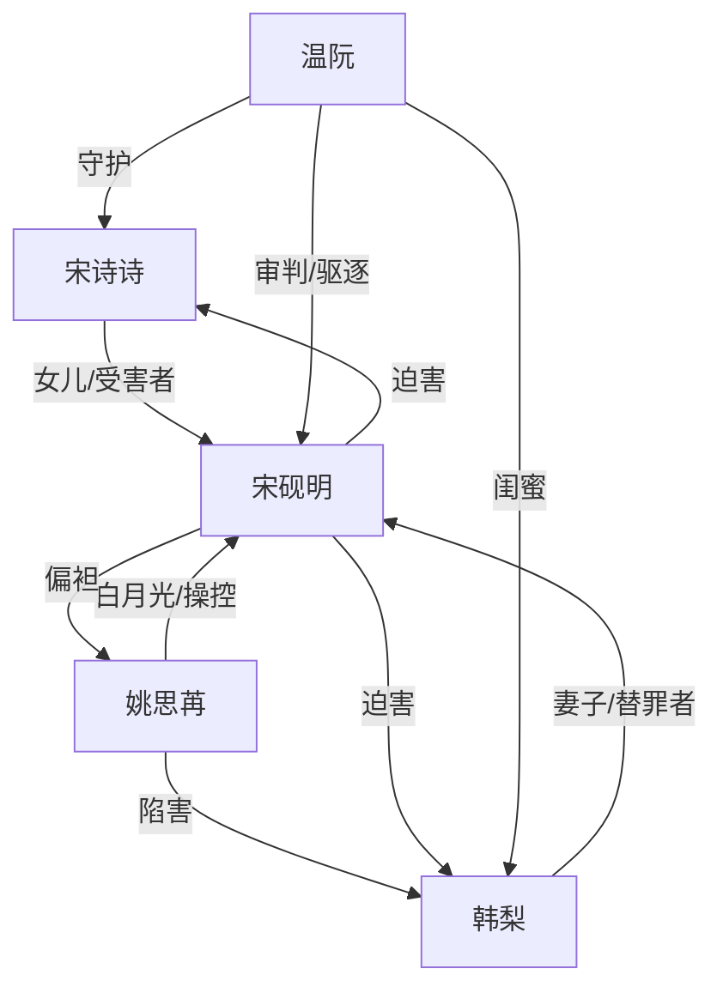

# 角色标签图谱

## 角色清单

### 宋诗诗 — 高考前夕惨死的清醒女儿
- 叙事功能: 第一人称受害者与灵魂旁观者，承载读者心疼和终局拒绝原谅。
- 核心标签: 高考生、被牺牲的女儿、死后旁观
- 弧光: 求生挣扎 → 被害死亡 → 冷眼看清算 → 与母亲重逢
- 台词风格: 低声求救、濒死短句、结尾冷拒绝
- 关键行为: 说出母亲已死；求父亲放她出去；给干妈打电话；死后旁观
- 读者情绪关系: 心疼、愤怒、代入弱者

### 韩梨 — 替罪惨死的母亲
- 叙事功能: 全文最大情绪债源头，虽缺席但驱动所有冲突。
- 核心标签: 替罪妻子、惨死母亲、沉默受害者
- 弧光: 为家庭替罪入狱 → 狱中惨死 → 骨灰被毁 → 污名洗清
- 台词风格: 原文直接台词少，主要以记忆和死亡事实存在
- 关键行为: 曾替姚思苒入狱；死亡后成为父亲悔恨对象
- 读者情绪关系: 心疼、怜惜、要求昭雪

### 宋砚明 — 偏执渣父/迟来悔疯者
- 叙事功能: 主压迫者，制造全部伤害，后段承担悔恨清算。
- 核心标签: 自欺、偏心白月光、亲手毁家
- 弧光: 傲慢不信 → 继续迫害 → 真相击穿 → 悔疯清算 → 自杀
- 台词风格: 命令式、否认式、自我合理化
- 关键行为: 要妻子二次顶罪；锁女儿进桑拿房；冲掉骨灰；曝光姚思苒；跳楼
- 读者情绪关系: 前期极恨，后期只允许看他痛苦，不允许原谅

### 姚思苒 — 恶毒白月光/伪弱者
- 叙事功能: 关系污染源，推动父亲偏执，终局被揭真凶。
- 核心标签: 装可怜、借刀杀人、伪善医生
- 弧光: 被保护的白月光 → 真凶暴露 → 名声破碎 → 入狱惨死
- 台词风格: 茶言茶语、柔弱退让、暗中拱火
- 关键行为: 阻止开门；诬称骨灰是脏东西；指使狱中伤害韩梨
- 读者情绪关系: 恨、恶心、期待报应

### 温阮/干妈 — 护犊复仇代理人
- 叙事功能: 替读者行动，负责救援、揭露、驱逐父亲。
- 核心标签: 母亲闺蜜、护犊、清醒执行者
- 弧光: 接到求救 → 奔走救人 → 失去母女 → 提刀问罪 → 重启生活
- 台词风格: 嘶吼、质问、直接审判
- 关键行为: 带骨灰上门；寻找桑拿房；办葬礼；持刀闯宋家；拒父入灵堂
- 读者情绪关系: 爽、依靠、替读者出气

## 关系网络

## 角色功能对照表（供改编参考）

| 原角色 | 极致标签 | 叙事功能 | 读者情绪功能 | 改编时必须保留的 |
|--------|---------|---------|-------------|---------------|
| 宋诗诗 | 惨死高考生 | 受害者/灵魂旁观 | 心疼、代入 | 重大人生节点被毁 |
| 韩梨 | 替罪惨死母亲 | 情绪债根源 | 心疼、昭雪欲 | 曾为反派替罪且惨死 |
| 宋砚明 | 偏执渣父 | 主压迫者 | 恨、看悔恨 | 不信真相并亲手加害 |
| 姚思苒 | 恶毒白月光 | 真凶/拱火者 | 厌恶、期待报应 | 装弱+实际犯罪 |
| 温阮 | 护犊干妈 | 复仇代理 | 爽、宣泄 | 替死者奔走并拒绝和解 |
