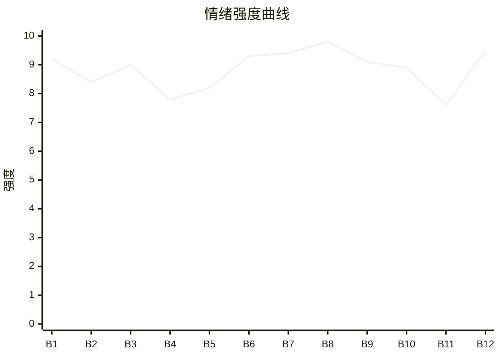

# Beat Sheet 节拍器

## 全文概况

- 总字数: 约 12600 字
- 节拍数: 12 幕
- 核心母题（Logline）: 被污名为叛徒的殉职女警向晚，死后旁观看爱人陈继洲从拒信真相到证据击溃，最终为她正名、清算凶手，并以卧底殉职完成迟来的偿还。
- 情绪模式: 极致污名 → 真相迟到 → 悔恨崩塌 → 英雄正名 → 殉职回环

## 节拍详表

### Beat 1: 审讯室口供撕开旧案 [开篇-第1章前半]
- **字数**: 约 1050 字（占比 8.3%）
- **核心事件**: 毒枭落网后说出向晚早已被虐杀，且真正内鬼是林薇。
- **情绪标签**: 震惊、恶寒、悬疑
- **情绪强度**: 9.2/10
- **情绪方向**: ⚡突变
- **冲突类型**: 大转折
- **悬念钩子**: 林薇突然闯入，她到底是受害者还是真凶？
- **叙事速度**: 快
- **对话占比**: 65%
- **reversal_mechanism**: [M4, M6]
- **hook_strength**: 9.2/10（极端度 3/3，信息密度 2.8/3，悬念 1.8/2，节奏 1.6/2）
- **关键句**: “唯一条件就是把向晚带走，坐实她叛徒的名声。”
- **原文摘录**: 边境围剿行动收网，贩毒集团老大落网。陈继洲追问“那个叛徒向晚”。犯人描述向晚遭毒品、钝器、铁丝网折磨而死，又反称她从没泄密，真正递消息的人质要求坐实向晚叛徒名声，好接手她老公。审讯室死寂，林薇冲进来问犯人是否交代向晚下落。

### Beat 2: 林薇表演受害，陈继洲拒绝真相 [第1章后半]
- **字数**: 约 1050 字（占比 8.3%）
- **核心事件**: 林薇借父母遇害身份完成自证，陈继洲把毒枭真话判定为挑拨。
- **情绪标签**: 憋屈、愤怒、无力
- **情绪强度**: 8.4/10
- **情绪方向**: ↑上升
- **冲突类型**: 微冲突
- **悬念钩子**: 向晚手机号突然来电。
- **叙事速度**: 快
- **对话占比**: 60%
- **reversal_mechanism**: [M4, M5]
- **hook_strength**: null
- **关键句**: “事实摆在眼前，你都能自己给它编个合理的故事。”
- **原文摘录**: 林薇看见毒枭后扑上去喊还父母命，陈继洲护住她，反驳她不可能陷害向晚。警员们也认定向晚擅长拿捏人心。灵魂视角的“我”站在角落，心里苦涩。毒枭嘲笑陈继洲洗脑成功，林薇借口不舒服脱身。陈继洲刚要离开，手机屏幕亮起“向晚”。

### Beat 3: 手机与酷刑细节，陈继洲仍旧不信 [第2章前半]
- **字数**: 约 950 字（占比 7.5%）
- **核心事件**: 毒枭拿出向晚手机，揭露陈继洲语音曾被当作折磨背景音。
- **情绪标签**: 生理不适、心痛、愤怒
- **情绪强度**: 9.0/10
- **情绪方向**: ↑上升
- **冲突类型**: 大转折
- **悬念钩子**: 陈继洲会不会去找尸体？
- **叙事速度**: 快
- **对话占比**: 45%
- **reversal_mechanism**: [M4, M5]
- **hook_strength**: null
- **关键句**: “正好给我们折磨那个小警察的时候，当背景音乐。”
- **原文摘录**: 陈继洲接通电话，以为向晚装死脱罪。犯人晃出向晚手机，说明他每天发给向晚的语音被毒枭用作折磨背景。犯人讲述侵犯、敲断腿、处理尸体的细节，警员头皮发麻，向晚灵魂发抖。陈继洲却笑称故事编得不错，转身安抚林薇。

### Beat 4: 边境搜索与旧誓言反讽 [第2章后半]
- **字数**: 约 900 字（占比 7.1%）
- **核心事件**: 陈继洲根据口供前往荒山，却仍认定要抓捕向晚。
- **情绪标签**: 讽刺、期待、压抑
- **情绪强度**: 7.8/10
- **情绪方向**: →平稳
- **冲突类型**: 微冲突
- **悬念钩子**: 仓库里到底有什么？
- **叙事速度**: 中
- **对话占比**: 35%
- **reversal_mechanism**: [M5]
- **hook_strength**: null
- **关键句**: “若她负隅顽抗，哪怕是将其击毙，我也绝不会手软。”
- **原文摘录**: 陈继洲送走林薇后立刻召集外勤，推断向晚藏在边境荒山。副队建议他避嫌，他举枪说曾在师父墓前发誓亲手逮捕向晚。向晚回忆父亲曾把她托付给陈继洲，同一个誓言如今荒谬。破门瞬间，队员僵住。

### Beat 5: 仓库遗骨与恋爱回忆 [第3章]
- **字数**: 约 1500 字（占比 11.9%）
- **核心事件**: 仓库出现血迹、碎骨、警服，但陈继洲继续否认；回忆补足昔日爱意与林薇入侵。
- **情绪标签**: 心痛、怀旧、憋屈
- **情绪强度**: 8.2/10
- **情绪方向**: ↑上升
- **冲突类型**: 大转折
- **悬念钩子**: DNA 报告将证明什么？
- **叙事速度**: 中
- **对话占比**: 35%
- **reversal_mechanism**: [M5]
- **hook_strength**: null
- **关键句**: “这警服也一定是她设的障眼法，我们不能被她蒙蔽！”
- **原文摘录**: 仓库内血腥、铁链、钝器和碎骨证明有人受虐。警服上印着向晚警号，陈继洲仍用风化程度和反侦察能力解释为障眼法。随后进入回忆：联合演练初见、陈继洲追求、两人成为警队金童玉女。劫持案中向晚救下林薇，将其带回家，林薇乖巧依附，却暗中磨尖爪子。

### Beat 6: 任务前夜与死亡真相回忆 [第4章]
- **字数**: 约 1300 字（占比 10.3%）
- **核心事件**: 向晚回忆林薇下药、泄密、杀害父母，并用假情报换毒贩损失，最终死去。
- **情绪标签**: 绝望、清醒、壮烈
- **情绪强度**: 9.3/10
- **情绪方向**: ⚡突变
- **冲突类型**: 大转折
- **悬念钩子**: DNA 报告与新线索同时到来。
- **叙事速度**: 中
- **对话占比**: 40%
- **reversal_mechanism**: [M4, M5, M6]
- **hook_strength**: null
- **关键句**: “我用我这条命，换了他们大半势力覆灭。”
- **原文摘录**: 婚期前一个月，行动前夜陈继洲让向晚平安回来做新娘，林薇端来热牛奶。行动中向晚头晕失去意识，兄弟惨死。囚禁期间她听见林薇承认下药、泄密、害死她父母，只为得到家和陈继洲。向晚故意交出假情报，换毒贩损失惨重，自己被酷刑折磨后死在铁丝网上。天亮时，DNA 报告和新线索同时传来。

### Beat 7: U盘录音引爆第一真相 [第5章前半]
- **字数**: 约 950 字（占比 7.5%）
- **核心事件**: U盘中的录音证明林薇下药、泄露布控、嫁祸向晚。
- **情绪标签**: 震惊、痛快、迟来正义
- **情绪强度**: 9.4/10
- **情绪方向**: ↑上升
- **冲突类型**: 大转折
- **悬念钩子**: 陈继洲将如何面对未读 DNA 报告？
- **叙事速度**: 快
- **对话占比**: 55%
- **reversal_mechanism**: [M6, M3]
- **hook_strength**: null
- **关键句**: “放心，我已经在向晚的牛奶里下了药。”
- **原文摘录**: 队员在石缝里找到向晚留下的 U 盘。技术部打开后，最早一条录音就是林薇与毒枭约定行动，称已在牛奶下药，要伪造成向晚泄露消息，并处理警队活口。后续录音记录她长期从陈继洲处获取布控、路线、队员信息。所有人沉默，陈继洲终于喃喃“怎么会是林薇？”

### Beat 8: DNA与视频完成英雄正名 [第5章后半-第6章]
- **字数**: 约 1450 字（占比 11.5%）
- **核心事件**: DNA确认死者为向晚，视频证明她受虐至死也未泄密，反用假情报打击毒贩。
- **情绪标签**: 崩溃、敬意、悲壮
- **情绪强度**: 9.8/10
- **情绪方向**: ↑上升
- **冲突类型**: 大转折
- **悬念钩子**: 陈继洲要带英雄回家并清算恶人。
- **叙事速度**: 中
- **对话占比**: 30%
- **reversal_mechanism**: [M4, M5, M6]
- **hook_strength**: null
- **关键句**: “她不是叛徒，她是英雄，是我们对不起她。”
- **原文摘录**: 陈继洲打开 DNA 报告，确认尸骨为向晚。他点开视频，看见向晚被绑、殴打、羞辱，却始终不求饶、不泄露警方内幕。最终视频里，她啐向毒枭，说“正义永不会缺席”。年轻警员指出当年剿灭一半势力是向晚用命争取。陈继洲承认她是警队英雄，决定带英雄回家，让恶人血债血偿。

### Beat 9: 回家对峙林薇 [第7章]
- **字数**: 约 1150 字（占比 9.1%）
- **核心事件**: 陈继洲回家揭穿林薇伪装，林薇承认因嫉妒害死向晚。
- **情绪标签**: 爽感、愤怒、清算前夜
- **情绪强度**: 9.1/10
- **情绪方向**: ↑上升
- **冲突类型**: 大转折
- **悬念钩子**: 林薇抛出怀孕保命牌。
- **叙事速度**: 快
- **对话占比**: 65%
- **reversal_mechanism**: [M3, M5]
- **hook_strength**: null
- **关键句**: “你还要装到什么时候！”
- **原文摘录**: 陈继洲带回 U 盘和警服后回家。林薇系着围裙装温柔，听说找到向晚后继续表演无辜。陈继洲摔勺怒斥她下药、泄密、害死师父师母和兄弟。林薇终于崩溃，抱腿求饶，说自己只是太爱他，嫉妒向晚。陈继洲准备送她下地狱时，林薇尖叫：“我怀孕了！”

### Beat 10: 怀孕牌失效与烈士回家 [第8章前中段]
- **字数**: 约 1550 字（占比 12.3%）
- **核心事件**: 陈继洲拒绝用孩子掩盖罪恶，林薇小产被捕；向晚烈士葬礼完成正名。
- **情绪标签**: 清算、安慰、迟来的温暖
- **情绪强度**: 8.9/10
- **情绪方向**: ↓下降后回升
- **冲突类型**: 大转折
- **悬念钩子**: 陈继洲被开除后去向何处？
- **叙事速度**: 中
- **对话占比**: 45%
- **reversal_mechanism**: [M3, M5]
- **hook_strength**: null
- **关键句**: “我终于回家了。”
- **原文摘录**: 林薇以孩子求陈继洲帮她隐瞒，陈继洲反问一个孩子是否比得上兄弟、师父师母、向晚的折磨与冤屈。拉扯中林薇撞桌小产，陈继洲报警。之后向晚葬礼在烈士墓园举行，全省公安干警送行，她的墓碑刻上“烈士向晚之墓”，向晚灵魂终于感到回家。

### Beat 11: 判决与陈继洲代号“晚星” [第8章后半]
- **字数**: 约 750 字（占比 6.0%）
- **核心事件**: 林薇与毒枭获死刑，陈继洲被开除，实则申请成为卧底。
- **情绪标签**: 余痛、悬念、赎罪
- **情绪强度**: 7.6/10
- **情绪方向**: →平稳
- **冲突类型**: 微冲突
- **悬念钩子**: “晚星”是否会走向向晚同样的命运？
- **叙事速度**: 快
- **对话占比**: 10%
- **reversal_mechanism**: [M5, M6]
- **hook_strength**: null
- **关键句**: “他主动申请，成为了一名卧底警察，代号‘晚星’。”
- **原文摘录**: 法院判林薇故意杀人、泄露国家机密，数罪并罚死刑，因精神失常暂缓执行；毒枭立即执行死刑。陈继洲因泄密源头来自他而被开除。所有人惋惜，他不辩解。无人知道他并未真正离开，而是申请成为卧底，代号“晚星”。

### Beat 12: 殉职回环，天亮了 [第9章]
- **字数**: 约 1450 字（占比 11.5%）
- **核心事件**: 陈继洲卧底两年后暴露，遭受与向晚相似酷刑，守住情报至死。
- **情绪标签**: 悲壮、回环、释然
- **情绪强度**: 9.5/10
- **情绪方向**: ⚡突变后收束
- **冲突类型**: 大转折
- **悬念钩子**: 结尾完成，无商业卡点。
- **叙事速度**: 中
- **对话占比**: 20%
- **reversal_mechanism**: [M3, M5, M8]
- **hook_strength**: null
- **关键句**: “晚晚，天亮了……”
- **原文摘录**: 陈继洲潜入跨国毒贩集团，两年传递情报，雨夜身份暴露。他被锁在铁椅上，被注射毒品、逼问联络点，毒瘾发作时用额头撞铁椅保持清醒。他遭受棍棒铁锤折磨，却半个字没吐，笑着说“你们……输定了”。阳光照进窗户，他想起国徽前的誓言，最后说：“晚晚，天亮了……”

## 情绪曲线可视化

## 节拍密度检测

- 平均每 1050 字一个节拍
- 微冲突密度: 每约 2100 字一次
- 大转折密度: 每约 1260 字一次
- 判定: 符合高频节拍器标准；强卡点集中于手机、仓库、U盘、DNA、怀孕、卧底暴露。

## 反转机制清单(Reversal Mechanisms)

从 prompts/patterns/reversal-mechanisms.md 的 8 大机制中命中以下机制:

| 机制 ID | 机制名 | 承载 Beat | 关键段落/金句 | 等价改编提示 |
|--------|--------|-----------|--------------|-------------|
| M4 | 灵魂线视角 | Beat 1-12 | “我站在角落，心里说不出什么滋味。” | 死亡必须前置，死者只能旁观，保留只有死者知道的信息差炸弹。 |
| M5 | 温度反转曲线 | Beat 3-12 | “同样的人，同样的誓言，如今却显得十分荒谬。” | 温柔正峰、冷漠归零、悔恨负值三段必须完整。 |
| M6 | 多层递进反转 | Beat 1, 6, 7, 8, 11-12 | 口供、回忆、录音、DNA视频、卧底殉职层层升维 | 反转层数不能少，每层量级从真相到身份到价值逐步升维。 |
| M3 | 因果回旋反讽 | Beat 9-12 | 向晚死守情报，陈继洲最后也“半个字都没吐” | 必须保留镜像动作与结尾回旋，让伤害逻辑反向成为偿还逻辑。 |
