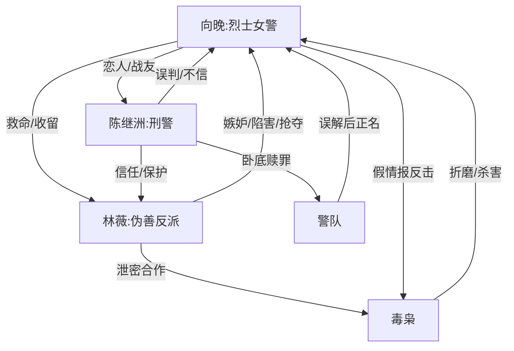

# 角色标签图谱

## 角色清单

### 向晚 — 被污名的烈士女警
- 叙事功能: 灵魂旁观者、真相承载者、道德坐标中心。
- 核心标签: 英雄、冤魂、殉职者。
- 弧光: 被污名叛徒 → 真相揭开 → 烈士回家。
- 台词风格: 生前坚定短句，死后克制旁白。
- 关键行为: 救林薇、行动中被陷害、囚禁中给假情报、以命换剿毒进展。
- 读者情绪关系: 心疼、敬佩、替她愤怒。

### 陈继洲 — 错信白莲的悔恨刑警
- 叙事功能: 误判制造者、真相接受者、后段偿债者。
- 核心标签: 执拗、迟钝、赎罪。
- 弧光: 坚信向晚叛变 → 证据击溃 → 亲手清算 → 卧底殉职。
- 台词风格: 前期冷硬审判，后期沙哑悔恨。
- 关键行为: 否认口供、寻找尸骨、打开录音视频、揭穿林薇、申请卧底。
- 读者情绪关系: 前期恨，后期复杂心疼，结尾获得有限原谅。

### 林薇 — 恩将仇报的伪善毒闺蜜
- 叙事功能: 核心反派、白莲伪装、情绪债来源。
- 核心标签: 伪善、嫉妒、掠夺者。
- 弧光: 受害孤女外壳 → 真凶曝光 → 精神崩溃待死。
- 台词风格: 前期柔弱哭诉，暴露后求饶狡辩。
- 关键行为: 下药、泄露警方消息、害死向晚父母、坐实叛徒名声、抢走陈继洲。
- 读者情绪关系: 强烈憎恨，期待报应。

### 毒枭犯人 — 残酷真相触发器
- 叙事功能: 开篇 Hook 承载者、证据线索提供者。
- 核心标签: 残忍、粗鄙、反讽真话者。
- 弧光: 被捕毒枭 → 供出真相 → 死刑立即执行。
- 台词风格: 粗俗、挑衅、具象残忍。
- 关键行为: 审讯中揭露向晚之死，保留手机，供出仓库。
- 读者情绪关系: 厌恶，但其真话推动正义。

### 警队众人 — 集体误判与集体正名者
- 叙事功能: 社会评价风向，承载“污名/烈士”身份转换。
- 核心标签: 误信、震动、肃穆。
- 弧光: 认定叛徒 → 证据震惊 → 敬礼送英雄。
- 台词风格: 职业化、集体口径。
- 关键行为: DNA鉴定、播放录音视频、烈士葬礼送行。
- 读者情绪关系: 先憋屈，后获得公共正义满足。

## 关系网络

## 角色功能对照表（供改编参考）

| 原角色 | 极致标签 | 叙事功能 | 读者情绪功能 | 改编时必须保留的 |
|--------|---------|---------|-------------|---------------|
| 向晚 | 被污名英雄 | 道德中心/灵魂视角 | 心疼与敬佩 | 已死旁观、守住底线、被迟来正名 |
| 陈继洲 | 错信者/赎罪者 | 误判与偿还 | 先恨后复杂 | 前期拒信、后期崩塌、结尾付出等价代价 |
| 林薇 | 伪善掠夺者 | 核心施害者 | 恨点集中 | 恩将仇报、装受害、抢夺关系 |
| 毒枭 | 残酷证人 | Hook与线索 | 生理厌恶 | 口供真相、具体残忍、证据导向 |
| 警队 | 公共评价 | 正名场 | 集体补偿 | 从误解到敬礼的身份翻转 |
