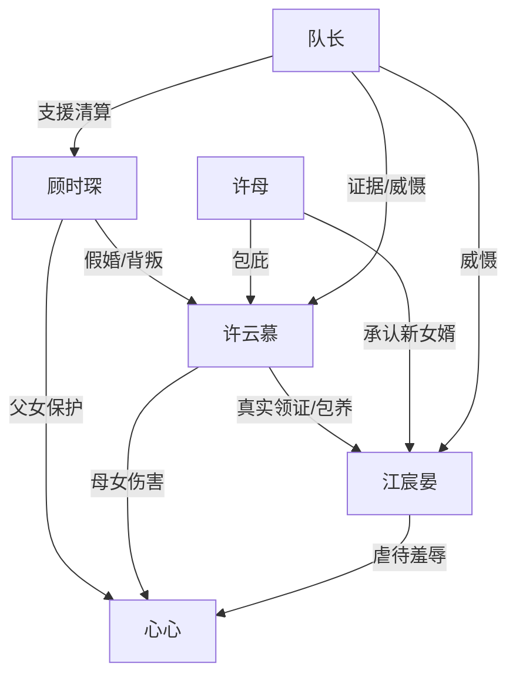

# 角色标签图谱

## 角色清单

### 顾时琛 — 冷怒复仇型父亲 / 雇佣兵归来者
- 叙事功能: 主视角、受害者、清算者、女儿保护者
- 核心标签: 能忍、能打、有证据
- 弧光: 满怀归家期待 → 被剥夺丈夫/父亲身份 → 冷静收集清算 → 带女儿重建家
- 台词风格: 短句、冷笑、审判式控诉
- 关键行为: 折断保安手腕、打伤江宸晏、联系队长、拿出证据、起诉许云慕
- 读者情绪关系: 心疼、代入、期待他爆发、为他复仇爽

### 心心 — 被虐但清醒的亲生女儿
- 叙事功能: 情绪核弹、道德锚点、反派罪证、最终拒绝原谅者
- 核心标签: 可怜、懂事、清醒
- 弧光: 狗窝受虐的小孩 → 见到爸爸求保护 → 拒绝被母亲绑架 → 回到真正的家
- 台词风格: 哭腔、直接、孩子式朴素正义
- 关键行为: 挡棍保护爸爸、揭露狗窝与停学、展示伤痕、拒绝替许云慕求情
- 读者情绪关系: 心疼、愤怒、保护欲、欣慰

### 许云慕 — 恶毒出轨妻 / 资产侵占者
- 叙事功能: 主要反派，制造背叛、财产侵占、亲情背弃
- 核心标签: 贪婪、心狠、会伪装
- 弧光: 被男主救下的弱者 → 被供养的妻子 → 另组家庭的压迫者 → 入狱悔求
- 台词风格: 前期沉默心虚，后期冷酷狡辩，败局后哀求
- 关键行为: 伪造婚姻、侵占房产公司、虐待女儿、污蔑男主精神病
- 读者情绪关系: 恨、厌恶、期待被清算

### 江宸晏 — 鸠占鹊巢的小白脸 / 嚣张继父
- 叙事功能: 明面羞辱者，承接暴力打脸，强化男主女儿受虐债
- 核心标签: 嚣张、恶毒、吃软饭
- 弧光: 以“丈夫”自居 → 被打脸断指 → 靠许云慕撑腰 → 沦为疯子
- 台词风格: 辱骂密集，喜欢“蠢狗”“小野种”等极端羞辱
- 关键行为: 戳破心心额头、虐打心心、要送男主进精神病院、结尾与许母互殴
- 读者情绪关系: 恨、想看他被打、爽

### 许母 — 忘恩负义的岳母
- 叙事功能: 第二背刺者，证明许家整体道德腐烂
- 核心标签: 白眼狼、势利、翻脸
- 弧光: 曾被男主拿钱救命 → 帮新女婿否认男主 → 被清算边缘化 → 与江宸晏互撕
- 台词风格: 粗暴、推诿、装不认识
- 关键行为: 打男主、否认认识男主、让保安赶人
- 读者情绪关系: 寒心、厌恶、期待报应

### 队长 — 外部强权 / 降维支援者
- 叙事功能: 身份反差引爆器、公权/武力替代力量、证据见证者
- 核心标签: 强势、护短、可信
- 弧光: 电话中被召唤 → 带队撞门 → 点明罪名 → 推动清算
- 台词风格: 简短威慑、法律列举式
- 关键行为: 派人支援、撞门救男主、揭示罪名、提供婚礼录像
- 读者情绪关系: 安全感、爽、期待局势翻盘

## 关系网络

## 角色功能对照表（供改编参考）

| 原角色 | 极致标签 | 叙事功能 | 读者情绪功能 | 改编时必须保留的 |
|--------|---------|---------|-------------|---------------|
| 顾时琛 | 冷怒父亲 | 受害者与清算者 | 代入、爽 | 能打但更重证据，前半隐忍后半清算 |
| 心心 | 被虐亲女 | 情绪核弹 | 心疼、护崽怒 | 狗窝/伤痕/拒绝原谅的清醒表达 |
| 许云慕 | 恶毒出轨妻 | 主反派 | 恨、期待报应 | 伪造关系、侵占资产、污蔑精神病 |
| 江宸晏 | 鸠占鹊巢小白脸 | 明面打压者 | 想看被揍 | 霸占身份、虐待孩子、结尾回旋受辱 |
| 许母 | 忘恩岳母 | 背刺放大器 | 寒心 | 曾受恩却否认男主 |
| 队长 | 外援强权 | 翻盘引擎 | 安全感 | 与男主真实身份绑定，带证据/武力到场 |
