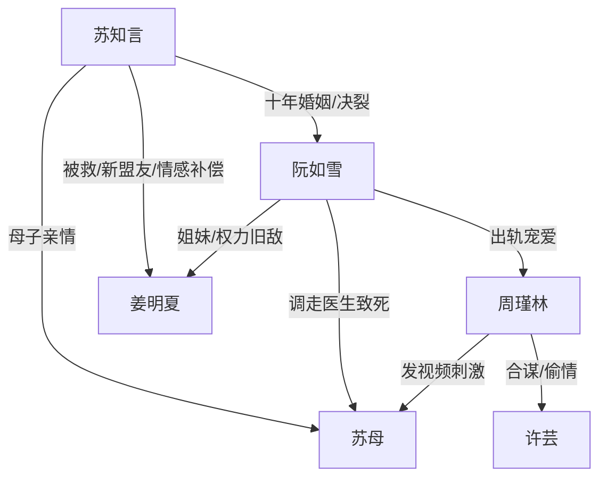

# 角色标签图谱

## 角色清单

### 苏知言 — 被背叛的清醒复仇者

- 叙事功能: 主视角受害者与复仇执行者。
- 核心标签: 骄傲、重情、狠绝。
- 弧光: 深爱妻子 → 被连环羞辱 → 母亡触底 → 借势反杀 → 冷酷收束。
- 台词风格: 短句、冷句、判决式。
- 关键行为: 提离婚、点天灯、婚礼持枪、寄 U 盘、吞阮氏、送走阮如雪。
- 读者情绪关系: 前期心疼，后期爽。

### 阮如雪 — 疯批豪门妻/迟到悔恨者

- 叙事功能: 第一压迫者、温度反转核心。
- 核心标签: 占有欲、傲慢、自毁。
- 弧光: 掌控一切 → 沉迷新欢 → 逼死苏母 → 失去苏知言 → 悔疯败落。
- 台词风格: 命令式、居高临下，后期哀求式。
- 关键行为: 下药、调走医生、软禁、送精神病院、求复合。
- 读者情绪关系: 恨，后期看她悔恨获得爽感。

### 周瑾林 — 绿茶男小三/蛇蝎骗子

- 叙事功能: 持续挑衅源，推动阮如雪作恶。
- 核心标签: 装纯、恶毒、贪婪。
- 弧光: 得宠挑衅 → 骗局暴露 → 被折磨抛弃。
- 台词风格: 茶言茶语，倒打一耙。
- 关键行为: 直播羞辱、发视频害死苏母、灵堂挑衅、与许芸合谋。
- 读者情绪关系: 强烈厌恶，期待报应。

### 姜明夏 — 守护型大女主/隐藏外援

- 叙事功能: 后半段身份反转与资源升维。
- 核心标签: 深情、强势、掌权。
- 弧光: 旧案背锅者 → 海外掌权者 → 救赎苏知言 → 共同复仇。
- 台词风格: 温柔但不容拒绝。
- 关键行为: 劫车救人、揭旧案真相、提供资本与武力支持。
- 读者情绪关系: 补偿、安心、爽。

### 许芸 — 共谋闺蜜/诱饵型恶人

- 叙事功能: 开篇钩子和骗局证人。
- 核心标签: 贪婪、好色、胆小。
- 弧光: 爬床诱惑 → 合谋败露 → 被供出并反咬。
- 台词风格: 挑衅、怨毒。
- 关键行为: 开篇爬床、与周瑾林开房直播、供出计划。
- 读者情绪关系: 厌恶，工具型报应。

### 苏母 — 情绪债锚点

- 叙事功能: 主角软肋与复仇合法性来源。
- 核心标签: 保护、亲情、无辜。
- 弧光: 被儿子保护 → 被延误救治 → 死亡成为清算根因。
- 台词风格: 主要通过回忆呈现。
- 关键行为: 年少时护住苏知言，病中等待救治。
- 读者情绪关系: 心疼，推动读者支持男主狠绝复仇。

## 关系网络

## 角色功能对照表（供改编参考）

| 原角色 | 极致标签 | 叙事功能 | 读者情绪功能 | 改编时必须保留的 |
|--------|---------|---------|-------------|---------------|
| 苏知言 | 清醒复仇男主 | 承债与清算 | 心疼转爽 | 骄傲、不回头、冷判决 |
| 阮如雪 | 疯批豪门妻 | 主压迫者 | 恨与看悔 | 曾经深爱+现在践踏 |
| 周瑾林 | 绿茶男小三 | 持续挑衅 | 恨点集中 | 装纯、倒打一耙、害死亲人间接责任 |
| 姜明夏 | 守护型大女主 | 权力升维 | 补偿爽 | 旧识身份+高资源救援 |
| 苏母 | 无辜亲情锚 | 情绪触底 | 心疼与愤怒 | 死亡必须由反派选择导致 |
