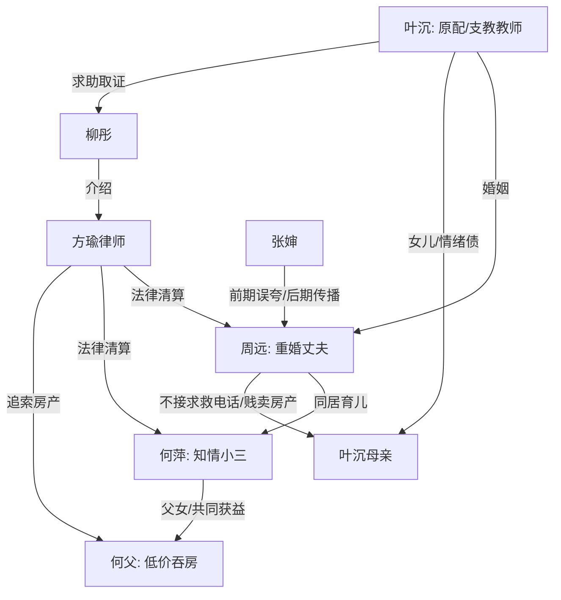

# 角色标签图谱

## 角色清单

### 叶沉 — 清醒克制的支教原配

- 叙事功能: 受害者、侦查者、清算者、价值回归者。
- 核心标签: 边疆支教、冷静取证、亲情重债。
- 弧光: 带着惊喜回家 → 发现人生被侵占 → 法律清算 → 把情感留给值得的人。
- 台词风格: 短、准、审讯式，关键处用数字和反问压人。
- 关键行为: 假装“姐姐”进入现场、拨电话查流水、公开身份、引入律师和教育局、追索房产。
- 读者情绪关系: 心疼、代入、爽；读者愿意跟她一起忍到清算。

### 周远 — 伪善重婚丈夫

- 叙事功能: 核心施害者、谎言制造者、所有情绪债的债务主体。
- 核心标签: 双面人、软威胁、侵占者。
- 弧光: 好丈夫好父亲形象 → 谎言暴露 → 试图威胁体面 → 职业和法律崩塌。
- 台词风格: 前期温柔体贴，暴露后官腔和威胁并用。
- 关键行为: 谎称叶沉是姐姐、推动支教、转移工资、贱卖房产、母亲求救时不接电话。
- 读者情绪关系: 恨；越会装，清算越爽。

### 何萍 — 装无辜的既得利益小三

- 叙事功能: 鸠占鹊巢的具象化载体，负责无意识炫耀和后期被证据击穿。
- 核心标签: 幸福炫耀、装不知道、利益享受者。
- 弧光: 家中女主人 → 自称被骗受害者 → 通话记录曝光 → 共同责任者。
- 台词风格: 前期热情碎嘴，后期哭喊求饶。
- 关键行为: 把叶沉当姐姐招待、展示满月酒照片、享受服装店装修和车辆、两年前知情仍同居。
- 读者情绪关系: 前期憋屈，后期厌恶；不是最大恶源，但必须被惩罚。

### 何建国/何父 — 贪利共犯父亲

- 叙事功能: 财产侵占链条的落点，放大何萍一家“全家吃血”的恶感。
- 核心标签: 低价吞房、装可怜、贪便宜。
- 弧光: 幕后获益者 → 上门求情 → 被判返还房产和赔偿。
- 台词风格: 讨好、推责、卖惨。
- 关键行为: 低价接收叶沉母亲房产，劝女儿装不知道。
- 读者情绪关系: 恶心、愤怒；他的出现让财产债更完整。

### 叶沉母亲 — 被背叛的亲情核心

- 叙事功能: 最高情绪债载体，支撑女主复仇正当性。
- 核心标签: 凑首付、遗物座钟、独死两天。
- 弧光: 回忆中的付出者 → 死亡真相被揭开 → 以墓地告别完成情绪归位。
- 台词风格: 仅在回忆里以嘱咐出现。
- 关键行为: 拿积蓄帮买学区房，留下座钟和老房子，临死前拨打周远电话。
- 读者情绪关系: 心疼；她的死亡让周远不可原谅。

### 柳彤 — 外部助力/证据入口

- 叙事功能: 帮女主从现场情绪转入法律取证。
- 核心标签: 政法系统、效率、愧疚。
- 弧光: 知情未确认 → 帮忙查证 → 引入律师。
- 台词风格: 简短、实务。
- 关键行为: 查资产流水，介绍律师，协助提取记录。
- 读者情绪关系: 稳定感；她让反击可信。

### 方瑜律师 — 法律降维打击执行者

- 叙事功能: 把女主掌握的信息转译为罪名和保全措施。
- 核心标签: 干练、专业、冷静。
- 弧光: 入场即压制 → 列罪名 → 击穿何萍装无辜。
- 台词风格: 法律条款式，清晰冷硬。
- 关键行为: 指出重婚、伪造公文、财产保全、交易无效。
- 读者情绪关系: 爽；公权和专业力量给清算兜底。

### 张婶 — 舆论镜子

- 叙事功能: 前期误夸周远，后期传播真相，完成社会评价反转。
- 核心标签: 邻里嘴快、群众视角、口碑翻转。
- 弧光: 夸周远好男人 → 公开复述其恶行。
- 台词风格: 市井、直接、传播性强。
- 关键行为: 送红薯、夸好男人、后期向小区传播真相。
- 读者情绪关系: 先憋屈后痛快。

## 关系网络

## 角色功能对照表（供改编参考）

| 原角色 | 极致标签 | 叙事功能 | 读者情绪功能 | 改编时必须保留的 |
|--------|---------|---------|-------------|---------------|
| 叶沉 | 清醒支教原配 | 受害与清算主体 | 心疼、代入、爽 | 冷静取证，不靠哭闹解决 |
| 周远 | 伪善重婚丈夫 | 核心施害者 | 恨、期待报应 | 双面口碑、职业体面、软威胁 |
| 何萍 | 装无辜小三 | 鸠占鹊巢载体 | 憋屈、厌恶 | 前期炫耀幸福，后期知情证据曝光 |
| 何父 | 贪利共犯 | 财产侵占落点 | 恶心、痛快 | 低价吞掉亲人遗产 |
| 叶母 | 亲情债核心 | 道德坐标 | 心疼、愤怒 | 遗物、房产、死亡等待 |
| 柳彤 | 证据入口 | 外援 | 稳定、期待 | 能快速查证但不替女主完成情绪 |
| 方瑜 | 法律执行者 | 清算放大器 | 爽 | 入场列罪名，压制反派 |
| 张婶 | 舆论镜子 | 口碑反转 | 前后对照 | 从误夸到传播真相 |
