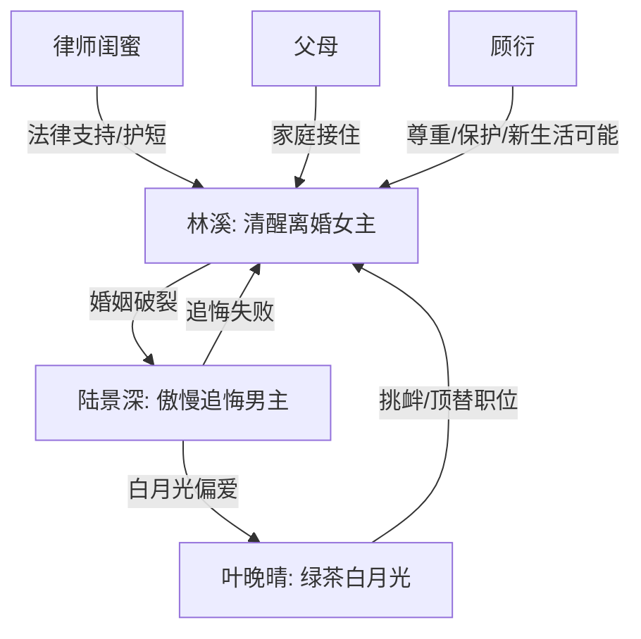

# 角色标签图谱

## 角色清单

### 林溪 — 清醒离婚大女主

- 叙事功能: 承受情绪债、完成抽离、兑现女性自救爽点。
- 核心标签: 清醒、克制、决绝
- 弧光: 恋爱脑隐忍妻子 → 不再需要爱的独立者
- 台词风格: 短句、平静、直接切割
- 关键行为: 提离婚、拟协议、辞职、泼酒、离城、拒绝复合
- 读者情绪关系: 心疼转爽，读者期待她别回头。

### 陆景深 — 傲慢迟钝追妻火葬场男主

- 叙事功能: 制造压迫与误判，后半承担追悔惩罚。
- 核心标签: 自负、迟钝、控制欲
- 弧光: 笃定她不会离开 → 发现她真的不要他 → 卑微求复合失败
- 台词风格: 命令式、质问式，后期转为低姿态哀求
- 关键行为: 格式化旧手机、降职女主、护白月光、追到云城、签字离婚
- 读者情绪关系: 前期恨，后期看他追悔获得爽感。

### 叶晚晴 — 绿茶白月光/伪高配替代者

- 叙事功能: 刺激情绪债，具象化男主偏爱。
- 核心标签: 白月光、挑衅、伪装
- 弧光: 回国空降得势 → 舆论小三 → 学历造假塌房
- 台词风格: 温软、委屈、暗戳戳挑拨
- 关键行为: 接受偏爱、抢职位、自泼红酒、甩锅林溪、项目出错
- 读者情绪关系: 恨点承载者，最终塌房提供打脸爽点。

### 闺蜜 — 清醒外援/法律支点

- 叙事功能: 提供离婚协议、确认女主决定、阻断男主寻人。
- 核心标签: 护短、理性、嘴硬心软
- 弧光: 担心女主 → 支持离婚 → 帮她切断男主
- 台词风格: 直白、泼辣
- 关键行为: 拟协议、骂男主、陪法院
- 读者情绪关系: 替读者骂醒男主，提供安全感。

### 顾衍 — 温柔竹马/新生活可能性

- 叙事功能: 对照陆景深的失礼和控制欲，证明女主值得被尊重。
- 核心标签: 克制、体面、分寸感
- 弧光: 老友重逢 → 保护但不越界
- 台词风格: 礼貌、冷静
- 关键行为: 陪林溪吃饭，停车场警告陆景深报警。
- 读者情绪关系: 提供补偿感，但不抢女主独立线。

### 林溪父母 — 家庭托底者

- 叙事功能: 修复女主被婚姻消耗后的归属感。
- 核心标签: 心疼、传统、最终接纳
- 弧光: 当年反对婚姻 → 心疼女儿回家 → 接纳离婚
- 台词风格: 家常、试探、含蓄关心
- 关键行为: 做糖醋排骨、劝问婚姻、接纳她回家。
- 读者情绪关系: 温暖补偿，降低离婚后的孤独感。

## 关系网络

## 角色功能对照表（供改编参考）

| 原角色 | 极致标签 | 叙事功能 | 读者情绪功能 | 改编时必须保留的 |
|--------|---------|---------|-------------|---------------|
| 林溪 | 清醒离婚大女主 | 主视角与价值兑现 | 心疼、爽、尊重 | 平静切割，不复合 |
| 陆景深 | 迟钝霸总前夫 | 压迫源与追悔源 | 恨、看火葬场 | “她不会离开”的误判 |
| 叶晚晴 | 绿茶白月光 | 三角压迫与职位抢夺 | 恨、等塌房 | 自导自演和最终塌房 |
| 闺蜜 | 法律外援 | 推动离婚落地 | 安全感 | 拟协议、骂男主 |
| 顾衍 | 温柔竹马 | 新生活对照 | 补偿感 | 有分寸，不强行上位 |
| 父母 | 家庭托底 | 情绪修复 | 温暖 | 接纳女主回家 |
