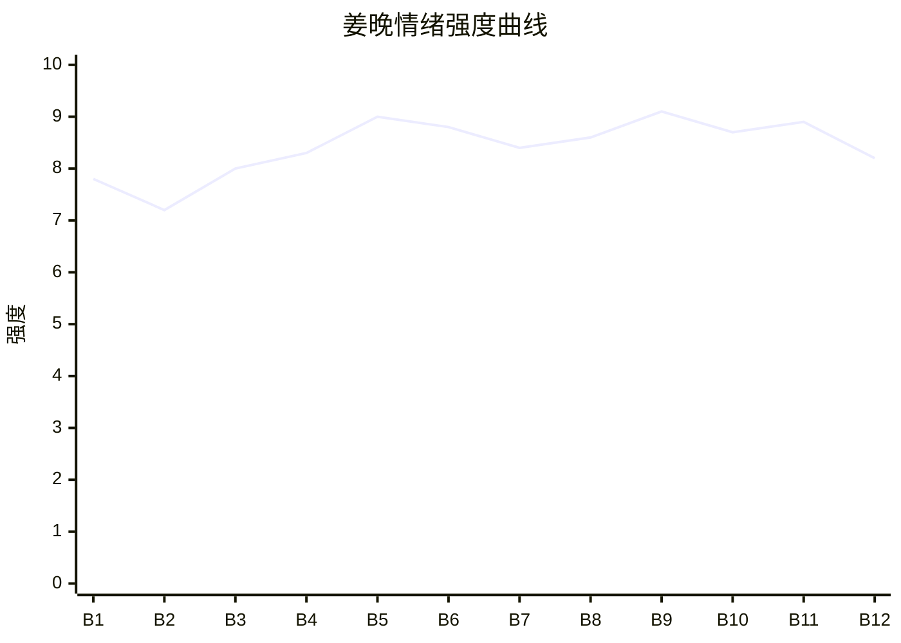

# Beat Sheet 节拍器

## 全文概况

- 总字数: 约 20500 字
- 节拍数: 12 幕
- 核心母题（Logline）: 被竹马和家人长期轻视的女创始人，在旧爱破产求融资时以投资人身份登场，用专业流程拆穿他的失败与自卑，最终完成情感脱钩。
- 情绪模式: 长期忽视 → 亲情施压 → 身份反转 → 专业打脸 → 情感清算 → 自我完成

## 节拍详表

### Beat 1: 旧爱求投，投资方是我 [开篇-01 前]

- **字数**: 约 720 字（占比 3.5%）
- **核心事件**: 交代三角关系、女主出国创业上市，沈既白资金链断裂并预约融资。
- **情绪标签**: 冷感、期待、暗爽
- **情绪强度**: 7.8/10
- **情绪方向**: ⚡突变
- **冲突类型**: 大转折
- **悬念钩子**: 沈既白明天要见的大投资方正是姜晚。
- **叙事速度**: 快
- **对话占比**: 15%
- **reversal_mechanism**: [M2]
- **hook_strength**: 8.5/10
- **关键句**: "名字一栏写着——沈既白。"
- **原文摘录**: "我跟妹妹喜欢了同一个人，十年。沈既白说喜欢温柔体贴的女孩。妹妹天生会撒娇。我学不来。每次三个人在一起，他只跟妹妹说话。我坐旁边，像根电线杆。大学毕业那天，他和妹妹领了证。我赌了一口气。出国，MBA，全奖。熬了四年创业。第六年，敲钟上市。最近听说沈既白资金链断了。到处求人投资，发了条朋友圈：'明天见一个大投资方，求好运！'妹妹在下面评论：老公加油！你最棒的！我看了看秘书发来的明日行程。九点半，有位小公司负责人来谈融资。名字一栏写着——沈既白。"

### Beat 2: 亲情绑架第一次压下 [01]

- **字数**: 约 1900 字（占比 9.3%）
- **核心事件**: 母亲要求姜晚帮妹夫牵线，妹妹语音撒娇，家族群集体给沈既白加油。
- **情绪标签**: 憋屈、冷笑、孤立
- **情绪强度**: 7.2/10
- **情绪方向**: ↓下降
- **冲突类型**: 微冲突
- **悬念钩子**: 姜晚隐瞒投资方身份，决定按普通融资面谈处理。
- **叙事速度**: 中
- **对话占比**: 45%
- **reversal_mechanism**: [M2, M3]
- **hook_strength**: null
- **关键句**: "投资方是我。"
- **原文摘录**: 母亲说“你妹夫快撑不下去了”，又用“你妹妹嫁得多好”贬低姜晚；姜柔发语音求她帮忙，却连她做什么都不知道；家族群二十几条消息都围绕沈既白。姜晚想起自己 A 轮融资时无人回应，最后让秘书“按普通的融资面谈走”。

### Beat 3: 妹妹篡改女主人设 [02]

- **字数**: 约 2200 字（占比 10.7%）
- **核心事件**: 室友周芸转述姜柔饭局叙事：姜晚是失恋出国、至今放不下的可怜姐姐。
- **情绪标签**: 被污名、恶心、清醒
- **情绪强度**: 8.0/10
- **情绪方向**: ↓下降
- **冲突类型**: 大转折
- **悬念钩子**: 姜柔多年舆论操控被揭开，姜晚即将面对沈既白。
- **叙事速度**: 中
- **对话占比**: 50%
- **reversal_mechanism**: [M3]
- **hook_strength**: null
- **关键句**: "把我六年的路一句话抹成了一场逃跑。"
- **原文摘录**: 周芸说姜柔称姜晚“因为失恋出国”“到现在没结婚，估计心里还是放不下”。姜晚指出凌晨四点航班无人知道，戳破“机场哭了”的谎言。随后家族群默认姜柔版本，姜晚在公司门口恢复职业状态：“按规矩谈。他是谁不重要，项目说话。”

### Beat 4: 男主求情与傲慢暴露 [03-04 前半]

- **字数**: 约 2100 字（占比 10.2%）
- **核心事件**: 沈既白第一次主动联系姜晚求探底；投资部发现 LINKER 与姜晚旧论文高度吻合；沈提前到场并称面谈只是流程。
- **情绪标签**: 荒唐、期待、压抑
- **情绪强度**: 8.3/10
- **情绪方向**: ↑上升
- **冲突类型**: 大转折
- **悬念钩子**: 沈既白即将进门看见真正投资人。
- **叙事速度**: 快
- **对话占比**: 40%
- **reversal_mechanism**: [M2, M5]
- **hook_strength**: null
- **关键句**: "那个‘投资方’就是我的公司，‘老总’就是我。"
- **原文摘录**: 沈既白发消息：“帮我探个底，看看他们老总什么路数。”姜晚发现他连自己做什么都不清楚。小周汇报 LINKER 底层概念与姜晚 2016 年论文高度吻合。沈提前四十分钟到，还对妻子说“今天不过走个流程”。姜晚命令：“九点半准时通知他进来。一分钟都不用提前。”

### Beat 5: 办公室身份揭露 [04 后半]

- **字数**: 约 1700 字（占比 8.3%）
- **核心事件**: 母亲最后一轮情绪施压后，沈既白进门，发现姜晚就是远峰控股创始人。
- **情绪标签**: 触底、爽感、震惊
- **情绪强度**: 9.0/10
- **情绪方向**: ⚡突变
- **冲突类型**: 大转折
- **悬念钩子**: 姜晚以“沈先生”身份重置两人关系。
- **叙事速度**: 快
- **对话占比**: 35%
- **reversal_mechanism**: [M2]
- **hook_strength**: null
- **关键句**: "沈先生，请坐。"
- **原文摘录**: 母亲骂姜晚“你那个小公司有什么好上的”，又说“以后别回这个家了”。姜晚想起敲钟视频无人回应。九点三十整，沈既白推门，看见她后标准微笑消失，文件滑了一寸，喊出“姜……姜晚？”姜晚看着他：“沈先生，请坐。”

### Beat 6: 融资面谈，数据打脸 [05]

- **字数**: 约 2300 字（占比 11.2%）
- **核心事件**: 姜晚用投资数据逐项拆解启辰问题，拒绝叙旧，完成第一次正面降位。
- **情绪标签**: 专业、痛快、反差
- **情绪强度**: 8.8/10
- **情绪方向**: ↑上升
- **冲突类型**: 大转折
- **悬念钩子**: 沈既白欲言又止提到 LINKER 概念。
- **叙事速度**: 快
- **对话占比**: 55%
- **reversal_mechanism**: [M2, M3]
- **hook_strength**: null
- **关键句**: "是沈先生第一次正式看我而已。"
- **原文摘录**: 姜晚指出启辰 A 轮资金消耗、品牌推广占比、研发不足、获客模型过期、现金流只剩四十七天。沈想“不聊数据”，姜晚回：“不能。这是融资面谈，不是叙旧。”他说“你变了很多”，她答：“没变。是沈先生第一次正式看我而已。”

### Beat 7: 地库迟到的道歉 [06]

- **字数**: 约 1900 字（占比 9.3%）
- **核心事件**: 沈既白堵姜晚道歉，试图转入私情，姜晚承认曾喜欢但明确那是十年前。
- **情绪标签**: 冷静、释然、迟来的痛
- **情绪强度**: 8.4/10
- **情绪方向**: →平稳
- **冲突类型**: 微冲突
- **悬念钩子**: 家人即将知道姜晚真实身份。
- **叙事速度**: 中
- **对话占比**: 60%
- **reversal_mechanism**: [M5]
- **hook_strength**: null
- **关键句**: "十年前我觉得你是我世界里最亮的人。现在回头看——你只是一个从来不看我的人。"
- **原文摘录**: 沈既白在地库等姜晚，回忆过去对她的敷衍并道歉。姜晚说“不喜欢一个人不需要道歉”，拒绝私下聊。沈问“你那个时候是真的喜欢我吗？”姜晚回答“是。但那是十年前的事了。”

### Beat 8: 妹妹破防，亲情索债升级 [第7章]

- **字数**: 约 2300 字（占比 11.2%）
- **核心事件**: 姜柔得知姐姐身份后破防，从指控嫉妒到下跪式哀求，再到威胁散播“挟私报复”。
- **情绪标签**: 厌烦、反感、爽前蓄力
- **情绪强度**: 8.6/10
- **情绪方向**: ↑上升
- **冲突类型**: 大转折
- **悬念钩子**: 姜晚以公司制度切断妹妹身份特权。
- **叙事速度**: 快
- **对话占比**: 65%
- **reversal_mechanism**: [M2, M3]
- **hook_strength**: null
- **关键句**: "我在公司没有妹妹。"
- **原文摘录**: 姜柔尖叫“你是远峰控股的老板？！”随后指控姜晚“还喜欢他”“用这种手段报复”，又哀求“我是你亲妹妹”。家族群无人关心姜晚成就，只问为什么不帮。小周问若姜柔说自己是妹妹怎么办，姜晚答：“我在公司没有妹妹。”

### Beat 9: 概念归属与男性自卑拆解 [第8章]

- **字数**: 约 2500 字（占比 12.2%）
- **核心事件**: 沈既白递交新材料，承认 LINKER 概念来自姜晚笔记；姜晚拆解他爱姜柔的真实原因是“喜欢弱”。
- **情绪标签**: 真相、锋利、溃败
- **情绪强度**: 9.1/10
- **情绪方向**: ↑上升
- **冲突类型**: 大转折
- **悬念钩子**: 投资部正式报告即将落地。
- **叙事速度**: 中
- **对话占比**: 58%
- **reversal_mechanism**: [M2, M5]
- **hook_strength**: null
- **关键句**: "你不是喜欢温柔。你是喜欢弱。弱让你有安全感。"
- **原文摘录**: 沈承认当年拿走姜晚笔记本，并用其中概念注册公司。姜晚指出他有微信却从未告知。沈说姜柔让他觉得被需要，姜晚定性：“你不是喜欢温柔。你是喜欢弱。”

### Beat 10: 正式拒投，制度清算 [第9章]

- **字数**: 约 2200 字（占比 10.7%）
- **核心事件**: 投资部正式报告“不建议投资”；姜柔和母亲被前台白名单制度拦下；姜柔长文字控诉。
- **情绪标签**: 稳定、痛快、余痛
- **情绪强度**: 8.7/10
- **情绪方向**: ↑上升
- **冲突类型**: 大转折
- **悬念钩子**: 姜晚是否会心软。
- **叙事速度**: 中
- **对话占比**: 35%
- **reversal_mechanism**: [M3]
- **hook_strength**: null
- **关键句**: "每一个值得的项目，都该被认真对待。"
- **原文摘录**: 报告结论为“启辰科技目前不具备投资价值”。前台告诉姜柔“我们总裁不接陌生来电”。姜柔改发文字说“你赢的是你亲妹妹的命”。姜晚想到自己多年“差一点没撑住”，最终回应：“每一个值得的项目，都该被认真对待。”

### Beat 11: 公司关闭与迟来答案 [第10章 前半]

- **字数**: 约 2300 字（占比 11.2%）
- **核心事件**: 沈既白宣布关闭启辰，承认概念属于姜晚，也承认自己因自卑否定她。
- **情绪标签**: 迟来、释然、清算
- **情绪强度**: 8.9/10
- **情绪方向**: ↑上升
- **冲突类型**: 大转折
- **悬念钩子**: 姜晚是否接受他的“看见”。
- **叙事速度**: 中
- **对话占比**: 60%
- **reversal_mechanism**: [M3, M5]
- **hook_strength**: null
- **关键句**: "现在它们只是一个答案。我花了很长时间需要的那个答案。但不重要了。"
- **原文摘录**: 沈既白说启辰准备关了，远峰报告每一条都验证了姜晚判断。他承认当年否定她是因为她让他心虚：“你什么都比我强。”姜晚总结：“然后拿了让你没有安全感的人的想法去创业。”

### Beat 12: 不再需要被看见 [第10章 后半]

- **字数**: 约 2200 字（占比 10.7%）
- **核心事件**: 姜晚回顾十年路程，家族群沉寂，沈既白道歉说她已不需要被看见，姜晚开车离开。
- **情绪标签**: 平静、自由、余味
- **情绪强度**: 8.2/10
- **情绪方向**: ↓回落
- **冲突类型**: 收束
- **悬念钩子**: 无，情绪闭合。
- **叙事速度**: 慢
- **对话占比**: 20%
- **reversal_mechanism**: [M5, M3]
- **hook_strength**: null
- **关键句**: "不是恨。是终于不需要从那个群里找存在感了。"
- **原文摘录**: 姜晚回忆十年前像电线杆、六年前机场无人送、出租屋泡面、纽交所敲钟无人回。她看着家族群最后一句“做事别太绝”，决定以后也不会回。沈既白发来：“对不起我用了十年才看见你。但你已经不需要被看见了。”姜晚把手机放进包里，开车往前，不回头。

## 情绪曲线可视化

## 节拍密度检测

- 平均每 1700 字一个节拍
- 微冲突密度: 每 1000-1500 字一次
- 大转折密度: 每 2500-3500 字一次
- 判定: 符合高频节拍器标准

## 反转机制清单(Reversal Mechanisms)

| 机制 ID | 机制名 | 承载 Beat | 关键段落/金句 | 等价改编提示 |
|--------|--------|-----------|--------------|-------------|
| M2 | 身份反差爆发 | Beat 1, 5, 8 | "沈先生，请坐。" / "我是远峰的创始人。" | 身份载体可换，但“被轻视者成为对方命门上的决策者”不可换。 |
| M3 | 因果回旋反讽 | Beat 2, 6, 10, 12 | "每一个值得的项目，都该被认真对待。" / "不是恨。是终于不需要从那个群里找存在感了。" | 必须保留“对方曾不认真对待我，我也不再把你当特例”的规则回旋。 |
| M5 | 温度反转曲线 | Beat 7, 9, 11, 12 | "十年前我觉得你是我世界里最亮的人。现在回头看——你只是一个从来不看我的人。" | 必须有曾经的爱与当下冷静并置，结尾不可复合，迟来悔意必须失效。 |
