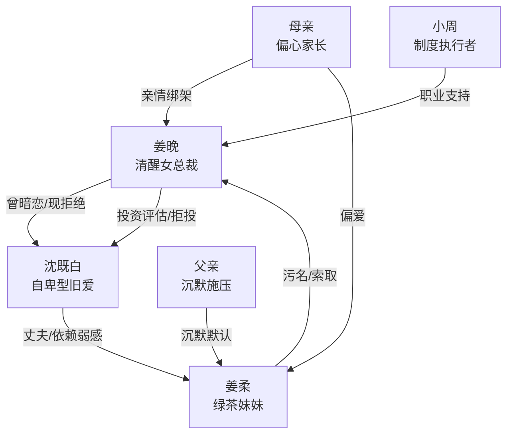

# 角色标签图谱

## 角色清单

### 姜晚 — 清醒女总裁 / 被轻视后的自我完成者

- 叙事功能: 主视角、反转承载者、制度化清算者。
- 核心标签: 克制、专业、稳定。
- 弧光: 渴望被看见 → 被迫自证 → 不再需要被看见。
- 台词风格: 短句、边界清晰、职业化。
- 关键行为: 按流程面谈、拒投启辰、切断家庭特权、保留员工机会。
- 读者情绪关系: 心疼、敬佩、爽。

### 沈既白 — 自卑型旧爱 / 迟来看见者

- 叙事功能: 旧情伤口、身份反差触发器、悔意承载者。
- 核心标签: 自负、自卑、迟钝。
- 弧光: 轻视姜晚 → 求她投资 → 被她拆解 → 承认自卑与亏欠。
- 台词风格: 前期自信，后期迟疑、低声、求确认。
- 关键行为: 拿姜晚概念创业、融资求助、关闭公司、道歉。
- 读者情绪关系: 前期厌烦，后期有限怜悯。

### 姜柔 — 撒娇型绿茶妹妹 / 叙事篡改者

- 叙事功能: 家庭压迫核心、舆论污染源、亲情绑架执行者。
- 核心标签: 会装、会哭、会改写事实。
- 弧光: 被偏爱的妹妹 → 破防的索取者 → 失去特权身份。
- 台词风格: 对外撒娇，对姜晚尖利威胁，失败后打字控诉。
- 关键行为: 饭局污名姜晚、逼姐姐帮忙、家族群带节奏、打公司前台。
- 读者情绪关系: 恨、厌恶、想看她被制度拦下。

### 母亲 — 偏心家长 / 亲情债务制造者

- 叙事功能: 亲情压力来源，强化“你有钱就该给”的伦理压迫。
- 核心标签: 偏心、轻视、理所当然。
- 弧光: 贬低姜晚事业 → 震惊她有钱 → 要求她救妹夫。
- 台词风格: 指责式、道德绑架式。
- 关键行为: 电话逼迫、家族群施压、前台辱骂。
- 读者情绪关系: 憋屈、愤怒。

### 小周 — 职场秩序见证人 / 女主强大的外部验证

- 叙事功能: 展示姜晚公司地位、递送信息、执行制度。
- 核心标签: 专业、敏锐、可靠。
- 弧光: 秘书执行者 → 见证姜晚情绪稳定。
- 台词风格: 职业化、简短。
- 关键行为: 汇报尽调、拦截来电、安排面谈。
- 读者情绪关系: 安心、替女主撑场。

## 关系网络

## 角色功能对照表（供改编参考）

| 原角色 | 极致标签 | 叙事功能 | 读者情绪功能 | 改编时必须保留的 |
|--------|---------|---------|-------------|---------------|
| 姜晚 | 清醒女总裁 | 主角与清算者 | 心疼转爽 | 克制、专业、拒绝复合 |
| 沈既白 | 自卑型旧爱 | 迟来悔意 | 厌烦转有限怜悯 | 他必须曾轻视女主，后承认自卑 |
| 姜柔 | 撒娇绿茶 | 舆论篡改者 | 恨点来源 | 她必须把女主奋斗改写成笑话 |
| 母亲 | 偏心家长 | 亲情债制造者 | 憋屈来源 | “你有钱为什么不给”的逻辑 |
| 小周 | 职场见证人 | 女主权力外显 | 稳定爽感 | 制度执行、称呼“姜总” |
