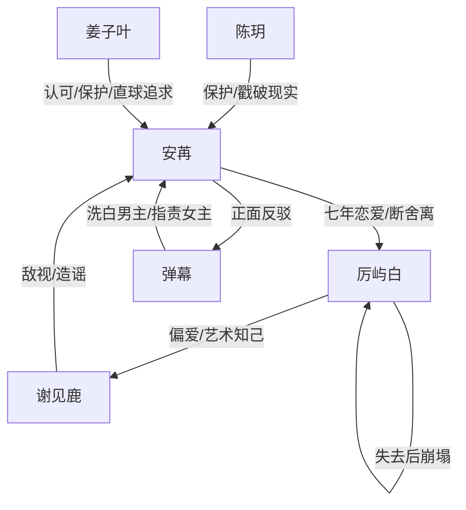

# 角色标签图谱

## 角色清单

### 安苒 — 清醒出走型大女主
- 叙事功能: 第一视角承受者、觉醒者、价值观审判者。
- 核心标签: 被误导七年、科研能力者、清醒断舍离。
- 弧光: 相信弹幕里的隐忍爱 → 识破冷暴力 → 选择事业和自我 → 拒绝迟来的告白。
- 台词风格: 克制、短句、反问见血。
- 关键行为: 掰断画笔、拖箱离开、申请南极项目、反驳弹幕、拒绝复合。
- 读者情绪关系: 前半心疼，后半替她痛快。

### 厉屿白 — 拧巴天才型伤害源
- 叙事功能: 情绪债制造者、温度反转承载者、旧价值观靶子。
- 核心标签: 天才画家、不长嘴、冷暴力依赖者。
- 弧光: 高位贬低女主 → 失去后崩塌 → 迟来告白 → 自毁。
- 台词风格: 刻薄、反话、命令式，终局才直白。
- 关键行为: 砸画笔、留泡面、护师妹、要求女主照顾、躲垃圾桶、接机求复合。
- 读者情绪关系: 从被弹幕强行心疼到被读者审判。

### 谢见鹿 — 绿茶知己型催化剂
- 叙事功能: 外部第三者压力、男主越界行为的显影剂。
- 核心标签: 小师妹、灵魂伴侣话术、委屈型进攻。
- 弧光: 被男主偏爱保护 → 怂恿围堵女主 → 男主崩塌时被波及。
- 台词风格: 软、歉意、带哭腔，实则把责任推给女主。
- 关键行为: 留宿、带寿司、点破画笔、闯公司要人、造谣女主。
- 读者情绪关系: 厌恶、烦躁，是压迫系统的一部分。

### 姜子叶 — 直球护航型新爱
- 叙事功能: 健康爱意对照组、自我价值确认者。
- 核心标签: 老板、狐狸式聪明、直球表达。
- 弧光: 认可女主能力 → 保护女主名誉 → 在南极表白 → 继续追求。
- 台词风格: 轻松、直白、带一点调侃。
- 关键行为: 给南极项目机会、替公司请客、挡画室闹事、送冰雕玫瑰。
- 读者情绪关系: 安全感、补偿感、发糖。

### 陈玥 — 人间清醒闺蜜
- 叙事功能: 外部现实判断、读者嘴替、友情补偿。
- 核心标签: 直率、护短、行动派。
- 弧光: 开篇戳破旁人观感 → 撞破隔壁丑事 → 结尾帮女主把生活拉回热闹。
- 台词风格: 直接、带骂感。
- 关键行为: 问女主为何黏厉屿白、撞破裸体画、聚餐时打破沉默。
- 读者情绪关系: 爽、可靠、替读者发声。

### 弹幕 — 错误叙事系统
- 叙事功能: 误导、洗脑、后期倒戈，代表“为拧巴男洗白”的舆论。
- 核心标签: 磕 CP、爱男、伪上帝视角。
- 弧光: 强行解释男主伤害 → 指责女主不称职 → 被女主反驳 → 部分倒戈。
- 台词风格: 网感、夸张、饭圈化。
- 关键行为: 把贬低解释成爱，把越界解释成艺术，把不道歉解释成拧巴。
- 读者情绪关系: 前期烦躁，后期反转带来痛快。

## 关系网络

## 角色功能对照表（供改编参考）

| 原角色 | 极致标签 | 叙事功能 | 读者情绪功能 | 改编时必须保留的 |
|--------|---------|---------|-------------|---------------|
| 安苒 | 清醒出走型大女主 | 觉醒与拒绝 | 心疼转痛快 | 从被误导到自我确认的弧光 |
| 厉屿白 | 拧巴天才型伤害源 | 制造情绪债 | 先复杂后可恨 | 有过救命/温柔证据，但长期不给安全感 |
| 谢见鹿 | 绿茶知己型催化剂 | 放大越界 | 厌恶 | 软性挑衅与男主偏袒 |
| 姜子叶 | 直球护航型新爱 | 健康对照 | 补偿 | 公开表达、尊重女主、行动保护 |
| 陈玥 | 人间清醒闺蜜 | 嘴替与支持 | 爽 | 直接指出现实，不被弹幕带偏 |
| 弹幕 | 错误叙事系统 | 误导与倒戈 | 烦躁到痛快 | 前期强行洗白，后期被女主价值观击穿 |
