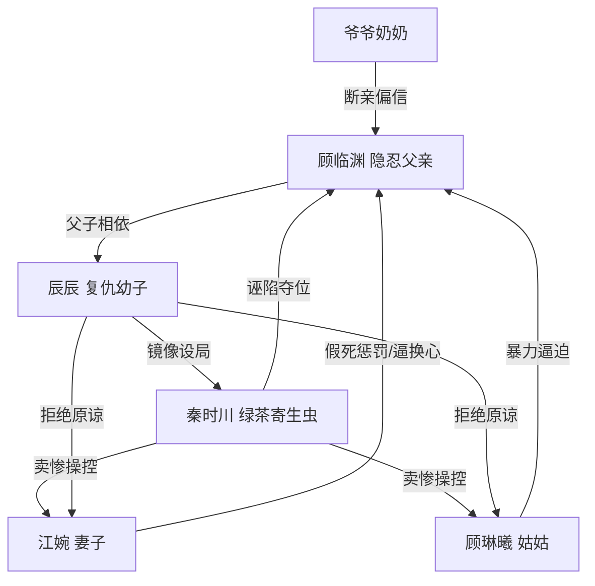

# 角色标签图谱

## 角色清单

### 辰辰 — 早熟复仇幼子

- 叙事功能: 第一人称见证者、情绪承载者、后半复仇执行者。
- 核心标签: 早熟、冷静、以弱胜强。
- 弧光: 无力求救的孩子 → 学会反派手段的复仇者 → 拒绝原谅的幸存者。
- 台词风格: 前期哭求，后期装怯，终局冷句。
- 关键行为: 公开服毒真相、揭假手术、录音设局、生日宴公开证据。
- 读者情绪关系: 心疼、代入、爽感托管。

### 顾临渊 — 隐忍献祭型好父亲

- 叙事功能: 受害核心、情绪债来源、复仇正当性来源。
- 核心标签: 善良、沉默、护子。
- 弧光: 被诬陷的家族核心 → 被抛弃的债务奴隶 → 死亡解脱。
- 台词风格: 少、平静、临死前短促爆发。
- 关键行为: 救秦时川、停卡救家族、为辰辰苟活三年、服毒自尽。
- 读者情绪关系: 强心疼、替他不值。

### 秦时川 — 绿茶寄生虫反派

- 叙事功能: 主谋、误会制造者、镜像反杀对象。
- 核心标签: 卖惨、贪婪、阴毒。
- 弧光: 被偏爱的假弟弟 → 假病夺心的凶手 → 公开证据下百口莫辩。
- 台词风格: 哭诉、推责、挑衅。
- 关键行为: 栽赃父亲、刮花药瓶、扔血包、假称心脏病、宴会自曝。
- 读者情绪关系: 恨、等他报应。

### 江婉/妈妈 — 愚爱误杀型妻子

- 叙事功能: 亲密关系背叛者、悔恨爆点承载者。
- 核心标签: 偏听、傲慢、迟来悔恨。
- 弧光: 设局惩罚丈夫 → 强行摘心帮凶 → 崩溃悔恨 → 入狱。
- 台词风格: 命令式、审判式，后期哀求式。
- 关键行为: 策划假破产、要求父亲道歉、踢开父亲、逼换心、殴打秦时川。
- 读者情绪关系: 恨大于怜悯。

### 顾琳曦/姑姑 — 偏爱帮凶型亲人

- 叙事功能: 暴力打压执行者、亲情冷漠放大器。
- 核心标签: 急躁、狠、愚蠢。
- 弧光: 嘲讽父亲 → 动手拖拽 → 知真相后崩溃施暴。
- 台词风格: 刻薄、命令、暴力化。
- 关键行为: 揪头发、拖父亲、扔药瓶、逼换心、砸秦时川。
- 读者情绪关系: 愤怒、期待清算。

### 爷爷奶奶 — 迟来亲情型帮凶

- 叙事功能: 扩大家庭系统的背叛范围。
- 核心标签: 偏听、断亲、迟悔。
- 弧光: 打骂断亲 → 提蛋糕探秦时川 → 见尸崩溃。
- 台词风格: 居高临下、道德审判。
- 关键行为: 打断真相、宣布只认秦时川。
- 读者情绪关系: 厌恶、冷眼旁观其悔恨。

## 关系网络

## 角色功能对照表（供改编参考）

| 原角色 | 极致标签 | 叙事功能 | 读者情绪功能 | 改编时必须保留的 |
|--------|---------|---------|-------------|---------------|
| 辰辰 | 早熟复仇幼子 | 见证与反杀 | 心疼转爽 | 弱者身份、装可怜反杀、拒绝原谅 |
| 顾临渊 | 隐忍好父亲 | 情绪债核心 | 心疼、愤怒 | 曾救反派、为孩子苟活、不可逆死亡 |
| 秦时川 | 绿茶寄生虫 | 主谋反派 | 恨点 | 卖惨栽赃、假病、被同招反噬 |
| 江婉 | 愚爱妻子 | 亲密背叛 | 怒与悔 | 假惩罚、迟来悔恨、不能被原谅 |
| 姑姑 | 暴力帮凶 | 打压加码 | 愤怒 | 动手羞辱、逼迫、后期崩溃 |
| 爷爷奶奶 | 断亲帮凶 | 家族背叛 | 厌恶 | 公开否认亲情、迟来哭喊 |
