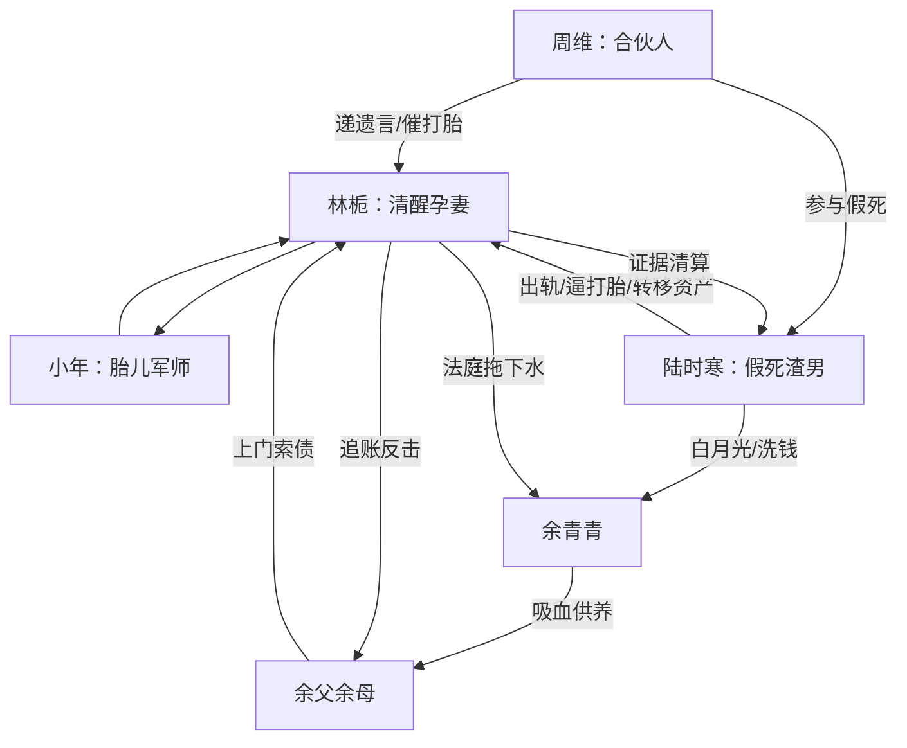

# 角色标签图谱

## 角色清单

### 林栀 — 清醒孕妻 / 克制复仇者
- 叙事功能: 第一人称主角，承受背叛并完成合法清算。
- 核心标签: 孕妻、会演、冷静执行
- 弧光: 悲痛遗孀 → 证据收集者 → 法庭反杀者 → 自主人生母亲
- 台词风格: 前期柔弱低声，后期短句锁死。
- 关键行为: 取得证据、继承资产、应对余家、法庭投证。
- 读者情绪关系: 心疼、代入、爽。

### 小年 — 天才胎儿 / 嘴毒外挂
- 叙事功能: 信息提供者、吐槽役、情感补偿核心。
- 核心标签: 胎儿、全知、护妈
- 弧光: 肚中提醒者 → 复仇军师 → 出生后的陪伴者
- 台词风格: 冷静、精准、带网感吐槽。
- 关键行为: 指出保险柜、密码、证据、资产路径和反派行动。
- 读者情绪关系: 爽、萌、安心。

### 陆时寒 — 假死渣男 / 洗钱反派
- 叙事功能: 主要施害者，情绪债总源头。
- 核心标签: 出轨、贪婪、伪造死亡
- 弧光: 死亡受害者假象 → 假死操盘者 → 财产诉讼原告 → 刑事被告
- 台词风格: 伪深情、急躁、被逼后失控。
- 关键行为: 假死、逼打胎、转移资产、起诉林栀。
- 读者情绪关系: 恨、期待其崩塌。

### 余青青 — 白月光 / 洗钱帮凶
- 叙事功能: 婚姻背叛具象化，资产转移载体。
- 核心标签: 初恋、贪财、共犯
- 弧光: 隐身白月光 → 证据中的共谋者 → 法庭被牵连者
- 台词风格: 主要通过聊天记录呈现，柔弱但贪婪。
- 关键行为: 和陆时寒私奔、接收资产、协助洗钱。
- 读者情绪关系: 厌恶、看她翻车的爽。

### 余父余母 — 吸血亲属 / 勒索型小反派
- 叙事功能: 中段压迫升级，提前释放一次打脸爽点。
- 核心标签: 贪婪、无耻、失言
- 弧光: 上门索债者 → 转账记录暴露者 → 法庭失言牵连者
- 台词风格: 道德绑架、软硬兼施、慌乱嘴碎。
- 关键行为: 拿借条索钱、索要生活费、法庭失言。
- 读者情绪关系: 恨、期待被拖下水。

### 周维 — 合伙人 / 假死执行帮凶
- 叙事功能: 前期催打胎压力源，证明陆时寒外部共犯网络。
- 核心标签: 体面、帮凶、催促
- 弧光: 关切合伙人 → 背后催胎者 → 被追责者
- 台词风格: 客气、沉重、带压迫感。
- 关键行为: 递遗言、催打胎、参与伪造空难。
- 读者情绪关系: 厌恶、警惕。

### 林栀母亲 — 亲情见证者
- 叙事功能: 开篇悲伤氛围和弱者处境的见证。
- 核心标签: 母亲、扶持、旁观
- 弧光: 陪女儿认领噩耗 → 见证女儿撑住
- 台词风格: 心疼、担忧。
- 关键行为: 在医院与殡仪馆扶住林栀。
- 读者情绪关系: 增强林栀孤立无援的心疼感。

## 关系网络

## 角色功能对照表（供改编参考）

| 原角色 | 极致标签 | 叙事功能 | 读者情绪功能 | 改编时必须保留的 |
|--------|---------|---------|-------------|---------------|
| 林栀 | 清醒孕妻 | 承压与反杀主体 | 心疼转爽 | 克制表演、合法清算、最后主体宣言 |
| 小年 | 嘴毒胎儿外挂 | 信息差来源与陪伴 | 萌、爽、安心 | 胎儿心声/等价超现实亲子信息源 |
| 陆时寒 | 假死渣男 | 主要债务源 | 恨与打脸期待 | 假死/逼放弃孩子/财产贪婪 |
| 余青青 | 白月光帮凶 | 背叛和转移资产载体 | 厌恶 | 资产挂名、共同犯罪 |
| 余家 | 吸血小反派 | 中段压迫升级 | 小爽点释放 | 上门索债反被追账 |
| 周维 | 体面帮凶 | 催打胎和假死外证 | 憋屈 | 递“遗言”、外部压力 |
