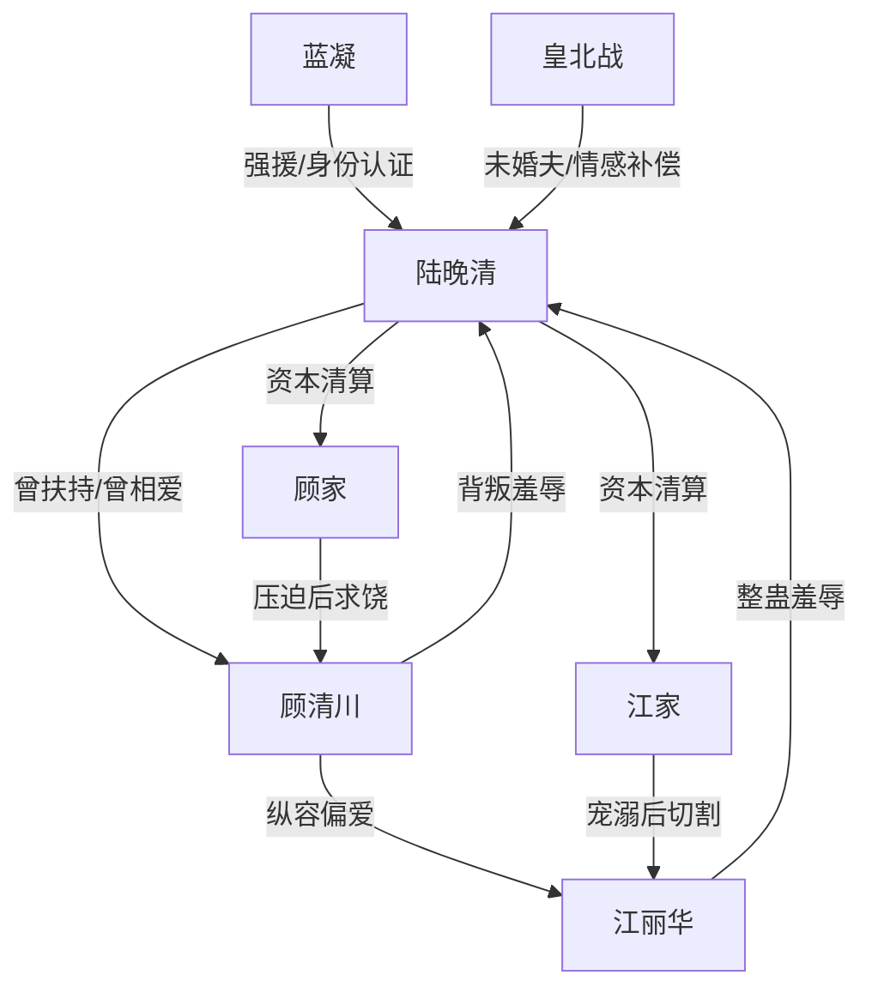

# 角色标签图谱

## 角色清单

### 陆晚清 — 隐藏霸主型疯感大女主

- 叙事功能: 承受极端羞辱后完成身份反杀和全局清算。
- 核心标签: 黑白两边霸主、冷血、先忍后杀
- 弧光: 被当成乡下情人羞辱 → 浴缸翻盘 → 陆氏霸主降维清算
- 台词风格: 短句、冷笑、原话反打
- 关键行为: 打电话调蟑螂、浴缸夺衣、召黑衣人、打垮顾江两家
- 读者情绪关系: 前半心疼，后半爽

### 顾清川 — 负心豪门废物

- 叙事功能: 主要背叛者，负责制造爱情债与阶层羞辱。
- 核心标签: 虚伪、忘恩负义、私生子上位
- 弧光: 自认首富继承人 → 被揭靠女主扶持 → 家族破产跪求
- 台词风格: 轻蔑、命令式、阶层歧视
- 关键行为: 纵容青梅、隐瞒假证、把女主创伤告诉江丽华
- 读者情绪关系: 恨、鄙夷、期待他跪

### 江丽华 — 娇纵绿茶青梅

- 叙事功能: 直接施害者，负责蟑螂羞辱和女性羞辱。
- 核心标签: 恶毒、撒娇式施暴、仗势欺人
- 弧光: 下注整蛊者 → 被喂蟑螂 → 被家族抛弃
- 台词风格: 装天真、撒娇、尖酸
- 关键行为: 放蟑螂、夺手机、扇女主、威胁喂女主蟑螂
- 读者情绪关系: 强恨点，适合重度清算

### 蓝凝 — 外援型强势闺蜜

- 叙事功能: 第一层身份认证器，替女主压场和嘲讽男主。
- 核心标签: 红发霸主、毒舌、战力强
- 弧光: 神秘登场 → 踢飞顾清川 → 被长辈认出
- 台词风格: 毒舌、轻蔑、羞辱反派
- 关键行为: 带气场入场、嘲讽“短把男”、触发身份识别
- 读者情绪关系: 爽、助攻

### 皇北战 — 情感补偿型强者未婚夫

- 叙事功能: 证明女主值得更高位的爱，完成情感层碾压。
- 核心标签: 黑暗霸王、冷漠专情、高位替代
- 弧光: 传闻中的更优选择 → 亲密拥抱女主 → 刺痛顾清川
- 台词风格: 克制、强势、少话
- 关键行为: 安抚女主、接纳女主、结尾搂腰形成打脸画面
- 读者情绪关系: 补偿、解气

### 顾江两家长辈 — 权力坐标校准器

- 叙事功能: 认证女主身份高度，反向惩罚自家子女。
- 核心标签: 势利、恐惧权力、切割保家
- 弧光: 追责女主 → 识破身份 → 磕头求饶
- 台词风格: 命令式到惊慌式
- 关键行为: 查看监控、认出蓝凝、责打顾清川和江丽华
- 读者情绪关系: 爽点放大器

## 关系网络

## 角色功能对照表（供改编参考）

| 原角色 | 极致标签 | 叙事功能 | 读者情绪功能 | 改编时必须保留的 |
|--------|---------|---------|-------------|---------------|
| 陆晚清 | 隐藏霸主大女主 | 受辱后反杀 | 心疼转爽 | 前半低位假象、后半高位碾压 |
| 顾清川 | 负心豪门废物 | 爱情背叛者 | 恨与鄙夷 | 假证/利用/阶层羞辱 |
| 江丽华 | 恶毒青梅 | 直接施害者 | 强恨点 | 撒娇式施暴和蟑螂镜像清算 |
| 蓝凝 | 毒舌强援 | 身份认证 | 爽点助推 | 登场压场和反派震惊 |
| 皇北战 | 高位未婚夫 | 情感补偿 | 替代性满足 | 结尾亲密画面打脸前任 |
