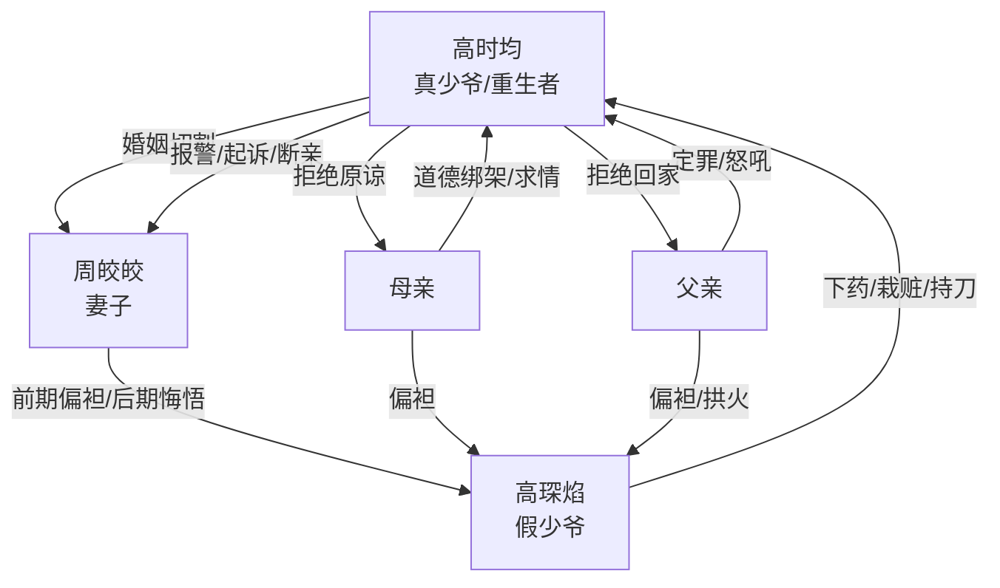

# 角色标签图谱

## 角色清单

### 高时均 — 清醒重生真少爷
- 叙事功能: 受害者、复仇执行者、情绪债清算者。
- 核心标签: 重生、冷静切割、被偏袒链伤害。
- 弧光: 懦弱求爱 → 预知反设局 → 不再解释 → 离婚断亲。
- 台词风格: 短句、反问、低声量。
- 关键行为: 要求周皎皎同行、报警、拒绝拿包、起诉离婚、同意断亲。
- 读者情绪关系: 心疼转痛快，读者期待他彻底离开所有施害者。

### 周皎皎 — 迟来悔悟的偏心妻
- 叙事功能: 婚姻压迫者、温度反转承载者、后期真相见证人。
- 核心标签: 青梅偏袒、家暴、迟来护夫。
- 弧光: 威胁主角 → 替高琛焰说话 → 误打主角 → 发现真相 → 挽回失败。
- 台词风格: 前期命令式，后期哀求式。
- 关键行为: 喝下药酒、绑主角挨打、病房护主角、送高琛焰进监狱、拖延离婚。
- 读者情绪关系: 前期恨，后期不完全解恨；她的悔恨服务于主角离开。

### 高琛焰 — 绿茶假少爷/恶意寄生者
- 叙事功能: 主要施害者、所有误判的起点。
- 核心标签: 装可怜、下药、栽赃。
- 弧光: 被全家偏爱 → 阴谋屡次升级 → 病房暴露恶意 → 持刀被抓。
- 台词风格: 哥哥式伪善与粗口暴露交替。
- 关键行为: 下药、安排混混、假装绑架、嘲笑伤者、持刀刺杀。
- 读者情绪关系: 纯恨点，必须被法律清算。

### 母亲 — 偏心生母/情感勒索者
- 叙事功能: 亲情债主要制造者。
- 核心标签: 偏袒、下跪求情、断亲威胁。
- 弧光: 逼主角接人 → 扇耳光定罪 → 替高琛焰求情 → 断亲威胁失效。
- 台词风格: 先哭求，后威胁。
- 关键行为: 酒吧扇主角、绑架案再扇、病房跪求放过高琛焰。
- 读者情绪关系: 恨其偏心，爽点在主角不再吃她的情感勒索。

### 父亲 — 拱火型偏心父
- 叙事功能: 父权压迫与二次定罪。
- 核心标签: 暴躁、护短、甩锅。
- 弧光: 逼迫主角 → 怒吼定罪 → 医院甩锅 → 被周皎皎暴打。
- 台词风格: 怒吼、命令、推责。
- 关键行为: 护高琛焰、报警后继续圆场、威胁告周皎皎。
- 读者情绪关系: 恨点补强，承担部分身体报应。

## 关系网络

## 角色功能对照表（供改编参考）

| 原角色 | 极致标签 | 叙事功能 | 读者情绪功能 | 改编时必须保留的 |
|--------|---------|---------|-------------|---------------|
| 高时均 | 清醒重生真少爷 | 受害与清算主体 | 心疼、痛快 | 从求爱到切割的姿态变化 |
| 周皎皎 | 迟来悔悟妻 | 温度反转 | 恨、遗憾、爽 | 必须亲手伤害主角后才悔 |
| 高琛焰 | 绿茶假少爷 | 恶意源头 | 纯恨 | 至少三次主动作恶 |
| 母亲 | 偏心情感勒索者 | 亲情债 | 憋屈、愤怒 | 下跪求情与断亲威胁 |
| 父亲 | 暴躁偏心父 | 二次压迫 | 愤怒、爽 | 甩锅和被反噬 |
