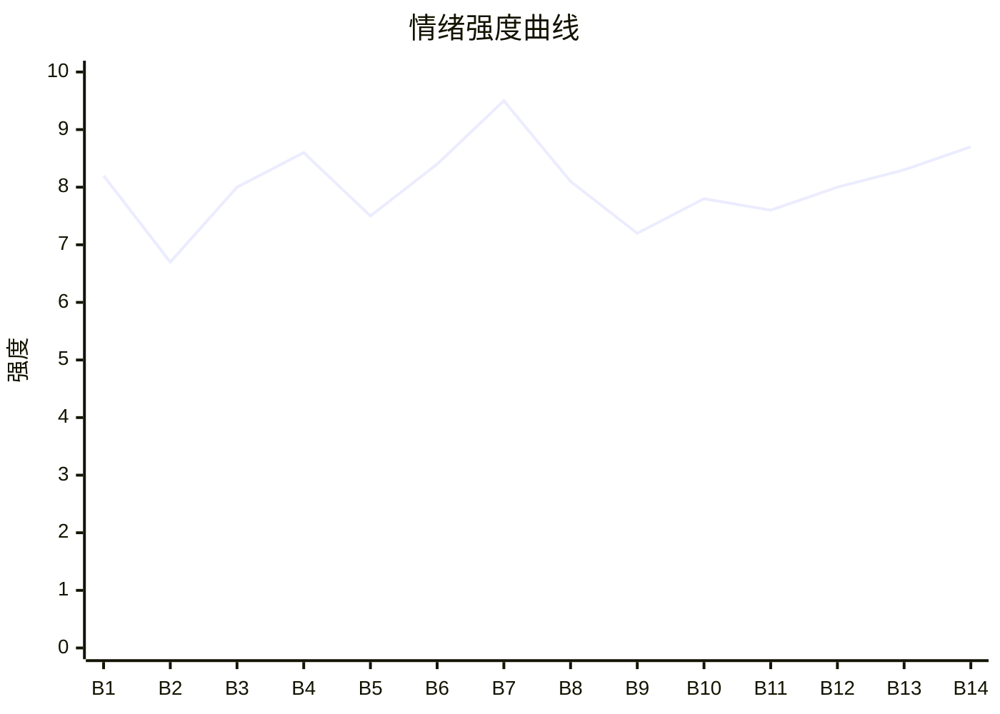

# Beat Sheet 节拍器

## 全文概况

- 总字数: 约 15100 字
- 节拍数: 14 幕
- 核心母题（Logline）: 一个被男友和资助过的同乡女孩双重背叛的女创业者，为了找回初心与家乡承诺，表面退出公司，暗中完成股权反杀，最终回寨创业并获得真正归处。
- 情绪模式: 期待破裂 → 连续羞辱 → 表面认输 → 股权反杀 → 归乡治愈 → 旧人悔恨无效 → 价值兑现

## 节拍详表

### Beat 1: 戒指转赠，求婚破裂 [开篇-01前]
- **字数**: 约 520 字（占比 3.4%）
- **核心事件**: 曲雅以回寨相亲试探婚姻承诺，潘之景把戒指给了杨晚清。
- **情绪标签**: 震惊、羞辱、清醒
- **情绪强度**: 8.2/10
- **情绪方向**: ⚡突变
- **冲突类型**: 大转折
- **悬念钩子**: 女主说“我跟他，完了”后会如何切断多年关系？
- **叙事速度**: 快
- **对话占比**: 55%
- **reversal_mechanism**: [M5]
- **hook_strength**: 8.2/10
- **关键句**: “我等了这么多年的戒指，他随手就给了别人。”
- **原文摘录**: 族里有个规矩，30岁不结婚，就要接受族长的安排回寨子相亲。潘之景冷笑：“你们村是什么封建余孽聚集地？”他说会娶我，却把戒指随手给了助理。杨晚清红着脸接过。我没接回戒指，只让她戴着合适，并告诉她：“告诉你们潘总，我跟他，完了。”

### Beat 2: 夜晚收拾，旧爱翻篇失败 [01-回忆前]
- **字数**: 约 700 字（占比 4.6%）
- **核心事件**: 潘之景回家发现曲雅收拾行李，仍想让她顺台阶翻篇。
- **情绪标签**: 疲惫、冷淡、失望
- **情绪强度**: 6.7/10
- **情绪方向**: ↓下降
- **冲突类型**: 微冲突
- **悬念钩子**: 女主为何这次不争了？
- **叙事速度**: 中
- **对话占比**: 40%
- **reversal_mechanism**: [M5]
- **hook_strength**: null
- **关键句**: “他总有独自翻篇的能力。”
- **原文摘录**: 晚上潘之景下班，我正在收拾东西。他问为什么不等他。我意识到过去每次都是他独自翻篇，我顺着台阶继续扮演恩爱情侣。这一次我不想装了。他指责我阴阳怪气，说杨晚清是妹妹。我只说：“你说得对，是我矫情了。以后不会了。”他茫然后离开，一夜未归。

### Beat 3: 助理闯祸，沙发床刺痛 [公司事故]
- **字数**: 约 1150 字（占比 7.6%）
- **核心事件**: 杨晚清误发底价单，潘之景却在办公室照顾她，曲雅要求承担 120 万损失。
- **情绪标签**: 心痛、荒唐、压怒
- **情绪强度**: 8.0/10
- **情绪方向**: ↑上升
- **冲突类型**: 大转折
- **悬念钩子**: 120 万赔偿会成为后续反杀伏笔吗？
- **叙事速度**: 快
- **对话占比**: 48%
- **reversal_mechanism**: [M3, M5]
- **hook_strength**: null
- **关键句**: “现在沙发床上躺着另一个女人，而他也在旁边珍而重之的守着。”
- **原文摘录**: 陈岁汇报杨晚清把底价单发给客户，导致项目可能损失 120 万。我推开潘之景办公室，看见杨晚清躺在当年他为我买的沙发床上，他一勺一勺喂她糖水。我把汇报表拍到桌上，问：“这个钱，你们谁补？”杨晚清装柔弱，潘之景指责我咄咄逼人。最后他甩银行卡在我脸上：“不过120万而已，我替她出了，行了吗？”

### Beat 4: 办公室被夺，证据打脸 [搬桌冲突]
- **字数**: 约 1450 字（占比 9.6%）
- **核心事件**: 杨晚清搬曲雅办公桌，曲雅当众公开两人开房、买包、买戒指证据。
- **情绪标签**: 愤怒、痛快、鄙夷
- **情绪强度**: 8.6/10
- **情绪方向**: ↑上升
- **冲突类型**: 大转折
- **悬念钩子**: 曲雅明明赢了一局，为什么仍要回寨？
- **叙事速度**: 快
- **对话占比**: 52%
- **reversal_mechanism**: [M2, M3]
- **hook_strength**: null
- **关键句**: “你倒是说说，到底是谁被谁骗？”
- **原文摘录**: 我回来时，杨晚清正指挥人搬我的办公桌，合同文件散落满地。我扇了她一巴掌。潘之景说规矩就是规矩，让我放假回家。我拿出 A4 纸，当众读出三个月前开房 5800 元、两个月前买包 10200 元、一周前买戒指 126000 元等证据。陈岁喷酒精说“一股子小三味”，同事倒向我。族长来电，我确认要回家。

### Beat 5: 绿茶上位，股权赌局 [挑衅设赌]
- **字数**: 约 1050 字（占比 7.0%）
- **核心事件**: 杨晚清以老板娘自居，曲雅诱她用股权证明潘之景的爱。
- **情绪标签**: 冷笑、期待、设局
- **情绪强度**: 7.5/10
- **情绪方向**: ↑上升
- **冲突类型**: 微冲突
- **悬念钩子**: 潘之景会不会真的给杨晚清股份？
- **叙事速度**: 中
- **对话占比**: 50%
- **reversal_mechanism**: [M2, M3]
- **hook_strength**: null
- **关键句**: “男人嘛，钱在哪，爱在哪。”
- **原文摘录**: 撕破脸后，两人在公司出双入对，杨晚清以老板娘自居。她第五次挑衅，我仍不接招。她冲进办公室问我为什么赖着不走。我替她整理西装，说公司我有 49% 股份，问她有没有。随后我提出赌局：如果潘之景愿给她 10%，我放弃股份滚蛋；如果不愿意，她滚蛋。

### Beat 6: 签字认输，办公室腾空 [股权协议]
- **字数**: 约 1200 字（占比 7.9%）
- **核心事件**: 杨晚清拿到 15% 股权，曲雅签下放弃协议，旧办公室被夺。
- **情绪标签**: 憋屈、失落、蓄势
- **情绪强度**: 8.4/10
- **情绪方向**: ↓下降
- **冲突类型**: 大转折
- **悬念钩子**: 女主为什么真的签了？她的底牌是什么？
- **叙事速度**: 中
- **对话占比**: 45%
- **reversal_mechanism**: [M6]
- **hook_strength**: null
- **关键句**: “我静静地看着我打拼了多年的地方，一点一点被腾空。”
- **原文摘录**: 几天后，杨晚清拿着转让给她 15% 股份的协议来逼我认赌服输。潘之景说商人重信誉，又许诺我以后做潘太太。我说我不稀罕。杨晚清播放录音，我拦住陈岁，拿笔签字。我的保温杯、毯子、兰花被人搬走踩坏，门牌变成杨总办公室。

### Beat 7: 坐上总裁位，股权反杀 [最大反转]
- **字数**: 约 1850 字（占比 12.3%）
- **核心事件**: 曲雅坐到潘之景办公室，宣布解雇他，揭开已把股份卖给宋然的底牌。
- **情绪标签**: 爽、震惊、清算
- **情绪强度**: 9.5/10
- **情绪方向**: ⚡突变
- **冲突类型**: 大转折
- **悬念钩子**: 她为什么要放弃自己亲手打下的公司？
- **叙事速度**: 快
- **对话占比**: 50%
- **reversal_mechanism**: [M2, M3, M6]
- **hook_strength**: null
- **关键句**: “潘之景，现在你被解雇了。”
- **原文摘录**: 我转身走进潘之景办公室，坐上他的位置，说：“潘之景，现在你被解雇了。”两人嘲笑我。宋然带保镖出现，扔出文件，宣布持有 64% 股份，是最大股东，剥夺潘之景管理权。我回击：“你都能免费给小三呢，我还不能卖给我闺蜜？”又把 120 万回旋成 100 个 120 万。杨晚清原来已被宋然父亲诱导卖股。

### Beat 8: 初心回溯，精神动机落地 [寨子记忆]
- **字数**: 约 1650 字（占比 10.9%）
- **核心事件**: 曲雅回忆被阿婆养大、全寨凑学费、创业初心，以及阿婆病重唤醒她。
- **情绪标签**: 心疼、释然、坚定
- **情绪强度**: 8.1/10
- **情绪方向**: →平稳后上扬
- **冲突类型**: 情感转折
- **悬念钩子**: 女主将如何兑现回乡梦想？
- **叙事速度**: 慢
- **对话占比**: 28%
- **reversal_mechanism**: [M5]
- **hook_strength**: null
- **关键句**: “我的初心，找回来了。我的梦想，我自己来圆。”
- **原文摘录**: 我回忆自己是阿婆捡来的弃婴，寨子里的阿叔阿娘几块几十块凑够我的学费。我曾告诉潘之景，我要赚钱回报寨子，修路、做旅游，让老人老有所依。后来他一次也没陪我回过寨子。阿婆生病后，族长提醒我已经一年没回家。我明白自己该走了。

### Beat 9: 告别旧部，抵达寨子 [离场与新场]
- **字数**: 约 1200 字（占比 7.9%）
- **核心事件**: 曲雅把陈岁交给宋然，回寨见苏和和阿婆。
- **情绪标签**: 温暖、轻松、归属
- **情绪强度**: 7.2/10
- **情绪方向**: ↑上升
- **冲突类型**: 无/转场
- **悬念钩子**: 苏和是否会成为真正同路人？
- **叙事速度**: 中
- **对话占比**: 42%
- **reversal_mechanism**: [M5]
- **hook_strength**: null
- **关键句**: “我的家乡很美。”
- **原文摘录**: 离开前，我把陈岁交给宋然，提到她母亲手术费，陈岁哭着谢我多年偷偷垫付。飞机落地，苏和来接我，我们像小时候一样斗嘴。入寨路已修成柏油路，阿婆迎出来，我在她怀里哭，她说还能再活 100 岁。我说这次哪都不去了。

### Beat 10: 投资寨子，同路人确认 [创业新线]
- **字数**: 约 1150 字（占比 7.6%）
- **核心事件**: 曲雅投资一千万，与苏和共同建设寨子，确认共同理想。
- **情绪标签**: 希望、欣赏、心动
- **情绪强度**: 7.8/10
- **情绪方向**: ↑上升
- **冲突类型**: 微转折
- **悬念钩子**: 一年后寨子发展到什么程度？
- **叙事速度**: 中
- **对话占比**: 38%
- **reversal_mechanism**: [M5]
- **hook_strength**: null
- **关键句**: “我从里面看到了我们共同的梦想。”
- **原文摘录**: 我去苏和工作室，听他和投资人谈村子的潜力，开口问：“一千万够吗？”他震惊后仍拉我去族长那里做公证，以村名义签投资合同。我们一起讨论寨子未来。他说要让年轻人回来，建设医疗和教育，让老人老有所依，少年有所成。我看见了共同的梦想。

### Beat 11: 旧人落魄登场 [潘之景追来]
- **字数**: 约 1400 字（占比 9.3%）
- **核心事件**: 一年后曲雅事业起色，潘之景落魄来到寨子，旧公司失势消息补全。
- **情绪标签**: 冷淡、反差、余爽
- **情绪强度**: 7.6/10
- **情绪方向**: →平稳
- **冲突类型**: 大转折
- **悬念钩子**: 潘之景来干什么，是否会打扰阿婆？
- **叙事速度**: 中
- **对话占比**: 25%
- **reversal_mechanism**: [M3, M5]
- **hook_strength**: null
- **关键句**: “再听这些事，我已经毫无波澜，仿佛在听别人的故事。”
- **原文摘录**: 一年后，寨子游客多了起来。接博主时，我看见风尘仆仆的潘之景。宋然和陈岁曾轮番告诉我，他失去客户、被旧下属架空，杨晚清离职逼婚，两人投资失败赔光身家。我已经毫无波澜。晚上他带礼物来我家，我怕他刺激阿婆，把他拉到榕树下赶走。

### Beat 12: 潘之景认输，女主拒绝回头 [悔恨无效]
- **字数**: 约 1200 字（占比 7.9%）
- **核心事件**: 潘之景承认当年是因自卑才和曲雅争输赢，曲雅拒绝和解。
- **情绪标签**: 释然、冷静、终结
- **情绪强度**: 8.0/10
- **情绪方向**: ↑上升
- **冲突类型**: 情感清算
- **悬念钩子**: 杨晚清会不会再闹？
- **叙事速度**: 慢
- **对话占比**: 60%
- **reversal_mechanism**: [M5]
- **hook_strength**: null
- **关键句**: “我曲雅这辈子都是为了自己的目标向前冲，在你身边这几年，已经算我在停留了。”
- **原文摘录**: 潘之景住在民宿十天后引出传言，我把他叫到苏和工作室。他问我恨不恨。我说刚发现出轨时恨，现在不恨。他承认自己嫉妒公司的人、客户、父母都更认可我，于是把我当成要赢过的人，拖着不求婚，不回老家，只为在感情上赢我。我让他说完就走。

### Beat 13: 杨晚清闹剧，反派互锁 [村口清算]
- **字数**: 约 900 字（占比 6.0%）
- **核心事件**: 杨晚清追来大闹，插足事实传回村里，最终被父母赶走，与潘之景互相折磨。
- **情绪标签**: 荒诞、痛快、解气
- **情绪强度**: 8.3/10
- **情绪方向**: ↑上升
- **冲突类型**: 大转折
- **悬念钩子**: 女主的新事业会如何真正爆发？
- **叙事速度**: 快
- **对话占比**: 65%
- **reversal_mechanism**: [M3, M5]
- **hook_strength**: null
- **关键句**: “两个人就一直互相折磨，谁也不肯放过谁。”
- **原文摘录**: 杨晚清在工作室外和潘之景吵架，尖叫自己抢走他却仍得不到他的心。村里人认出她，插足消息一夜传开。族长生气，她父母没脸见人，把她赶出去。潘之景道歉后带她离开。后来他想离婚，她死都不肯，两人互相折磨。

### Beat 14: 视频爆火，归途兑现 [结尾]
- **字数**: 约 1500 字（占比 9.9%）
- **核心事件**: 曲雅和苏和推广寨子成功，年轻人回流，二人财务自由但总回寨子。
- **情绪标签**: 圆满、温暖、归属
- **情绪强度**: 8.7/10
- **情绪方向**: ↑上升后平稳
- **冲突类型**: 价值兑现
- **悬念钩子**: 结尾收束，无续篇硬钩。
- **叙事速度**: 中
- **对话占比**: 15%
- **reversal_mechanism**: [M5, M6]
- **hook_strength**: null
- **关键句**: “那才是我们心底最终的归途。”
- **原文摘录**: 苏和意外剪辑的我在村里日常视频爆火，网友被寨子景色和我与阿婆的相处打动。客人、博主、文旅支持接连到来，年轻人回乡帮忙，阿叔阿娘做起小生意。后来寨子交给更年轻的人，我和苏和财务自由，环游世界，却总会回到寨子。那才是心底最终的归途。

## 情绪曲线可视化

## 节拍密度检测

- 平均每 1078 字一个节拍
- 微冲突密度: 每 1400 字一次
- 大转折密度: 每 1800 字一次
- 判定: 基本符合高频节拍器标准；前半段强，后半段治愈线节奏变缓但主题补偿明确。

## 反转机制清单(Reversal Mechanisms)

| 机制 ID | 机制名 | 承载 Beat | 关键段落/金句 | 等价改编提示 |
|--------|--------|-----------|--------------|-------------|
| M2 | 身份反差爆发 | Beat 7 | “睁大你的狗眼看清楚，我现在持有你们公司64%的股份” | 具体身份可换，但反差层级必须保留：弱势退出者→真正控盘者。 |
| M3 | 因果回旋反讽 | Beat 3, Beat 7, Beat 13 | “120万不在乎的潘总，100个120万，应该也没关系吧？” | 必须保留施害者原规则被女主原句式回敬。 |
| M5 | 温度反转曲线 | Beat 1-3, Beat 8, Beat 12 | “我竟然跟我的爱人争输赢。” | 必须有曾经的温柔和后来的冷漠，悔恨要具体落地。 |
| M6 | 多层递进反转 | Beat 4-7, Beat 14 | 办公室被夺→签字认输→股权反杀→归途价值胜利 | 层数不能少，至少保留职场/资产/价值三层升维。 |
