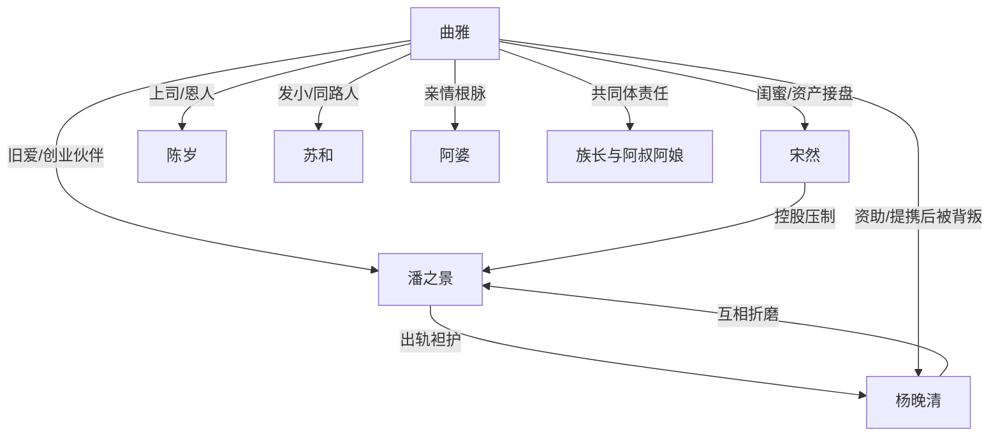

# 角色标签图谱

## 角色清单

### 曲雅 — 清醒事业大女主/归乡建设者
- 叙事功能: 承受背叛、设局反杀、完成价值重建。
- 核心标签: 清醒、能忍、重情义
- 弧光: 被旧爱拖住 → 切断旧公司旧关系 → 回寨兑现初心
- 台词风格: 冷静短句，反问打脸。
- 关键行为: 公开出轨证据、设股权赌局、卖股给宋然、投资寨子。
- 读者情绪关系: 心疼她被羞辱，爽于她反杀，满足于她找到归途。

### 潘之景 — 自卑争输赢型前男友
- 叙事功能: 制造情感与职场压迫，后期承担悔恨火葬场。
- 核心标签: 傲慢、自卑、控制欲
- 弧光: 共同创业伴侣 → 背叛者/夺权者 → 失势悔恨者
- 台词风格: 居高临下、道德倒打一耙。
- 关键行为: 把戒指给杨晚清、袒护助理、给小三股份、后来追到寨子认错。
- 读者情绪关系: 前期恨，后期看他落魄获得余爽。

### 杨晚清 — 恩将仇报绿茶助理
- 叙事功能: 外部小三压迫源，触发职场与情感双线冲突。
- 核心标签: 装弱、贪婪、背刺
- 弧光: 被资助同乡 → 小三上位 → 被股权诱杀 → 名声崩塌
- 台词风格: 装可怜、哭诉、抢功。
- 关键行为: 接戒指、误发底价单、搬办公室、卖掉股权、大闹寨子。
- 读者情绪关系: 主要恨点之一，报应越具体越解气。

### 宋然 — 富家闺蜜/降维支援者
- 叙事功能: 承接女主资产，提供股权反杀执行力。
- 核心标签: 爽利、护短、有资源
- 弧光: 旁观吐槽 → 入局控股 → 接管公司
- 台词风格: 直接、带嘲讽。
- 关键行为: 收购股份、带保镖亮相、剥夺潘之景管理权。
- 读者情绪关系: 提供外援爽点和安全感。

### 陈岁 — 忠诚旧部/职场见证人
- 叙事功能: 见证杨晚清无能，见证曲雅德行，承接公司未来。
- 核心标签: 能干、忠诚、懂感恩
- 弧光: 被项目事故压垮 → 支持曲雅 → 被托付给宋然
- 台词风格: 职场汇报式，关键时刻阴阳怪气。
- 关键行为: 汇报底价单事故，帮曲雅撑腰，接受新职位。
- 读者情绪关系: 证明女主值得被追随。

### 苏和 — 同路发小/真正归处
- 叙事功能: 对照潘之景，承载家乡梦想与健康关系。
- 核心标签: 同频、踏实、理想主义
- 弧光: 发小重逢 → 事业伙伴 → 人生归途
- 台词风格: 轻松熟稔，少承诺多行动。
- 关键行为: 接机、修路、宣传寨子、与曲雅共同创业。
- 读者情绪关系: 提供治愈和补偿型甜感。

### 阿婆/族长/阿叔阿娘 — 精神共同体
- 叙事功能: 解释女主初心，承载“归处”主题。
- 核心标签: 温暖、互助、根脉
- 弧光: 被牵挂的家乡 → 被回馈的家乡 → 共同繁荣的家乡
- 台词风格: 朴素、方言感、短句。
- 关键行为: 当年凑学费，如今接纳曲雅回家。
- 读者情绪关系: 温暖、催泪、价值补偿。

## 关系网络

## 角色功能对照表（供改编参考）

| 原角色 | 极致标签 | 叙事功能 | 读者情绪功能 | 改编时必须保留的 |
|--------|---------|---------|-------------|---------------|
| 曲雅 | 清醒事业大女主 | 承压与反杀 | 心疼、爽、敬佩 | 不恋战，反杀后回到自己的目标 |
| 潘之景 | 自卑争输赢前男友 | 压迫与悔恨 | 恨、余爽 | 他把爱变成输赢的病根 |
| 杨晚清 | 恩将仇报绿茶 | 直接挑衅 | 恨、解气 | 被女主提携却背刺 |
| 宋然 | 护短资源闺蜜 | 降维支援 | 安全感、爽感 | 股权/资源反杀执行者 |
| 苏和 | 同频发小 | 价值补偿 | 治愈、甜 | 共同梦想，不只是新欢 |
| 阿婆/寨子 | 归途共同体 | 主题根基 | 温暖、泪点 | 当年托举女主，后被女主回馈 |
