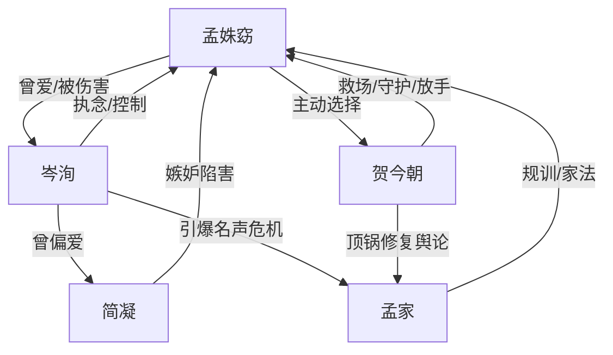

# 角色标签图谱

## 角色清单

### 孟姝窈 — 贞洁规训下的破碎大女主
- 叙事功能: 承压核心、情绪债载体、最终选择主体。
- 核心标签: 豪门千金、禁忌受害者、创伤后觉醒。
- 弧光: 以爱为名忍受羞辱 → 被家族逐出 → 海外修复 → 主动选择自由。
- 台词风格: 前期低声求饶、后期短句拒绝。
- 关键行为: 同意嫁贺今朝、出逃、拳馆反抗、书店说“滚”、撕掉离婚协议。
- 读者情绪关系: 心疼、愤怒、希望她彻底脱离旧人旧家。

### 岑洵 — 自以为深情的疯批施害者
- 叙事功能: 主要压迫源、温度反转承载者、火葬场执行者。
- 核心标签: 小叔禁忌、控制欲、迟来悔恨。
- 弧光: 作践占有 → 为简凝羞辱女主 → 发现失去 → 追悔纠缠 → 以命偿还。
- 台词风格: 前期调笑羞辱，后期执拗哀求。
- 关键行为: 宴会羞辱、夜店献祭、推入荆棘、逼布置求婚、海外纠缠、悬崖救人。
- 读者情绪关系: 恨、厌恶、后期只接受死亡式偿还。

### 贺今朝 — 浪子外壳的边界感救赎者
- 叙事功能: 新秩序、女主救生通道、舆论反转执行人。
- 核心标签: 花花公子、清醒守护者、自由引路人。
- 弧光: 宴会旁观救场 → 雨中带走 → 顶锅结婚 → 训练女主反抗 → 放她自由。
- 台词风格: 吊儿郎当但冷静，一针见血。
- 关键行为: 递耳环、接走女主、公开承认照片男主、守客房、拳馆训练、递离婚协议。
- 读者情绪关系: 安全感、爽、补偿性喜爱。

### 简凝 — 恶毒白月光/嫉妒型反派
- 叙事功能: 外部刺激源，推动岑洵不断暴露偏爱。
- 核心标签: 红裙、嫉妒、恶意陷害。
- 弧光: 被偏爱者 → 主动加害者 → 绑架者 → 入狱疯癫。
- 台词风格: 挑衅、轻快、残忍。
- 关键行为: 夜店设局、玫瑰自伤陷害、发布照片、绑架女主。
- 读者情绪关系: 恨，期待被清算。

### 孟父/孟家 — 规训秩序具象化
- 叙事功能: 家族名声压力、二次伤害来源。
- 核心标签: 家规、体面、父权。
- 弧光: 维护门楣 → 家法逐女 → 名声崩塌 → 迟来求回。
- 台词风格: 威严、审判式。
- 关键行为: 九十九鞭、划族谱、葬礼求女儿回家。
- 读者情绪关系: 憋屈、失望，最终希望女主拒绝回归。

## 关系网络

## 角色功能对照表（供改编参考）

| 原角色 | 极致标签 | 叙事功能 | 读者情绪功能 | 改编时必须保留的 |
|--------|---------|---------|-------------|---------------|
| 孟姝窈 | 破碎觉醒大女主 | 承压与新生 | 心疼、期待反抗 | 从服从到主动选择 |
| 岑洵 | 疯批火葬场男 | 压迫与偿债 | 恨、看他悔死 | 迟来悔悟必须付生命级代价 |
| 贺今朝 | 边界感救赎男 | 新秩序 | 安全感、补偿 | 不越界、给自由 |
| 简凝 | 恶毒白月光 | 加害催化 | 恨 | 主动陷害与最终疯癫 |
| 孟家 | 名声规训系统 | 社会压力 | 憋屈 | 家法/逐出/迟来召回 |
