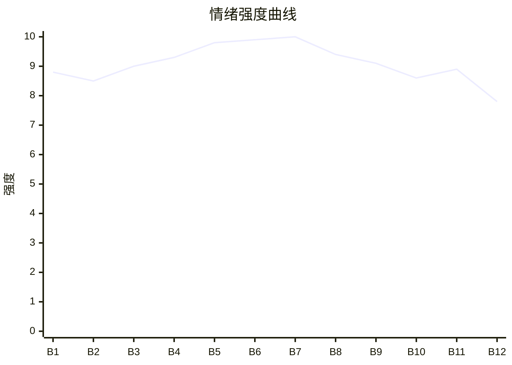

# Beat Sheet 节拍器

## 全文概况

- 总字数: 约 9500 字
- 节拍数: 12 幕
- 核心母题（Logline）: 一个被母亲装死测试毁掉十年的高考状元，为了给亡父讨回真相，承受母亲与养舅的连续误判，最终让父亲尸骨、校长证据和反派罪行反噬所有施害者，并拒绝迟来的亲情补偿。
- 情绪模式: 极端 Hook → 亲情背叛累积 → 墓地触底 → 天台坠河 → 尸骨真相爆炸 → 校长打脸 → 反派清算 → 冷拒和解

## 节拍详表

### Beat 1: 状元捞尸，死母归来 [开篇-“死了。”]

- **字数**: 约 700 字（占比 7.4%）
- **核心事件**: 顾晨高考出分成全国状元，却在河边打捞父亲尸体；死去十年的母亲坐迈巴赫归来，宣称父子通过测试。
- **情绪标签**: 震惊、荒诞、悬疑
- **情绪强度**: 8.8/10
- **情绪方向**: ⚡突变
- **冲突类型**: 大转折
- **悬念钩子**: 父亲为什么会死在河里？母亲为何装死十年？
- **叙事速度**: 快
- **对话占比**: 35%
- **reversal_mechanism**: [M5, M6]
- **hook_strength**: 9.0/10（极端度 3/3；信息密度 3/3；悬念尖锐度 1.5/2；节奏利落度 1.5/2）
- **关键句**: “高考出分当天，记者为了采访全国状元，在河边找到了正在打捞尸体的我。”
- **原文摘录**: 高考出分当天，记者为了采访全国状元，在河边找到了正在打捞尸体的我。他们问我最该感谢的爸爸还是妈妈时，死去十年的妈妈出现了。她从迈巴赫上走下来，居高临下：“你爸十年未婚，你也考上了状元，果然都通过了我的测试。”我握着竹竿，茫然地看着她。原来十年前，妈妈的养弟向妈妈提议：“不如用假死来考验一下姐夫，你装破产跳楼，如果他能为你守身如玉十年，就能证明他不是图钱。”妈妈笑了：“当年恋爱时我装穷三年，他能一天打五份工养我，他爱我爱得要死。别说十年，二十年，守到死都不是问题。”高考状元竟是首富之子，公司股价一路飙升，全国人民都在期盼我和妈妈抱头痛哭的感人画面。妈妈环顾四周：“你爸呢？我来接你们回家了。”“死了。”

### Beat 2: 父死真相初揭，母亲拒信 [“手中的打捞杆”-“才会懂分寸”]

- **字数**: 约 900 字（占比 9.5%）
- **核心事件**: 顾晨说父亲为给母亲买墓地累死河里，母亲第一反应是维护顾氏名声；小舅舅倒打一耙，说父子挥霍遗产。
- **情绪标签**: 憋屈、愤怒、荒唐
- **情绪强度**: 8.5/10
- **情绪方向**: ↑上升
- **冲突类型**: 微冲突升级
- **悬念钩子**: 遗产到底去哪了？小舅舅在背后做了什么？
- **叙事速度**: 中快
- **对话占比**: 55%
- **reversal_mechanism**: [M3, M5]
- **hook_strength**: null
- **关键句**: “三年前，他为了给你买一块最好的墓地没日没夜打工，死在这条河里了。”
- **原文摘录**: 手中的打捞杆在掌心寸寸断裂，我抬眼，一字一顿：“三年前，他为了给你买一块最好的墓地没日没夜打工，死在这条河里了。”妈妈瞳孔一颤。周围全是记者倒吸冷气的声音，快门声疯狂响起。妈妈她最在乎顾氏的名声，立刻回过神：“顾晨，那么多人都在看，玩笑不是这么开的。”“当初虽说是装破产，但我还是给他留了一笔遗产，他怎么可能会连个墓地都买不起。”我一脸茫然，当年妈妈死的时候，我们父子被小舅舅扫地出门，说妈妈欠了一大笔钱逼着我们卖掉了所有的东西，哪来的遗产？还没等我开口，小舅舅一把扯住我的胳膊。“小晨，没想到你们父子那么能挥霍，把这么大一大笔钱都用完了。可是也不能用这种方法来引起你妈的负罪感啊，太过分了。”妈妈深以为然，点头：“还是你看得清楚，果然男人最了解男人。当初听你的，截下他的升职机会是对的。”

### Beat 3: 升职被截，结案书被毁 [“我瞪大了眼睛”-“眼里全是失望”]

- **字数**: 约 1000 字（占比 10.5%）
- **核心事件**: 顾晨回忆父亲升职被截、五年积蓄被夺；拿出警局结案书证明父亲死亡，却被小舅舅撕毁，母亲继续要求父亲现身。
- **情绪标签**: 心痛、无力、恨
- **情绪强度**: 9.0/10
- **情绪方向**: ↑上升
- **冲突类型**: 大转折
- **悬念钩子**: 证明死亡的证据被毁，顾晨还能如何让母亲相信？
- **叙事速度**: 中
- **对话占比**: 45%
- **reversal_mechanism**: [M3, M5]
- **hook_strength**: null
- **关键句**: “你下去给爸爸道歉啊！”
- **原文摘录**: 我瞪大了眼睛，爸爸能升职任劳任怨，每天最早到岗，最晚下班，节假日加班的永远都是他。那天爸爸那么开心地抱着我，说他升职加薪了，以后我们再也不用住在下雨天都会漏雨的地下室。可是第二天，他就被辞退了。公司冤枉他损坏设备，要他赔偿一大笔钱。那是他攒了整整五年的血汗钱啊。想到爸爸过劳得肺癌的样子，我瞬间红了眼：“为什么？为什么你要这么对我们？”“如果你没有那么做，爸爸就不会一天打五份工，活活累死在这里！”“都是你的家人，凭什么小舅舅和他儿子就可以满身奢侈品，出国旅游。爸爸和我只是想过正常生活都不行！？”妈妈皱眉：“你小舅舅从小就在顾家长大娇生惯养，你们跟他有什么可比的？”“那你去啊！”我整个人控制不住地发抖，把发旧的警局结案书狠狠砸在她名贵的裙子上。“你下去给爸爸道歉啊！”结案书落在地上的时候，妈妈指尖猛地一颤。还没等她弯腰，小舅舅一把撕成了碎片。

### Beat 4: 举报高考作弊，毁掉父亲遗愿 [“小舅舅眼里闪过”-“我倒要看看”]

- **字数**: 约 900 字（占比 9.5%）
- **核心事件**: 小舅舅污蔑顾晨三年没上高中不可能考状元；母亲为挽回顾氏名声实名举报儿子高考作弊。
- **情绪标签**: 窒息、愤怒、坍塌
- **情绪强度**: 9.3/10
- **情绪方向**: ⚡突变
- **冲突类型**: 大转折
- **悬念钩子**: 顾晨状元身份会不会被毁？母亲还会做出什么？
- **叙事速度**: 快
- **对话占比**: 60%
- **reversal_mechanism**: [M3, M6]
- **hook_strength**: null
- **关键句**: “为了高考的公正，请求将他的成绩，全部作废。”
- **原文摘录**: 小舅舅眼里闪过一丝恶意：“大家之所以这么关注，说到底还是因为小晨是全国状元。可如果，他不是了呢？”我呼吸一滞。“我让人查过了，小晨这三年根本没上过高中，他怎么可能考上全国状元？”妈妈的眸光沉了下去，深深看向我：“顾晨，你竟然作弊。”“看来现在只有我主动举报大义灭亲，才能为顾氏挽回一些声誉。”我瞬间慌了，考上一个好大学，这是爸爸活着时的心愿。“你不能这么做！”“我是你妈，想做什么都可以。”妈妈盯着我：“如果不想我这么做，那就告诉我，你爸爸在哪。”喉咙仿佛被烧干：“我说了，爸爸就在这条河里，所以我才会每天在这里打捞。”“不见棺材不落泪。”妈妈的眼神彻底冷了下去，拨出了教育局举报热线。“你好，我是顾氏集团总裁，也是考生顾晨的母亲，我实名举报我儿子高考作弊。”“为了高考的公正，请求将他的成绩，全部作废。”

### Beat 5: 奶奶墓被毁，亲情债触底 [“记者却没有按”-“骨灰被妈妈全部倾倒”]

- **字数**: 约 1200 字（占比 12.6%）
- **核心事件**: 舆论不受控，母亲将顾晨拖到奶奶墓前，逼父亲出现；顾晨哀求无果，奶奶骨灰被倾倒。
- **情绪标签**: 绝望、崩溃、恨到极点
- **情绪强度**: 9.8/10
- **情绪方向**: ↑上升至触底
- **冲突类型**: 大转折
- **悬念钩子**: 触及死者尊严后，顾晨会做出什么极端选择？
- **叙事速度**: 中快
- **对话占比**: 40%
- **reversal_mechanism**: [M5, M6]
- **hook_strength**: null
- **关键句**: “奶奶的骨灰被妈妈全部倾倒在地上。”
- **原文摘录**: 可是现场的记者却没有按妈妈预想的方向走。相反，他们的新闻敏锐度让他们像是闻到血腥味的鲨鱼：“程总，请问您举报自己儿子作弊，是不是为了掩盖您害死丈夫，以及虐待儿子的丑闻？”妈妈一把攥住我的胳膊，力道大得像要把骨头捏碎。她拖着我，直接把我扔进了迈巴赫后座。奶奶的墓地。按照爸爸的遗愿，我每个月都会来打扫。“是你爸自己出来，还是要我动手逼他出来，你替他选一个。”我意识到妈妈要做什么了，“轰”的一声，浑身血液一下子冲上头。“你疯了吗！？”“当初你装穷的那几年，是奶奶把棺材本都拿出来支持你创业，心疼你是孤儿，省吃俭用，把最好的都给了你。她把你当亲女儿，你怎么敢！”可妈妈只是低头，冷冷看着我：“你爸爸连这个都告诉你了，看来你小舅舅说的没错，他就是想要挟恩以报。”“既然你不选，那我替你选。”身后的工作人员上前，墓碑一锤子就被砸烂了。“不要！”我猛地冲过去护住墓地，指甲死死抠进棺椁缝里。手指被人用力掰开，指尖像是连皮带肉被撕扯下来。爸爸依然没有出现。奶奶的骨灰被妈妈全部倾倒在地上。

### Beat 6: 小舅舅自曝杀父，烟花灭尸危机 [“姐夫可真狠心”-“也会炸得稀巴烂吧”]

- **字数**: 约 1100 字（占比 11.6%）
- **核心事件**: 小舅舅挑拨父亲早知装穷，试图逼母亲离婚失败；随后私下向顾晨自曝三年前将父亲推河砸死，并安排水下烟花毁尸。
- **情绪标签**: 惊骇、杀意、绝望
- **情绪强度**: 9.9/10
- **情绪方向**: ⚡突变
- **冲突类型**: 大转折
- **悬念钩子**: 顾晨能否在烟花爆炸前保住父亲尸骨？
- **叙事速度**: 快
- **对话占比**: 65%
- **reversal_mechanism**: [M6]
- **hook_strength**: null
- **关键句**: “他好几次想游上来，都被我用石头砸下去了，头破血流。”
- **原文摘录**: “姐夫可真狠心，自己亲妈都被挫骨扬灰了，还能忍着不出来。”小舅舅一下捂住嘴，低笑：“啊呀瞧我这嘴，真不该说的。”妈妈身形一顿，转头看他：“你这话什么意思？齐远当年早就知道我是在装穷？”“你胡说！”我几乎是下意识解释：“我爸根本就不知道，他是真的爱妈妈！”小舅舅靠近妈妈：“姐，你还记得小时候妈妈领养我的时候，开玩笑说我是你的童养夫嘛。”“你跟姐夫离婚吧。这么多年了，我一直在等你。”妈妈沉默了一瞬。“不行，我不会和齐远离婚。”小舅舅靠近我，用只有我能听见的声音。“你知道吗，你爸是被我弄死的。”三年前，他在商场做保洁的时候看见我们了。“所以，我把他推进了河里。”“他好几次想游上来，都被我用石头砸下去了，头破血流。直到，再也起不来。”“对了，晚上顾氏要在那条河上放烟花，庆祝万千学子高考顺利，前途光明。”“如果你爸的尸体真的在河底，那应该，也会炸得稀巴烂吧。”

### Beat 7: 天台同归于尽，父亲骸骨浮出 [“畜生！”-第1章末]

- **字数**: 约 950 字（占比 10.0%）
- **核心事件**: 顾晨掐小舅舅被母亲掌掴，决定带母亲“见爸爸”；在天台挟持小舅舅坠河，母亲刺穿顾晨救下养弟，水下烟花炸出父亲骸骨。
- **情绪标签**: 绝望、悲壮、震撼
- **情绪强度**: 10/10
- **情绪方向**: ⚡突变峰值
- **冲突类型**: 大转折/章末卡点
- **悬念钩子**: 母亲看到父亲骸骨后会崩溃吗？顾晨能不能活？
- **叙事速度**: 极快
- **对话占比**: 45%
- **reversal_mechanism**: [M6, M5]
- **hook_strength**: null
- **关键句**: “就在我狠狠砸进河面的一瞬间，一具骸骨因为河底剧烈震动浮了上来。”
- **原文摘录**: “畜生！”我目呲欲裂，指尖死死掐住小舅舅的脖子：“你还我爸爸！”“放肆！”一记耳光重重砸在我脸上，力道大得把我掀翻甩在地上。妈妈把小舅舅护在怀里，咬紧牙：“我已经没有耐心了，赶紧带我去见你爸。”“好，我带你去见爸爸。”河对岸的高楼天台上，妈妈左右看了一圈，脸色越来越沉：“你爸爸人呢？”我低头看着几百米下的河。“姐！救我！”妈妈回头，我已经死死箍着小舅舅的脖子，站在高楼边缘。“现在我就是要去见爸爸，妈妈，你敢一起吗？”我绝望又凄凉地笑了笑，拉着小舅舅就往后倒。突然，一把水果刀用力扎穿了我的手。妈妈拔下水果刀，把小舅舅从天台边缘拽了回去。而我身体失去平衡，直直向后栽了下去。“小晨！”头顶，妈妈的声音撕裂开。同一时间，一簇簇烟花，在水下准点炸开。就在我狠狠砸进河面的一瞬间，一具骸骨因为河底剧烈震动浮了上来。脖子上，还挂着爸爸从不摘下的定情项链。

### Beat 8: 烟花旧忆，尸骨确认 [第2章开篇-“是他，是齐远”]

- **字数**: 约 1200 字（占比 12.6%）
- **核心事件**: 母亲先被小舅舅再次误导不救顾晨，烟花触发她对父亲旧日温暖的回忆；随后手下报告浮尸项链，母亲赶到河边确认父亲身份。
- **情绪标签**: 后悔、恐惧、崩塌前兆
- **情绪强度**: 9.4/10
- **情绪方向**: ↓转↑
- **冲突类型**: 大转折
- **悬念钩子**: 顾晨是否已死？母亲如何面对父亲遗骨？
- **叙事速度**: 中
- **对话占比**: 35%
- **reversal_mechanism**: [M5, M3]
- **hook_strength**: null
- **关键句**: “这种不值钱的破玩意儿，除了他，还有谁会要。”
- **原文摘录**: 头顶烟花炸开，绚烂到了极致，所有镜头都对准了天空。没有人看见，那具浮在水面的骸骨。妈妈转身要往下冲，小舅舅却一把拉住她。“小晨刚才挟持我的时候说了，这是他们父子的把戏，就是要故意在镜头前抹黑报复你的。”妈妈顿住了：“人救没救上来都不用告诉我了。以后我不想再听到他们父子任何消息。”烟花一朵接一朵炸开。妈妈忽然走神了。她想起很多年前，他们没钱买烟花。爸爸却在凌晨十二点的那一刻，笑着从怀里拿出一把仙女棒。“以后我们会有很多很多个春节，十个，五十个，八十个，我们一定会越来越好的。”就在这时，一个手下脸色惨白地冲上来：“顾总，河，河里浮上来一具尸体！”手下喉结滚动了一下：“那具尸体，脖子上有一条项链。像……像先生以前一直戴着的那条。”妈妈疯了一样往楼下冲。当她看清那具骸骨脖子上的项链时，“扑通”一声，她整个人直接跪了下去。背面，刻着两个字母。妈妈喉咙干裂，声音嘶哑得不像人声：“这种不值钱的破玩意儿，除了他，还有谁会要。”触碰到骸骨的小腿。那里，有一道明显的旧伤。“是他，是齐远。”

### Beat 9: 父死子危，母亲迟来救赎 [“啊！”-“抢救很成功”]

- **字数**: 约 1000 字（占比 10.5%）
- **核心事件**: 母亲抱着父亲尸骨崩溃，又得知顾晨落水无人救，冲去救儿子；医院里小舅舅继续污蔑，校长出场证明顾晨清白。
- **情绪标签**: 崩溃、急切、打脸
- **情绪强度**: 9.1/10
- **情绪方向**: ↓后反弹
- **冲突类型**: 大转折
- **悬念钩子**: 顾晨醒来后会不会原谅母亲？
- **叙事速度**: 快
- **对话占比**: 50%
- **reversal_mechanism**: [M3, M6]
- **hook_strength**: null
- **关键句**: “你抛弃了十年的儿子，是一个真正的天才。”
- **原文摘录**: “啊！”一声撕裂般的嚎叫，从妈妈喉咙里炸出来。她抱着爸爸，整个人彻底崩塌。工作人员跌跌撞撞冲过来：“是，是大少爷。”妈妈的呼吸瞬间停住。“之前您说不用救大少爷他会游泳，我们就没管了。现在，大少爷已经被冲到了岸边，人昏迷不醒，已经没有反应了……”妈妈脸色骤变，转身冲向我。医院门口。车刚停稳，她就抱着我往里冲。“医生！救人！”小舅舅这时也匆匆赶来了：“因为你曝光了他作弊的事，他觉得丢脸，不想活了。”妈妈眼里的怒火，转变成了痛心。“是谁说的，没上学，就考不了状元了？”一道声音忽然从走廊尽头传来。小舅舅脸色一变：“您，您是清北大学校长！”老人没看他：“我不仅是校长，也是他报考专业的导师。”“他，会是我的最后一个关门弟子。”老人递上平板，考场监控画面开始播放。“举报别人成绩作废，不是靠一张嘴上下嘴一碰就可以的。要有证据。”他顿了一下，看向妈妈：“你抛弃了十年的儿子，是一个真正的天才。”这时，手术室门开了。医生摘下口罩：“抢救很成功，人已经醒了。”

### Beat 10: 儿子拒绝，母亲查真相 [“病房里”-“剩下的，交给我”]

- **字数**: 约 700 字（占比 7.4%）
- **核心事件**: 顾晨醒来拒绝母亲触碰，指出她从不信父子；母亲查清小舅舅所有罪行，决定清算。
- **情绪标签**: 冷、痛快、迟来的醒悟
- **情绪强度**: 8.6/10
- **情绪方向**: →平稳偏冷
- **冲突类型**: 微冲突
- **悬念钩子**: 母亲会如何处置小舅舅？
- **叙事速度**: 中
- **对话占比**: 55%
- **reversal_mechanism**: [M3, M5]
- **hook_strength**: null
- **关键句**: “我说了，你信吗？”
- **原文摘录**: 病房里，我躺在床上，脸色苍白。妈妈想摸我的脸，却被我侧头避开。她的手停在半空僵住，眼里那点亮光，一点点灭掉。“小晨，这次是妈妈不对，妈妈不该误会你。现在清北校长就在外面，你以后可以去你想去的学校，念你想念的专业了。”我看着天花板，扯了下嘴角。“只是这次吗？”“从以前到现在，永远都是别人说什么，你就信什么。可无论我和爸爸怎么解释，你都不会信。”“但凡你心里，对我和爸爸，有一点点信任，爸爸都不会死。”妈妈一句话也说不出来。过了很久，她才低声开口：“我会给你和你爸爸一个交代。”我嗤笑出声。闭上眼，不再看她。我早就不信她了。一个小时，手机响了。她看着屏幕，手指收紧，“咯吱”一声，手机几乎被捏裂。“我真没想到，每一件事的背后，都有你小舅舅的手笔。”“他竟然敢背着我这么欺负你和你爸爸。小晨，你以前怎么不说呢！”“我说了，你信吗？”妈妈不自觉往后倒退了一步。“你好好休息，剩下的，交给我。”

### Beat 11: 养弟清算，规则回旋 [“此时小舅舅”-“也没有把这件事转告妈妈”]

- **字数**: 约 900 字（占比 9.5%）
- **核心事件**: 小舅舅继续索要一个亿和房产，母亲假意答应后揭穿他，将他和儿子送去美国承受地狱式报应；顾晨接到求救电话后挂断。
- **情绪标签**: 爽、报应、冷
- **情绪强度**: 8.9/10
- **情绪方向**: ↑反弹
- **冲突类型**: 大转折/清算
- **悬念钩子**: 母亲能否获得顾晨原谅？
- **叙事速度**: 快
- **对话占比**: 65%
- **reversal_mechanism**: [M3]
- **hook_strength**: null
- **关键句**: “站街男，怎么会需要房子。别人一个电话，你们上门不就行了。”
- **原文摘录**: 此时小舅舅还不知道自己的真面目已经败露了。看到妈妈回家，他立刻迎上去，眼圈一红。“姐，小宥刚才告诉我，高考前小晨找过他，威胁他不许考好，否则就要把我们父子赶走，所以他才没考好。”“你能不能捐一个亿给哈佛？送小宥去美国留学，就当是补偿他了。”妈妈看着她，忽然笑了。“没问题，当然可以。”小舅舅眼里发光。“房子不用买，那边有现成的。”妈妈看着她，眼里像结了冰，没有一点温度。“站街男，怎么会需要房子。别人一个电话，你们上门不就行了。”妈妈一步上前，猛地掐住他的脖子。“别装了，别再把我当傻子了，你做的那些事，我全都知道了。”“小晨有自己的爸爸，不需要你去把他当儿子。而且，你也不配。”“我不会让你就这么死了的。”“你们既然那么想去美国，我现在就送你们上路。”后来，小舅舅打过很多次电话回来。有一次是我接的。“姐，我们快要死了，在这里我们一天都活不下去了，求你快来救救我们啊！”我安静听着，然后挂断。当然，也没有把这件事转告妈妈。

### Beat 12: 股份补偿与墓前余生，主角不回头 [“虽然我不经商”-结尾]

- **字数**: 约 650 字（占比 6.8%）
- **核心事件**: 母亲把股份转给顾晨，每周来学校等他却被无视；毕业后常住父亲墓边忏悔，顾晨拒绝看她，只为自己而活。
- **情绪标签**: 冷爽、怅惘、释然
- **情绪强度**: 7.8/10
- **情绪方向**: ↓收束
- **冲突类型**: 余波
- **悬念钩子**: 无，完成价值收束
- **叙事速度**: 慢
- **对话占比**: 10%
- **reversal_mechanism**: [M5, M3]
- **hook_strength**: null
- **关键句**: “最心疼妈妈的人，早就已经死了。而我以后只会为自己而活。再也不会回头。”
- **原文摘录**: 虽然我不经商，可是妈妈为了补偿我，把所有股份全转给了我。每个周末，她都会来来学校等我。有时候是为了跟我说几句话，有时候只是为了看我一眼。我每次都当她不存在。她就那么站一会儿，然后再离开。只是背，弯得越来越沉。在我毕业后，妈妈开始常住在爸爸的墓地旁。她每天都会打扫得干干净净，和爸爸讲讲话，说说我的近况，夸我有多么的优秀，让爸爸别担心。然后就会控制不住地哭。“齐远，对不起，我错了。”一遍又一遍。可是，没有人回应她。助理无数次求我去看看妈妈，陪陪她，我都拒绝了。最心疼妈妈的人，早就已经死了。而我以后只会为自己而活。再也不会回头。

## 情绪曲线可视化

## 节拍密度检测

- 平均每 792 字一个节拍
- 微冲突密度: 每 900-1100 字一次
- 大转折密度: 每 1000-1400 字一次
- 判定: 符合高频节拍器标准；几乎每一幕都有“误判加深/证据被毁/真相升级/清算兑现”。

## 反转机制清单(Reversal Mechanisms)

从 prompts/patterns/reversal-mechanisms.md 的 8 大机制中命中以下机制:

| 机制 ID | 机制名 | 承载 Beat | 关键段落/金句 | 等价改编提示 |
|--------|--------|-----------|--------------|-------------|
| M3 | 因果回旋反讽 | Beat 4, 10-12 | “我说了，你信吗？”；“当然，也没有把这件事转告妈妈。” | 必须让施害者的规则反身应用：母亲曾不听父子解释，结尾儿子也不再转达、不再回应。 |
| M5 | 温度反转曲线 | Beat 1-3, 8-12 | “只有爸爸，给了她第一个‘家’。”；“可是，没有人回应她。” | 温柔正峰必须显式存在，后半悔恨要有具体动作和长期代价。 |
| M6 | 多层递进反转 | Beat 4-9 | 举报作弊、毁墓、自曝杀父、坠河浮尸、校长证明 | 层数不能少：个人压迫→死亡真相→公共证据→价值拒绝，量级逐层升维。 |
