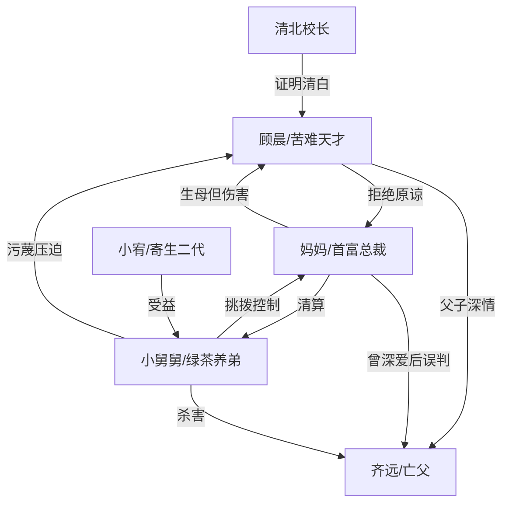

# 角色标签图谱

## 角色清单

### 顾晨 — 苦难天才/冷拒和解者

- 叙事功能: 第一人称受害者与道德坐标中心，承载读者心疼和最终冷爽。
- 核心标签: 全国状元、捞尸孤儿、被误判的天才
- 弧光: 反复解释求信任 → 被逼到同归于尽 → 醒后拒绝补偿 → 为自己而活
- 台词风格: 短句、反问、压抑控诉
- 关键行为: 河边捞尸、拿结案书、护奶奶墓、天台挟持小舅舅、拒绝母亲触碰、挂断求救电话
- 读者情绪关系: 心疼、替他憋屈，后期因“不原谅”获得冷爽

### 程总/妈妈 — 装死测试的首富母亲/迟来疯悔者

- 叙事功能: 最大情绪债制造者，也是温度反转的核心承载者。
- 核心标签: 首富总裁、偏听偏信、迟来忏悔
- 弧光: 自信归来验收测试 → 维护名声误伤父子 → 亲手毁墓举报儿子 → 看到尸骨崩塌 → 终身墓前忏悔
- 台词风格: 命令式、审判式，后期转为哀求和自责
- 关键行为: 装死十年、截断父亲升职、举报顾晨作弊、毁奶奶墓、刺伤顾晨、确认骸骨、清算养弟、转让股份
- 读者情绪关系: 前期恨，尸骨确认后转为“活该悔疯”，但不值得被原谅

### 齐远/爸爸 — 纯爱亡父/亲情债核心

- 叙事功能: 虽已死亡，但所有情绪债、母亲温度正峰和顾晨行动动机都围绕他展开。
- 核心标签: 纯爱、苦命、守信
- 弧光: 曾用贫穷里的仙女棒给母亲一个家 → 被设计失业贫困 → 为墓地打工 → 被小舅舅推河杀害 → 尸骨浮出证明一切
- 台词风格: 温柔、朴素、承诺式
- 关键行为: 一天打五份工、守身如玉十年、戴廉价定情项链、替母亲挡枪
- 读者情绪关系: 心疼与意难平，是母亲必须疯悔的理由

### 小舅舅 — 绿茶养弟/夺爱杀人犯

- 叙事功能: 外部挑拨者和显性反派，推动误判加深，并承接最终清算。
- 核心标签: 绿茶男、寄生虫、杀父凶手
- 弧光: 装无辜挑拨 → 吞遗产截升职 → 私下自曝杀父 → 继续索要资源 → 被揭穿送走受报应
- 台词风格: 阴阳怪气、装可怜、转移责任
- 关键行为: 提议假死测试、扫地出门、撕结案书、污蔑作弊、推父亲入河、安排水下烟花、索要哈佛捐款
- 读者情绪关系: 极致恨点，越恶越支撑后期报应爽点

### 小宥/表哥 — 寄生二代/清算附属

- 叙事功能: 展示小舅舅父子占用资源的结果，与顾晨形成“天才被剥夺 vs 废物被供养”对照。
- 核心标签: 娇生惯养、资源咖、替罪受益者
- 弧光: 享受顾家资源 → 被父亲申请哈佛捐款 → 被一起送走受苦
- 台词风格: 基本缺席，由父亲代言
- 关键行为: 高考失利后被父亲诬称受顾晨威胁
- 读者情绪关系: 厌恶、报应爽点附属

### 清北校长 — 权威证人/降噪打脸者

- 叙事功能: 用制度证据证明顾晨清白，打掉母亲和小舅舅的“作弊”污蔑。
- 核心标签: 权威、冷静、公正
- 弧光: 出场即定论 → 递上监控 → 点破抛弃十年的儿子是真天才
- 台词风格: 克制、压迫感强
- 关键行为: 公开认顾晨为关门弟子，播放考场监控
- 读者情绪关系: 爽点工具人，替读者打脸

## 关系网络

## 角色功能对照表（供改编参考）

| 原角色 | 极致标签 | 叙事功能 | 读者情绪功能 | 改编时必须保留的 |
|--------|---------|---------|-------------|---------------|
| 顾晨 | 苦难天才/冷拒和解者 | 受害者、见证者、最终价值选择 | 心疼、冷爽 | 被剥夺的前途、对亡父执念、结尾不原谅 |
| 妈妈 | 装死首富母亲/迟来疯悔 | 最大误判者、温度反转承载 | 恨、看她悔疯 | 曾爱父亲、亲手伤害、终身忏悔 |
| 齐远 | 纯爱亡父 | 情绪债核心 | 意难平 | 贫穷守爱、死亡物证、尸骨确认 |
| 小舅舅 | 绿茶养弟/杀人犯 | 显性反派、挑拨者 | 恨、报应爽 | 寄生、挑拨、私下自曝、被等价清算 |
| 清北校长 | 权威证人 | 制度打脸 | 爽 | 证据链证明主角清白 |
