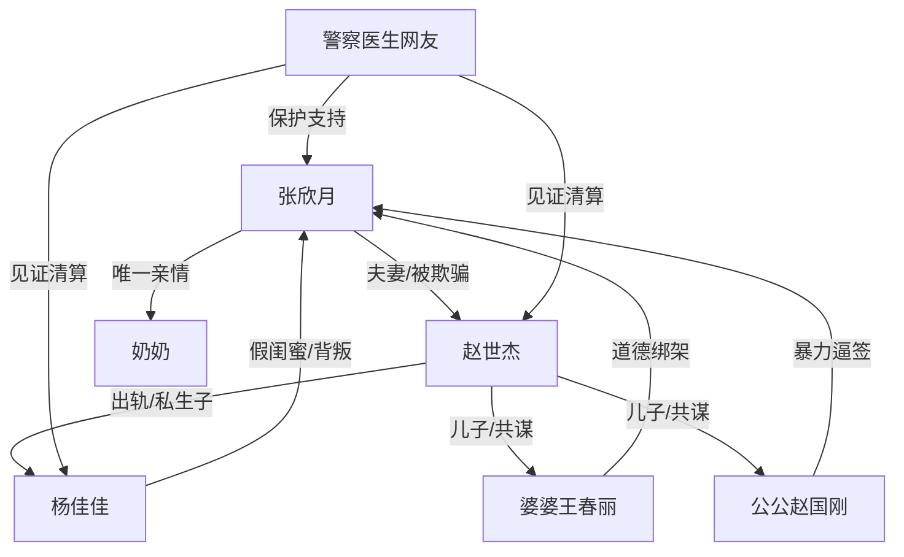

# 角色标签图谱

## 角色清单

### 张欣月 — 重生清醒复仇女主
- 叙事功能: 承受前世极端剥削，今生识破骗局并完成法律反杀。
- 核心标签: 清醒、狠决、护奶奶
- 弧光: 被骗耗尽一生的妻子 → 斩断婚姻情义的复仇者
- 台词风格: 短句、一字一顿、反问逼供
- 关键行为: 拒认孩子、报警、追问死亡证明、封棺、坚持不和解
- 读者情绪关系: 心疼、代入、爽

### 赵世杰 — 装死渣夫
- 叙事功能: 最大施害者，制造假死骗局并将妻子当血包。
- 核心标签: 出轨、懦弱、恶毒
- 弧光: 棺材里的幕后操盘者 → 法庭上磕头求饶的囚犯
- 台词风格: 狡辩、甩锅、羞辱式控制
- 关键行为: 装死、骗妻收养私生子、警局自爆、医院动手
- 读者情绪关系: 恨、鄙夷、期待报应

### 杨佳佳 — 毒闺蜜/小三
- 叙事功能: 亲密关系背叛者，负责情感层面的二次伤害。
- 核心标签: 伪善、恶毒、心虚
- 弧光: 温柔劝签的闺蜜 → 逃跑摔断门牙、法庭哭闹
- 台词风格: 装可怜、尖叫、甩锅
- 关键行为: 劝认孩子、掐哭婴儿、控制奶奶药、试图逃跑
- 读者情绪关系: 恨、恶心、想看社死

### 婆婆王春丽 — 道德绑架型恶婆婆
- 叙事功能: 用母亲身份、孝道和“遗愿”压迫女主。
- 核心标签: 伪善、狠毒、包庇
- 弧光: 哭丧控场者 → 瘫软获刑者
- 台词风格: 哭喊、撒泼、道德扣帽
- 关键行为: 逼签协议、抱孩子暴露病情、医院求和
- 读者情绪关系: 恨、厌烦、期待崩溃

### 公公赵国刚 — 暴力执行者
- 叙事功能: 把道德绑架升级为身体暴力。
- 核心标签: 凶狠、控制、虚伪
- 弧光: 灵堂上按跪断指的人 → 判刑五年的被告
- 台词风格: 命令式、辱骂式
- 关键行为: 撞女主额头、压跪、掰断手指、阻止封棺
- 读者情绪关系: 恨、恐惧、期待重判

### 奶奶 — 女主软肋与救赎对象
- 叙事功能: 前世遗憾与今生必须守住的亲情。
- 核心标签: 亲情、脆弱、温暖
- 弧光: 前世临终未见 → 今生陪女主走出法院
- 台词风格: 朴素、依赖女主
- 关键行为: 被带到灵堂、哮喘发作、结尾牵手回家
- 读者情绪关系: 心疼、保护欲、情绪补偿

### 警察/医生/病友/网友 — 外部秩序与舆论放大器
- 叙事功能: 把私人压迫转化为公共审判。
- 核心标签: 见证、公权力、舆论
- 弧光: 旁观者 → 清算执行者
- 台词风格: 事实判断、公开站队
- 关键行为: 救人、开棺、审讯、传播真相
- 读者情绪关系: 爽、安心、正义补偿

## 关系网络

## 角色功能对照表（供改编参考）

| 原角色 | 极致标签 | 叙事功能 | 读者情绪功能 | 改编时必须保留的 |
|--------|---------|---------|-------------|---------------|
| 张欣月 | 重生清醒复仇女主 | 反杀执行者 | 代入、心疼、爽 | 冷静报警+公开反杀+不和解 |
| 赵世杰 | 装死渣夫 | 主谋 | 恨、想看崩溃 | 假死/伪装失效/跪求无用 |
| 杨佳佳 | 毒闺蜜小三 | 情感背叛者 | 恶心、社死爽 | 闺蜜身份+孩子生母+逃跑失败 |
| 公婆 | 道德绑架恶亲属 | 压迫放大器 | 憋屈、恨 | 哭丧逼签+暴力升级 |
| 奶奶 | 女主软肋 | 情绪锚点 | 心疼、补偿 | 前世遗憾/今生守住 |
| 警察/网友 | 公共秩序 | 清算执行 | 安心、痛快 | 证据链和公开审判 |
