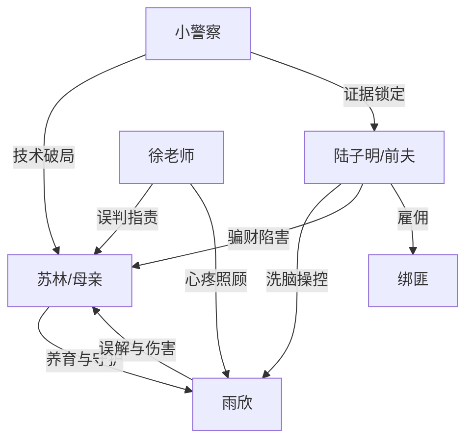

# 角色标签图谱

## 角色清单

### 苏林/我 — 隐忍护女型单亲母亲
- 叙事功能: 第一视角承压者、查案者、最终守护者
- 核心标签: 单亲、节俭、护女
- 弧光: 被全网误解的母亲 → 找出真相的母亲 → 修复亲情的母亲
- 台词风格: 克制解释，关键时刻短句质问
- 关键行为: 重生后查转账、报警、筹赎金、揭穿镜像软件和陆子明
- 读者情绪关系: 心疼、站队、替她憋屈后获得洗冤爽感

### 雨欣 — 被父爱骗局操控的学霸女儿
- 叙事功能: 谜团核心、情绪债载体、悔悟补偿者
- 核心标签: 学霸、敏感、渴望父爱
- 弧光: 指控母亲 → 被揭穿自导自演 → 认清父亲 → 回归母亲
- 台词风格: 前期冷硬怨怼，后期崩溃道歉
- 关键行为: 改头像、装镜像软件、篡改转账、故意饿肚子、对质父亲
- 读者情绪关系: 前期恨其糊涂，后期心疼其被利用

### 陆子明 — 吸血恶父/幕后操盘反派
- 叙事功能: 终极反派、伦理底线破坏者
- 核心标签: 自私、贪婪、重男轻女
- 弧光: 假装慈父 → 被女儿对质 → 供出卖女计划 → 判刑
- 台词风格: 道德绑架、甩锅、赤裸利益话术
- 关键行为: AI 合成照片、洗脑女儿、策划绑架、意图骗钱卖女
- 读者情绪关系: 强恨点，必须被法律重罚

### 徐老师 — 正义但被假象误导的班主任
- 叙事功能: 外部审判者、校园侧证人
- 核心标签: 负责、心疼学生、误判
- 弧光: 指责母亲 → 参与查证 → 见证真相
- 台词风格: 严厉、直接
- 关键行为: 联系家长、指出雨欣营养不良和生活困境
- 读者情绪关系: 前期增加母亲压力，后期证明女儿惨状真实

### 年轻小警察 — 技术真相引路人
- 叙事功能: 谜团解释入口、证据闭环辅助
- 核心标签: 专业、敏锐、基层经验
- 弧光: 提出相似案 → 解释镜像软件 → 协助抓捕
- 台词风格: 信息型、简洁
- 关键行为: 指出问题可能不在账户，解释镜像软件
- 读者情绪关系: 提供破局期待

### 绑匪 — 被雇佣的次级反派
- 叙事功能: 生死压力制造者、反向证人
- 核心标签: 贪婪、粗暴、被利用
- 弧光: 持刀威胁 → 发现 99 异常 → 供出陆子明
- 台词风格: 粗暴威胁
- 关键行为: 绑走雨欣、索要一百万、推动真相爆发
- 读者情绪关系: 恐惧与厌恶，后期作为证据工具

## 关系网络

## 角色功能对照表（供改编参考）

| 原角色 | 极致标签 | 叙事功能 | 读者情绪功能 | 改编时必须保留的 |
|--------|---------|---------|-------------|---------------|
| 苏林 | 隐忍护女母亲 | 承压、查案、守护 | 心疼与洗冤爽 | 她必须真心给钱、真心护女 |
| 雨欣 | 被操控学霸女儿 | 谜团核心、悔悟者 | 又恨又心疼 | 她伤害母亲但不是终极恶 |
| 陆子明 | 吸血恶父 | 幕后反派 | 绝对恨点 | 骗财、害女、重男轻女必须保留 |
| 徐老师 | 误判的正义者 | 外部压力 | 增强母亲冤屈 | 她的指责基于可见证据 |
| 小警察 | 破局者 | 技术解释 | 给读者希望 | 必须提供合理破案入口 |
| 绑匪 | 生死压力工具 | 推高卡点 | 恐惧与紧张 | 绑架必须迫使真相爆发 |
