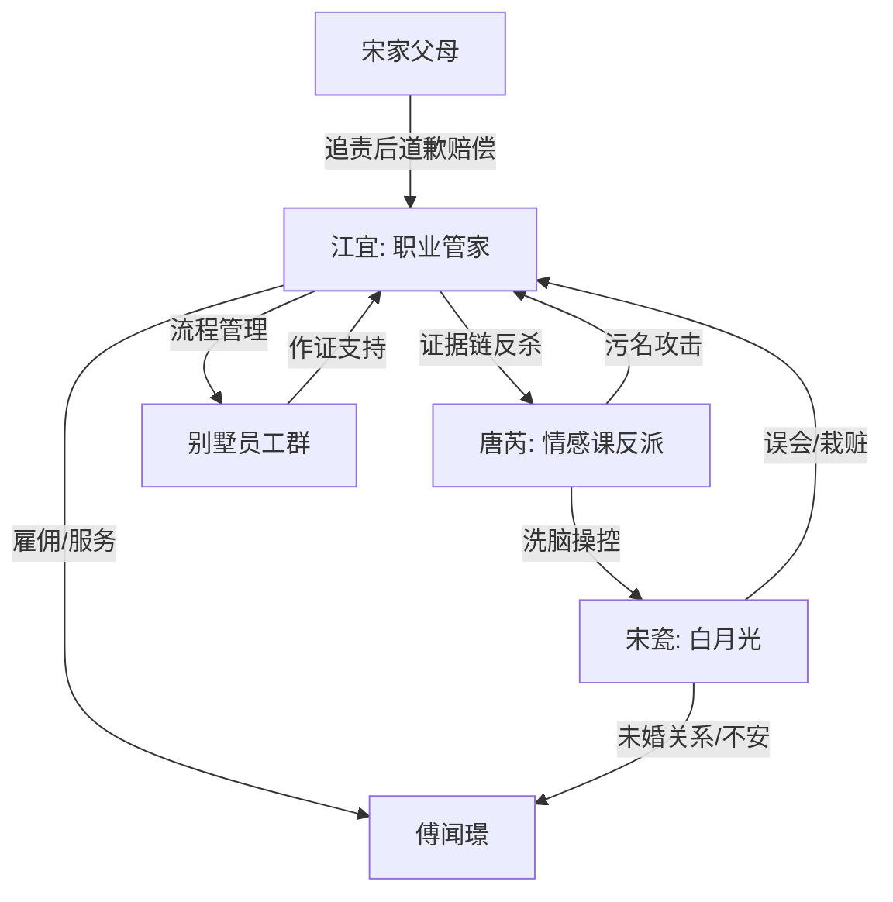

# 角色标签图谱

## 角色清单

### 江宜 — 冷幽默职业大女主
- 叙事功能: 第一人称视角、证据链执行者、职业秩序代表。
- 核心标签: 专业、冷静、打工人现实主义
- 弧光: 被污名的管家 → 主动留证自保 → 制度化涨薪胜利
- 台词风格: 敬语、流程化、短句反讽
- 关键行为: 留样、调监控、保存录音、封存证物、列补偿单
- 读者情绪关系: 心疼她被冤，爽她用职业流程打脸

### 宋瓷 — 被洗脑的恋爱脑白月光
- 叙事功能: 前台冲突制造者，被唐芮操控的情绪载体。
- 核心标签: 不安、敏感、被害妄想
- 弧光: 回国白月光 → 疯狂怀疑江宜 → 自伤栽赃后崩塌
- 台词风格: 质问、哭诉、重复“阿芮说”
- 关键行为: 拒水、查房、闯厨房、手链测试、吃芒果果酱
- 读者情绪关系: 前期烦与恨，后期有少量怜悯但不洗白

### 唐芮 — 情感课操盘反派
- 叙事功能: 真正幕后黑手，推动误会升级为名誉与人身危机。
- 核心标签: 操控、牟利、话术高手
- 弧光: 贴心闺蜜 → 课程导师 → 诱导自伤的诈骗者
- 台词风格: 温柔包裹攻击，句句替宋瓷“心疼”
- 关键行为: 发语音拱火、伪造茶水、威胁江宜、带芒果制品
- 读者情绪关系: 核心恨点，必须被公开拆穿与法律清算

### 傅闻璟 — 疲惫总裁/雇主
- 叙事功能: 权力场中心、证据见证者、补偿支付者。
- 核心标签: 理性、疲惫、后期站队流程
- 弧光: 调停者 → 见证荒唐 → 支持报警与赔偿
- 台词风格: 简短、压抑、低温
- 关键行为: 让江宜先退、要求道歉、报警、批补偿、签新合同
- 读者情绪关系: 部分不满其前期迟缓，后期因明确补偿获得接受

### 张师傅 — 喜剧见证人
- 叙事功能: 缓冲压迫、提供职业共同体证词。
- 核心标签: 怕扣钱、会吐槽、月薪八万厨师
- 弧光: 旁观吃瓜 → 作证自保 → 员工阵营成员
- 台词风格: 小声、实在、喜剧
- 关键行为: 作证厨房规则、参与留样闭环
- 读者情绪关系: 轻松、亲切、打工人共鸣

### 保洁阿姨/小夏/老赵 — 员工共同体
- 叙事功能: 展示“江宜不是孤立的心机女，而是管理体系的一部分”。
- 核心标签: 普通员工、被波及、学会留证
- 弧光: 被怀疑 → 被牵连 → 主动录音/作证
- 台词风格: 朴素、紧张、务实
- 关键行为: 提供录音、作证、欢迎江宜回归
- 读者情绪关系: 强化团队爽点与职业秩序胜利

## 关系网络

## 角色功能对照表（供改编参考）

| 原角色 | 极致标签 | 叙事功能 | 读者情绪功能 | 改编时必须保留的 |
|--------|---------|---------|-------------|---------------|
| 江宜 | 冷幽默职业大女主 | 证据链主控 | 心疼+爽 | 不恋爱脑，不哭诉，靠规则赢 |
| 宋瓷 | 被洗脑白月光 | 前台冲突 | 烦、恨、少量怜悯 | “阿芮说”式外部话术依赖 |
| 唐芮 | 情感课操盘反派 | 幕后升级 | 核心恨点 | 温柔话术+商业牟利+诱导自伤 |
| 傅闻璟 | 疲惫总裁雇主 | 权力见证与补偿 | 迟钝后修正 | 必须用钱和制度补偿主角 |
| 员工群 | 职业共同体 | 证人/喜剧 | 共鸣 | 普通人也开始学会留证 |
