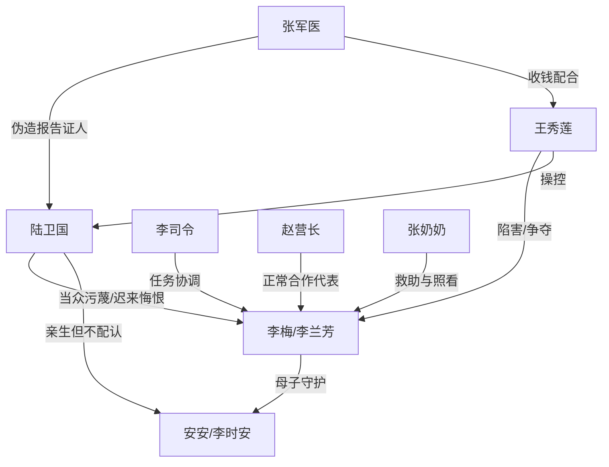

# 角色标签图谱

## 角色清单

### 李梅 / 李兰芳 — 清醒复仇母亲
- 叙事功能: 受害者、反杀设局者、道德坐标中心。
- 核心标签: 隐忍、技术强者、母性护犊。
- 弧光: 被当众污蔑的孕妻 → 深蓝技术总工 → 不原谅但放下的胜者。
- 台词风格: 平静短句，关键时刻冷硬截断。
- 关键行为: 撕碎随军申请、护住安安、要求换代表、准备证据链、拒绝复合。
- 读者情绪关系: 心疼、站队、爽。

### 陆卫国 — 自毁型军官丈夫
- 叙事功能: 原罪制造者、悔恨承担者、温度反转承载者。
- 核心标签: 自负、偏听、迟来悔恨。
- 弧光: 体面军官 → 伪造报告的施害者 → 失去儿子与生育能力的悔恨者。
- 台词风格: 命令式、威胁式，后期恳求式。
- 关键行为: 当众否认孩子、保护王秀莲、威胁母子、求弥补、海上救人。
- 读者情绪关系: 恨、鄙夷、看他悔恨的爽。

### 安安 / 李时安 — 天才儿子与反杀继承人
- 叙事功能: 被污名化的孩子、亲子真相载体、证据执行人。
- 核心标签: 聪明、冷静、护母。
- 弧光: 被威胁政审的孩子 → 公开投影证据者 → 斩断父子关系者。
- 台词风格: 孩子式直接 + 成年式冷讽。
- 关键行为: 拒绝合作邀请、递交证据信封、录下关键对话、支持母亲救人但不联系。
- 读者情绪关系: 心疼、骄傲、爽。

### 王秀莲 — 烈士遗孤绿茶
- 叙事功能: 第三者、伪弱者、阴谋发起者。
- 核心标签: 伪善、操控、贪婪。
- 弧光: 被军官保护的“烈士妹妹” → 伪造报告与借贷暴露 → 入狱加刑。
- 台词风格: 柔弱劝说，句句藏刀。
- 关键行为: 买通军医、写信自曝阴谋、威胁孩子政审、借高利贷。
- 读者情绪关系: 恨、等报应。

### 张军医 — 证据引爆人
- 叙事功能: 伪造报告链条的证人。
- 核心标签: 贪财、懦弱、认罪。
- 弧光: 收钱改报告 → 影像认罪。
- 台词风格: 发颤、认罪式。
- 关键行为: 承认陆卫国未伤到生殖系统，提供真相。
- 读者情绪关系: 厌恶，但服务爽点。

### 李司令 / 赵营长 / 张奶奶 — 秩序与新生活支撑
- 叙事功能: 公权力协调、正常男性对照、民间救助者。
- 核心标签: 秩序、正直、温情。
- 弧光: 从任务推进者到女主边界的见证者。
- 台词风格: 稳重、公事公办。
- 关键行为: 重新安排合作代表、完成打捞任务、照顾安安。
- 读者情绪关系: 缓冲、安心。

## 关系网络

## 角色功能对照表（供改编参考）

| 原角色 | 极致标签 | 叙事功能 | 读者情绪功能 | 改编时必须保留的 |
|--------|---------|---------|-------------|---------------|
| 李梅 | 清醒复仇母亲 | 反杀主体 | 心疼与爽 | 不原谅、不复合、以孩子为边界 |
| 陆卫国 | 自毁型丈夫 | 原罪与悔恨 | 恨与看报应 | 当众否认孩子，后期无资格弥补 |
| 安安 | 天才护母儿子 | 第二执行人 | 心疼与痛快 | 冷句回旋、录音/证据执行 |
| 王秀莲 | 伪弱绿茶 | 挑拨与陷害 | 强恨点 | 柔弱外壳、实质犯罪证据 |
| 张军医 | 关键证人 | 证据链引爆 | 反杀可信度 | 能证明原罪伪造 |
