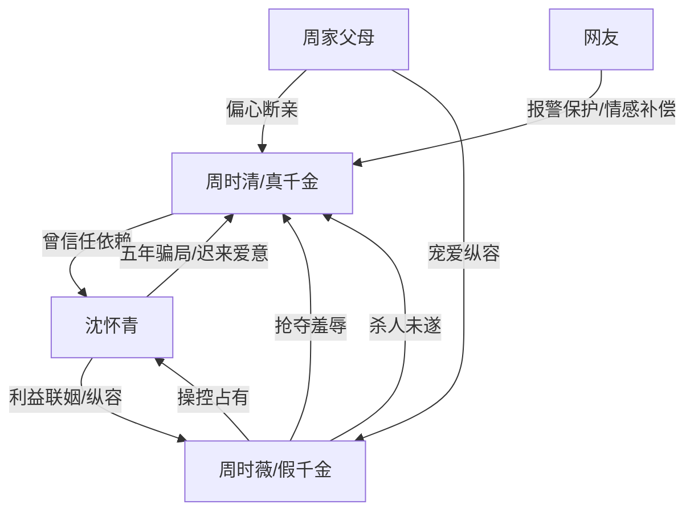

# 角色标签图谱

## 角色清单

### 周时清 — 被夺人生的清醒真千金

- 叙事功能: 受害者、情绪承载者、最终自救者
- 核心标签: 缺爱、隐忍、清醒重生
- 弧光: 相信被爱 → 被骗局击碎 → 拒绝补偿 → 自我拯救
- 台词风格: 轻、少、克制，崩溃时短句质问
- 关键行为: 攒三十万买房、直播讲述遭遇、拒绝别墅与道歉、换城生活
- 读者情绪关系: 心疼、代入、最后获得爽感和安慰

### 沈怀青 — 迟来悔悟的豪门男友

- 叙事功能: 施害者之一、温度反转对象、火葬场承载者
- 核心标签: 利益优先、伪装深情、悔疯
- 弧光: 设局欺骗 → 不自知动心 → 火场救人 → 失去资格
- 台词风格: 前期温柔哄骗，后期低声求饶
- 关键行为: 转走三十万、配合周时薇骗局、买礼物锁起、冲进火场救人
- 读者情绪关系: 恨、复杂、拒绝他被洗白

### 周时薇 — 恶毒假千金/大小姐施害者

- 叙事功能: 主压迫源、嫉妒与阶层暴力化身
- 核心标签: 娇纵、恶毒、占有欲
- 弧光: 高高在上抢夺一切 → 失控杀人未遂 → 入狱
- 台词风格: 轻蔑羞辱、命令式、炫耀式
- 关键行为: 抢走家庭和男友、用蛋糕砸女主、踹门纵火阻救
- 读者情绪关系: 极致厌恶，期待法律清算

### 周家父母 — 迟来悔恨的失职亲人

- 叙事功能: 背景压迫源，补足真千金困境
- 核心标签: 偏心、势利、迟钝
- 弧光: 赶走亲女儿 → 事件发酵后悔不当初 → 被拒见
- 台词风格: 原文中少量出现，以结果呈现
- 关键行为: 十八岁赶走女主、断绝关系、事后求见
- 读者情绪关系: 恨其偏心，爽于被拒

### 网友/直播观众 — 公共见证者与温柔外部力量

- 叙事功能: 让救援合理化，让女主知道世界并非全恶
- 核心标签: 沉默保护、救援、见证
- 弧光: 被女主误以为冷漠 → 实际报警救援并保护隐私
- 台词风格: 温和、保护性
- 关键行为: 报警、发帖保护现实信息、祝生日快乐
- 读者情绪关系: 缓冲前半极虐，提供社会性补偿

## 关系网络

## 角色功能对照表（供改编参考）

| 原角色 | 极致标签 | 叙事功能 | 读者情绪功能 | 改编时必须保留的 |
|--------|---------|---------|-------------|---------------|
| 周时清 | 被夺人生的真千金 | 承压与自救 | 心疼、代入、解脱 | 拒绝迟来补偿，自我拯救 |
| 沈怀青 | 追妻火葬场男友 | 温度反转 | 恨与复杂爽 | 参与骗局的原罪不可洗 |
| 周时薇 | 恶毒假千金 | 压迫源 | 强恨点 | “想要/得到”的抢夺规则 |
| 周家父母 | 失职亲人 | 背景债务 | 伦理愤怒 | 迟来悔恨被拒绝 |
| 网友 | 公共见证者 | 外部救援 | 温暖补偿 | 保护女主而非消费苦难 |
