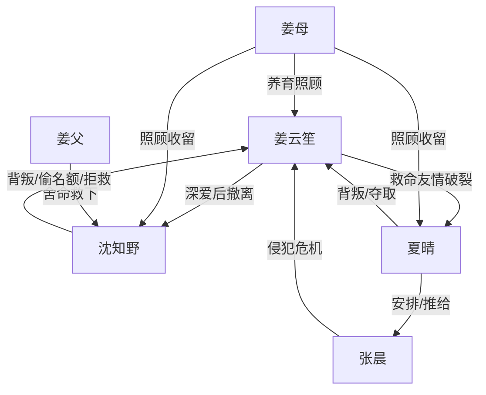

# 角色标签图谱

## 角色清单

### 姜云笙 — 清醒撤离型虐文女主
- 叙事功能: 承受背叛、累积情绪债、最终完成不原谅式自救。
- 核心标签: 重情、清醒、决绝
- 弧光: 全心信任 → 被连环背叛 → 丧母远走 → 学成归来 → 彻底不渡
- 台词风格: 前期质问，后期冷短句
- 关键行为: 发消息出国、守母亲、远走、夺回公司、拒绝沈知野
- 读者情绪关系: 心疼、代入、爽

### 沈知野 — 烂心追妻火葬场男主
- 叙事功能: 最大情绪债制造者，也是后半悔恨偿债容器。
- 核心标签: 自私、迟钝、追悔
- 弧光: 被救少年 → 背叛者 → 害死母亲的间接凶手 → 自毁疯癫
- 台词风格: 前期轻佻无所谓，后期破碎哀求
- 关键行为: 出轨、偷名额、拒接求救、报复夏晴、旧屋等待
- 读者情绪关系: 恨、厌、看其崩塌获得偿还感

### 夏晴 — 白眼狼闺蜜/伪小白花
- 叙事功能: 友情背叛与伦理恨点来源。
- 核心标签: 装弱、贪婪、背刺
- 弧光: 救命闺蜜 → 夺爱夺名额 → 间接害死干妈 → 被送回原命运
- 台词风格: 哭腔、卖惨、道德高位
- 关键行为: 与沈知野越界、戴戒指、介绍张晨、谎称脑震荡
- 读者情绪关系: 恨、恶心、期待报应

### 姜母 — 亲情债锚点
- 叙事功能: 将情感背叛升级成生命债。
- 核心标签: 养育、病弱、无辜
- 弧光: 苦撑病体 → 撞破背叛 → 抢救无效死亡
- 台词风格: 朴素、牵挂、愤怒
- 关键行为: 收养式照顾三人、临终前保护女儿
- 读者情绪关系: 心疼、愤怒

### 姜父 — 旧恩债源头
- 叙事功能: 证明沈知野欠姜家一条命。
- 核心标签: 救命恩人、牺牲、父爱
- 弧光: 已故但持续影响剧情
- 台词风格: 无直接台词
- 关键行为: 跳河救沈知野而死
- 读者情绪关系: 尊敬、替其不值

### 张晨 — 外部危险放大器
- 叙事功能: 将夏晴的恶意从语言推向身体危机。
- 核心标签: 油腻、猥琐、侵犯者
- 弧光: 暗恋者 → 加害者 → 被沈知野暴打
- 台词风格: 粘腻、病态
- 关键行为: 绑住女主侵犯未遂
- 读者情绪关系: 恐惧、恶心、恨

## 关系网络

## 角色功能对照表（供改编参考）

| 原角色 | 极致标签 | 叙事功能 | 读者情绪功能 | 改编时必须保留的 |
|--------|---------|---------|-------------|---------------|
| 姜云笙 | 清醒撤离女主 | 承债与自救 | 心疼、爽 | 不原谅、不复合 |
| 沈知野 | 烂心火葬场男 | 制债与偿债 | 恨、看崩塌 | 欠命旧恩、迟来追悔 |
| 夏晴 | 白眼狼闺蜜 | 友情背刺 | 恨、恶心 | 被救后反咬 |
| 姜母 | 生命债锚点 | 升级冲突 | 心疼、愤怒 | 因施害者错过救治 |
| 姜父 | 旧恩源头 | 道德坐标 | 让男主罪加一等 | 舍命救男主 |
| 张晨 | 身体危机工具人 | 外部暴力 | 恐惧 | 与闺蜜恶意相关 |
