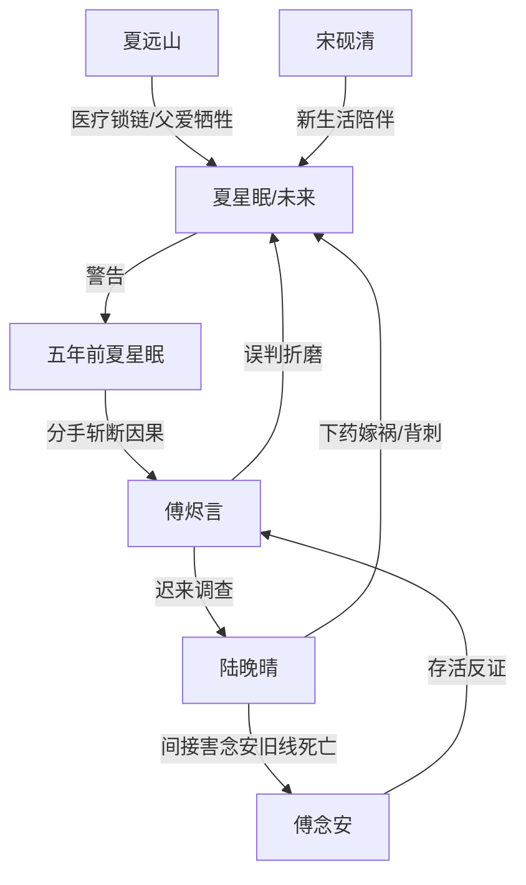

# 角色标签图谱

## 角色清单

### 夏星眠 — 清醒受害者/重生式自救大女主
- 叙事功能: 承载虐点、发出跨时空警告、完成因果斩断。
- 核心标签: 麻木、清醒、决绝
- 弧光: 被婚姻与父亲病情困住 → 父死触底 → 劝过去自己离开 → 新世界自由生活
- 台词风格: 短句、冷静、少解释
- 关键行为: 给过去的自己发出警告；提出离婚；拒绝傅烬言项目与证据；拉黑电话。
- 读者情绪关系: 心疼、替她憋屈、后期替她痛快。

### 五年前的夏星眠 — 鲜活旧我/改写命运的执行者
- 叙事功能: 接收未来证据，真正从源头改变因果。
- 核心标签: 天真、震碎、决绝
- 弧光: 相信青梅竹马爱情 → 看见未来地狱 → 主动分手
- 台词风格: 从质疑到一字一顿的果断
- 关键行为: 添加未来自己；看见出轨与废墟；答应“永远离开他”。
- 读者情绪关系: 期待她醒悟，爽点来自她真的离开。

### 傅烬言 — 傲慢施害者/迟来悔恨前夫
- 叙事功能: 制造前半压迫，承担后半悔恨清算。
- 核心标签: 误判、傲慢、悔疯
- 弧光: 掌控女主生死筹码 → 世界重写失控 → 查明真相 → 困在悔恨中腐烂
- 台词风格: 前半威胁轻蔑，后半嘶哑破碎
- 关键行为: 出轨报备、毁工作室、用父亲治疗威胁、用项目诱见、调查真相。
- 读者情绪关系: 前半恨，后半看他悔而不得产生爽感。

### 陆晚晴 — 绿茶闺蜜/真凶嫁祸者
- 叙事功能: 第三者羞辱女主，后期成为真相闭环的核心罪人。
- 核心标签: 背刺、挑衅、伪装
- 弧光: 闺蜜身份 → 情妇挑衅 → 旧时空真凶显影
- 台词风格: 娇笑、暗刺、道德挑衅
- 关键行为: 登堂入室；用怀孕刺激女主；旧时空下药嫁祸。
- 读者情绪关系: 恨点集中器，激发读者报应期待。

### 夏远山 — 温柔父亲/锁链与自由的双重象征
- 叙事功能: 解释女主无法离婚的现实枷锁，死亡触发女主最终脱身。
- 核心标签: 温柔、自责、牺牲
- 弧光: 被病困住 → 发现女儿受辱 → 拔管自杀释放女儿 → 新世界健康归来
- 台词风格: 朴素、心疼、克制
- 关键行为: 问女儿过得好不好；留下语音“你自由了”；新世界陪她生活。
- 读者情绪关系: 强心疼，父亲复活是最大补偿之一。

### 傅念安 — 误判死者/真相反证
- 叙事功能: 她的生死状态证明夏星眠并非罪魁祸首。
- 核心标签: 关键证人、因果锚点
- 弧光: 旧世界死亡 → 新世界存活 → 揭示陆晚晴线索
- 台词风格: 日常、轻松，强化“活着”的震撼
- 关键行为: 电话接通；说出前男友与陆晚晴在一起。
- 读者情绪关系: 她活着带来反转爽感，也放大傅烬言误判之罪。

### 宋砚清 — 踏实新生伴侣
- 叙事功能: 不是救赎者，而是女主新生活质量的证明。
- 核心标签: 专业、沉稳、温和
- 弧光: 工作合作对象 → 稳定陪伴者 → 春山生活的一部分
- 台词风格: 少废话、重专业、温和
- 关键行为: 分析图纸、陪父亲包粽子、给女主披外套。
- 读者情绪关系: 安心、补偿、替代旧爱。

## 关系网络

## 角色功能对照表（供改编参考）

| 原角色 | 极致标签 | 叙事功能 | 读者情绪功能 | 改编时必须保留的 |
|--------|---------|---------|-------------|---------------|
| 夏星眠 | 清醒受害女主 | 承受虐点并斩断因果 | 心疼→爽 | 不回头、不原谅、不拿男主资源 |
| 五年前夏星眠 | 命运改写者 | 执行源头分手 | 期待醒悟 | 必须亲眼看见未来证据 |
| 傅烬言 | 悔疯施害者 | 压迫与悔恨承载 | 恨→看报应 | 保留旧记忆但失去补偿资格 |
| 陆晚晴 | 绿茶真凶 | 羞辱与真相闭环 | 恨 | 闺蜜背刺+嫁祸核心不能删 |
| 夏远山 | 牺牲父亲 | 锁链与补偿 | 心疼 | “我不困住你了”的牺牲功能 |
| 傅念安 | 反证锚点 | 推翻男主复仇逻辑 | 反转爽 | 新世界存活证明女主无罪 |
| 宋砚清 | 踏实新伴侣 | 新生活稳定器 | 安心 | 不能喧宾夺主，重点是陪伴而非拯救 |
