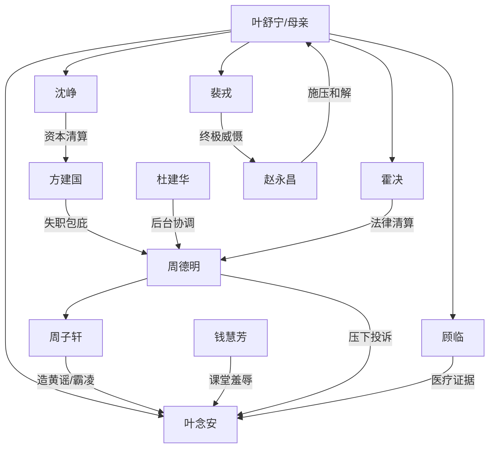

# 角色标签图谱

## 角色清单

### 叶舒宁/母亲 — 克制复仇型面馆妈妈
- 叙事功能: 受害者母亲、情绪锚点、四子资源的召唤者
- 核心标签: 单亲母亲、养育者、冷静索偿
- 弧光: 自责无知 → 克制追责 → 守住家庭定义
- 台词风格: 平直质问，少废话
- 关键行为: 打四通电话、拒绝和解、见证全校通报
- 读者情绪关系: 心疼、敬佩、代入

### 叶念安 — 被霸凌的命根子女儿
- 叙事功能: 情绪债核心、清算正当性来源
- 核心标签: 高三生、隐忍、怕添麻烦
- 弧光: 空洞求死 → 被保护 → 重新认同家庭
- 台词风格: 轻、短、压抑，后期恢复柔软
- 关键行为: 讲出真相、留下日记、出院后说“我的家人能写两万字”
- 读者情绪关系: 强心疼、保护欲

### 沈峥 — 资本压制型大哥
- 叙事功能: 第一层身份揭牌，击破“面馆弱势”误判
- 核心标签: 董事长、冷静、资源型保护者
- 弧光: 接电话归来 → 查资方 → 撤资与制度补偿
- 台词风格: 平、短、带命令感
- 关键行为: 查学校资金、堵校门、要求开除、设霸凌处理办公室
- 读者情绪关系: 爽、安全感

### 霍决 — 法律绞杀型二哥
- 叙事功能: 把情绪纠纷升级为刑事证据链
- 核心标签: 名律师、精准、程序压迫
- 弧光: 离庭赶回 → 取证曝光 → 刑事立案
- 台词风格: 条款化、冷静、一步封喉
- 关键行为: 拿录音、做材料、递交刑侦支队
- 读者情绪关系: 理性爽、信任

### 裴戎 — 隐秘权力型三哥
- 叙事功能: 终极威慑，压住更高层协调
- 核心标签: 沉默、危险、不可明说
- 弧光: 沉默守护 → 会客厅亮证 → 安抚念安
- 台词风格: 少字重压
- 关键行为: 亮证件夹、让赵委员退场、说“谁敢让你低头，我让他跪下”
- 读者情绪关系: 高级爽、神秘安全感

### 顾临 — 医疗证据型四哥
- 叙事功能: 固化伤害后果，补齐医学证明
- 核心标签: 神外医生、专业、温柔克制
- 弧光: 手术中赶回 → 转院会诊 → 陪伴恢复
- 台词风格: 职业平静，情绪藏在动作里
- 关键行为: 转院、出具 PTSD 诊断、照顾念安
- 读者情绪关系: 安心、温情

### 钱慧芳 — 师德失范型羞辱者
- 叙事功能: 主要恨点，制造“四个姓”羞辱
- 核心标签: 傲慢教师、刻薄、身份依赖
- 弧光: 当众羞辱 → 录音曝光 → 教师身份被剥夺
- 台词风格: 推诿、狡辩、轻慢
- 关键行为: 课堂辱骂念安和母亲
- 读者情绪关系: 恨、期待报应

### 周德明 — 包庇权力型年级主任
- 叙事功能: 制度压迫代表，回旋金句来源
- 核心标签: 护短、官僚、后台依赖
- 弧光: 果篮摆平 → 姐夫撑腰 → 被传唤切割
- 台词风格: 官腔、威胁、协调话术
- 关键行为: 压下投诉、威胁处分、求助杜建华
- 读者情绪关系: 恨、看其崩塌的爽

### 周子轩 — 被纵容的造谣者
- 叙事功能: 起因施害者，展示家庭权力纵容后果
- 核心标签: 被拒报复、黄谣制造者、怂
- 弧光: 横行校园 → 休学入档 → 低头道歉未果
- 台词风格: 嘻哈轻浮，后期失语
- 关键行为: 厕所墙写手机号、群聊造黄谣
- 读者情绪关系: 厌恶、报应期待

## 关系网络

## 角色功能对照表（供改编参考）

| 原角色 | 极致标签 | 叙事功能 | 读者情绪功能 | 改编时必须保留的 |
|--------|---------|---------|-------------|---------------|
| 叶舒宁 | 克制复仇母亲 | 召唤与见证清算 | 代入、心疼 | 普通表层身份+强养育史 |
| 叶念安 | 被逼吞药女儿 | 情绪债核心 | 心疼、保护欲 | “怕添麻烦”的隐忍 |
| 沈峥 | 资本大哥 | 第一层身份反转 | 初爽 | 资金/资源控制权 |
| 霍决 | 法律二哥 | 证据链清算 | 理性爽 | 录音、材料、法律定性 |
| 裴戎 | 神秘三哥 | 高层施压反制 | 终极爽 | 不明说但足够压制 |
| 顾临 | 医疗四哥 | 固化伤害 | 安心 | 专业诊断与康复关照 |
| 钱慧芳 | 恶师 | 主要羞辱源 | 恨 | “四个姓”羞辱原句 |
| 周德明 | 包庇主任 | 规则压迫源 | 恨、回旋爽 | “别上纲上线”原话 |
