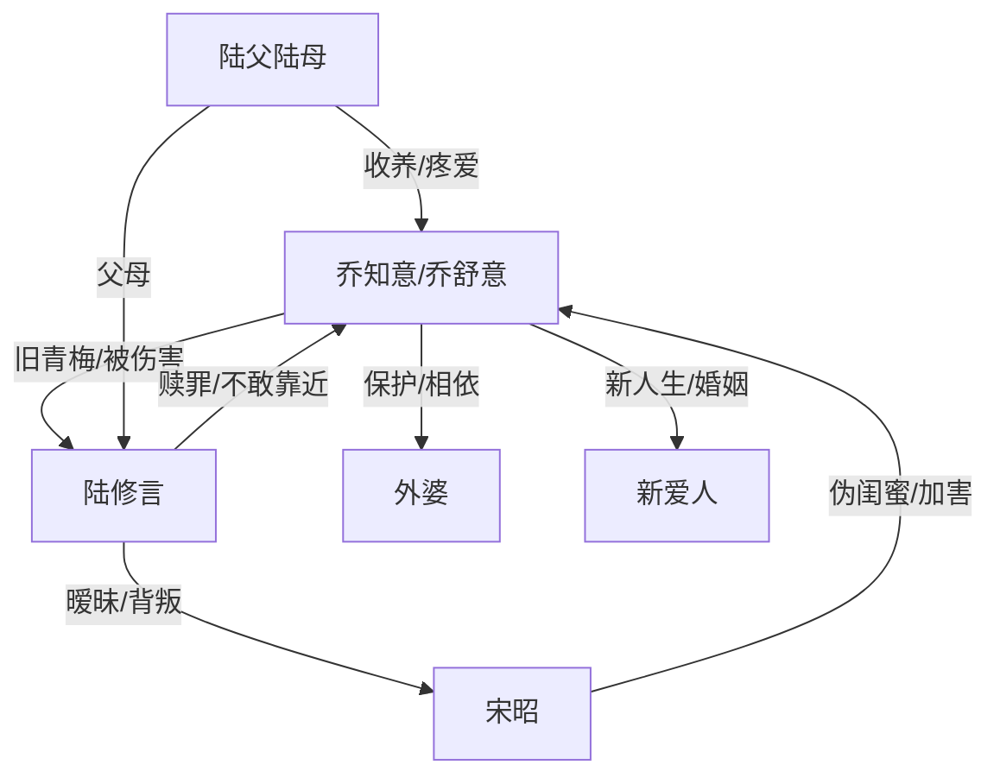

# 角色标签图谱

## 角色清单

### 乔知意 / 乔舒意 — 清醒逃离型虐文女主

- 叙事功能: 读者站队核心，承受未来伤害并提前改命。
- 核心标签: 清醒、克制、断舍离。
- 弧光: 依恋竹马 → 被未来真相击碎 → 带外婆出逃 → 获得事业爱情。
- 台词风格: 短句、平静、拒绝解释。
- 关键行为: 接收国外录取、带外婆离开、归还镯子、拒绝陆修言复合。
- 读者情绪关系: 心疼、代入、替她爽。

### 陆修言 — 迟来赎罪但不可原谅的竹马

- 叙事功能: 施害者、未来信息源、赎罪者。
- 核心标签: 软弱、自私、悔恨。
- 弧光: 被恩情束缚的少年 → 原时间线背叛者 → 未来自杀赎罪 → 现世沉默守望。
- 台词风格: 前期逃避、后期哽咽忏悔。
- 关键行为: 未来发帖刺激女主逃离，现世拒绝宋昭，四年寄药不相见。
- 读者情绪关系: 前期恨，后期复杂，但不能被原谅。

### 宋昭 — 伪直爽夺爱型闺蜜

- 叙事功能: 外部恶意与情感背叛实体化。
- 核心标签: 明媚伪装、占有欲、恶毒。
- 弧光: 直爽闺蜜表象 → 小三介入 → 谋害外婆和女主真相暴露 → 被清算。
- 台词风格: 大大咧咧表面，真相段尖毒。
- 关键行为: 给外婆看视频、下药制造精神病、未来害死女主。
- 读者情绪关系: 恨点集中承载者。

### 外婆 — 女主最后亲情锚点

- 叙事功能: 情绪债核心抵押物，女主逃离动机。
- 核心标签: 温柔、依靠、脆弱。
- 弧光: 原时间线被害死 → 新时间线被女主带走保护。
- 台词风格: 温和、信任女主。
- 关键行为: 答应跟女主出国。
- 读者情绪关系: 心疼、保护欲。

### 陆父陆母 — 善意养父母 / 旧关系缓冲层

- 叙事功能: 让女主离开不是彻底撕裂家庭伦理，也见证陆修言失去。
- 核心标签: 愧疚、温厚、开明。
- 弧光: 希望两人相守 → 接受乔知意离开 → 仍保留亲情。
- 台词风格: 家常、试探、关切。
- 关键行为: 支持出国，接纳女主新男友。
- 读者情绪关系: 缓冲痛感，提供温情补偿。

### 新男友 / 爱人 — 新人生证明

- 叙事功能: 证明女主不是空洞逃离，而是真正拥有未来。
- 核心标签: 稳定、缺席式可靠、新生活。
- 弧光: 被提及 → 成为结婚生子结局的一部分。
- 台词风格: 无直接台词。
- 关键行为: 作为乔知意新幸福的象征。
- 读者情绪关系: 补偿、安心。

## 关系网络

## 角色功能对照表（供改编参考）

| 原角色 | 极致标签 | 叙事功能 | 读者情绪功能 | 改编时必须保留的 |
|--------|---------|---------|-------------|---------------|
| 乔知意 | 清醒逃离女主 | 改命主体 | 心疼与爽感 | 不回头、不复合 |
| 陆修言 | 迟来赎罪竹马 | 施害+赎罪 | 恨与复杂 | 可悔但不可洗白 |
| 宋昭 | 伪直爽闺蜜 | 外部恶意 | 集中恨点 | 表面直爽、实则毒害 |
| 外婆 | 最后亲人 | 情绪债抵押 | 保护欲 | 必须被女主救下 |
| 陆父陆母 | 温情缓冲 | 旧家庭连接 | 缓和与补偿 | 支持女主离开 |
| 新爱人 | 新幸福证明 | 终局补偿 | 安心 | 不与旧爱竞争，只证明未来 |
