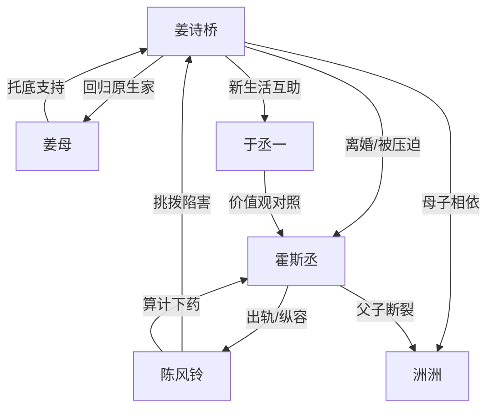

# 角色标签图谱

## 角色清单

### 姜诗桥 — 清醒离婚大女主
- 叙事功能: 承受压迫、完成断舍离、建立新生活秩序。
- 核心标签: 清醒、坚韧、母性保护。
- 弧光: 被出轨羞辱的霍太太 → 带子离开的单亲母亲 → 海岛咖啡馆主人。
- 台词风格: 前期克制反问，后期平静审判。
- 关键行为: 净身出户、拒绝下跪、带儿子急救、拿离婚证、回海岛、拒绝复合。
- 读者情绪关系: 心疼、代入、最终痛快。

### 霍斯丞 — 傲慢霸总/追妻火葬场男主
- 叙事功能: 施压者、情绪债制造者、后半悔恨承受者。
- 核心标签: 自大、控制欲、迟来的悔。
- 弧光: 笃定妻子离不开自己 → 用钱权封杀逼迫 → 发现被离婚拉黑 → 求而不得。
- 台词风格: 命令式、交易式、后期哀求式。
- 关键行为: 赶妻出门、纵容小三、封杀工作、胶水惩罚、寻找姜诗桥、转股份立遗嘱。
- 读者情绪关系: 前半恨，后半看他痛苦获得清算爽感。

### 陈风铃 — 绿茶小三/导火索
- 叙事功能: 外部诱因、挑衅工具、让男主傲慢显形。
- 核心标签: 张扬、算计、虚伪。
- 弧光: 登堂入室的准儿媳 → 陷害女主 → 被揭穿送回会所。
- 台词风格: 夹枪带棒、装委屈、挑衅。
- 关键行为: 改密码、占旧居、诬陷砸玻璃、推伤洲洲、胶水陷害、下药算计霍斯丞。
- 读者情绪关系: 厌恶，但最终不是主罪人。

### 洲洲 — 懂事儿子/情绪放大器
- 叙事功能: 放大母亲苦难，证明女主离开的正当性。
- 核心标签: 懂事、护母、受伤弱者。
- 弧光: 霍家独孙 → 被父亲忽视的孩子 → 坚定选择母亲。
- 台词风格: 稚嫩直接，情绪杀伤力强。
- 关键行为: 拒绝陈风铃、替母道歉、被推昏迷、要求跟妈妈走、咬霍斯丞保护妈妈。
- 读者情绪关系: 心疼、保护欲、对男主恨值倍增。

### 姜母 — 原生家的温暖锚点
- 叙事功能: 提供退路，证明女主不是无家可归。
- 核心标签: 包容、务实、托底。
- 弧光: 曾担心女儿嫁错 → 接女儿回家 → 支持创业。
- 台词风格: 温和、少责备、多行动。
- 关键行为: 接母子回家、拿出八百块、提供门面。
- 读者情绪关系: 安慰、修复。

### 于丞一 — 新生活秩序的对照男性
- 叙事功能: 对照霍斯丞，证明尊重比金钱更重要。
- 核心标签: 安静、才华、平等交换。
- 弧光: 咖啡馆常驻画画者 → 洲洲补课老师 → 让霍斯丞嫉妒的存在。
- 台词风格: 简短、淡漠。
- 关键行为: 用专属位置换补课，指出画是自己画的。
- 读者情绪关系: 安全感、价值观补强。

## 关系网络

## 角色功能对照表（供改编参考）

| 原角色 | 极致标签 | 叙事功能 | 读者情绪功能 | 改编时必须保留的 |
|--------|---------|---------|-------------|---------------|
| 姜诗桥 | 清醒离婚大女主 | 承压与断舍离 | 心疼、爽、尊重 | 不复合，不被钱收买 |
| 霍斯丞 | 傲慢霸总 | 制造情绪债并承受火葬场 | 恨、看报应 | “以为她会回来”这一核心误判 |
| 陈风铃 | 绿茶小三 | 激化冲突 | 厌恶 | 只是导火索，不是根因 |
| 洲洲 | 懂事护母儿子 | 放大痛感 | 心疼、保护欲 | 替母受辱与最终拒父 |
| 姜母 | 温暖退路 | 修复与托底 | 安慰 | 不责备，直接接回家 |
| 于丞一 | 尊重型男性 | 价值观对照 | 安全感 | 不强抢女主，只提供平等关系 |
