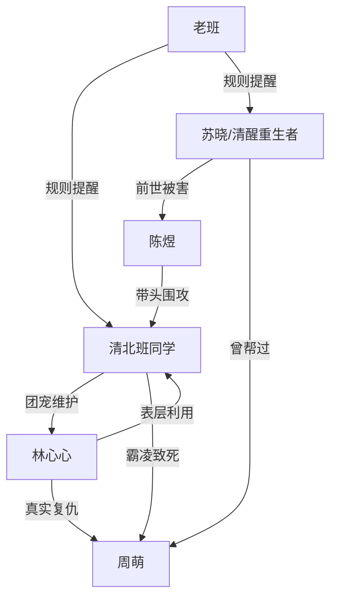

# 角色标签图谱

## 角色清单

### 苏晓 — 清醒重生做题家
- 叙事功能: 第一视角主角，承受前世与当世压迫，负责守住规则并见证反噬。
- 核心标签: 清醒、隐忍、规则感强
- 弧光: 前世出头救全班却被害 → 今生只救自己，拿回清北人生
- 台词风格: 短、冷、克制，关键时刻不解释
- 关键行为: 校准手表、不告状、不提醒、专注考试、删除陈煜短信
- 读者情绪关系: 心疼、代入、爽

### 林心心 — 宝宝病团宠/暗线复仇者
- 叙事功能: 表层反派与隐藏操盘者，制造调慢时钟事件，揭开周萌霸凌旧债。
- 核心标签: 装乖、操盘、复仇
- 弧光: “留住时间”的无害校花 → 故意让清北班坠落的复仇者
- 台词风格: 前期嗲、幼态；后期冷、癫、嘲讽
- 关键行为: 调慢挂钟、发动全班、给苏晓糖纸提醒、提交 U 盘
- 读者情绪关系: 前期厌恶，后期震惊与复杂认同

### 陈煜 — 疯批校草发小/傲慢舔狗
- 叙事功能: 主压迫者，负责把群体暴力推到最高，后期承担悔恨回旋。
- 核心标签: 暴躁、护短、傲慢
- 弧光: 高高在上的清北班核心 → 错失听力、档案受污、求复合被删
- 台词风格: 咆哮式、质问式、道德绑架
- 关键行为: 护林心心、扔资料、阻拦告状、带头调钟、错过听力
- 读者情绪关系: 恨、等报应、看崩塌

### 清北班同学 — 群体暴力共犯
- 叙事功能: 群体压迫场，放大女主孤立无援和后文集体清算。
- 核心标签: 从众、势利、傲慢
- 弧光: 自认天之骄子 → 集体错失名校
- 台词风格: 起哄、嘲讽、粗口、站队
- 关键行为: 辱骂苏晓、扔资料、调慢全校时钟、报警反咬
- 读者情绪关系: 厌恶、期待群体报应

### 老班 — 规则提示者
- 叙事功能: 提供听力三十分和考场纪律信息，埋下后文反噬依据。
- 核心标签: 负责、现实、无力
- 弧光: 尝试制止 → 被学生顶撞 → 规则后果由学生承担
- 台词风格: 教师训诫式，强调考试规则
- 关键行为: 提醒听力时间、要求恢复挂钟、警告后果自负
- 读者情绪关系: 认同、替她憋屈

### 周萌 — 隐形受害者
- 叙事功能: 林心心复仇动机来源，补足清北班被惩罚的道德理由。
- 核心标签: 被霸凌、差生、旧债
- 弧光: 生前被践踏 → 死后由林心心引爆复仇
- 台词风格: 无直接台词
- 关键行为: 曾被霸凌到跳楼
- 读者情绪关系: 心疼，强化清算正当性

## 关系网络

## 角色功能对照表（供改编参考）

| 原角色 | 极致标签 | 叙事功能 | 读者情绪功能 | 改编时必须保留的 |
|--------|---------|---------|-------------|---------------|
| 苏晓 | 清醒重生做题家 | 主角/见证者/规则守护者 | 代入、心疼、爽 | 不主动害人，只不再救恶人 |
| 林心心 | 宝宝病校花/暗线复仇者 | 诱发事件与身份反转 | 厌恶转震惊 | 表层无害与真实动机反差 |
| 陈煜 | 疯批发小舔狗 | 主压迫者 | 恨点与悔恨爽点 | 前期足够恶，后期必须求悔 |
| 清北班 | 群体暴力共犯 | 压迫环境 | 集体报应爽点 | 全员参与，不能只惩罚一人 |
| 老班 | 规则提示者 | 信息埋伏 | 合理性支撑 | 必须提供关键规则与后果提示 |
| 周萌 | 旧案受害者 | 道德底层债 | 心疼与正当性 | 旧债必须足够重 |
