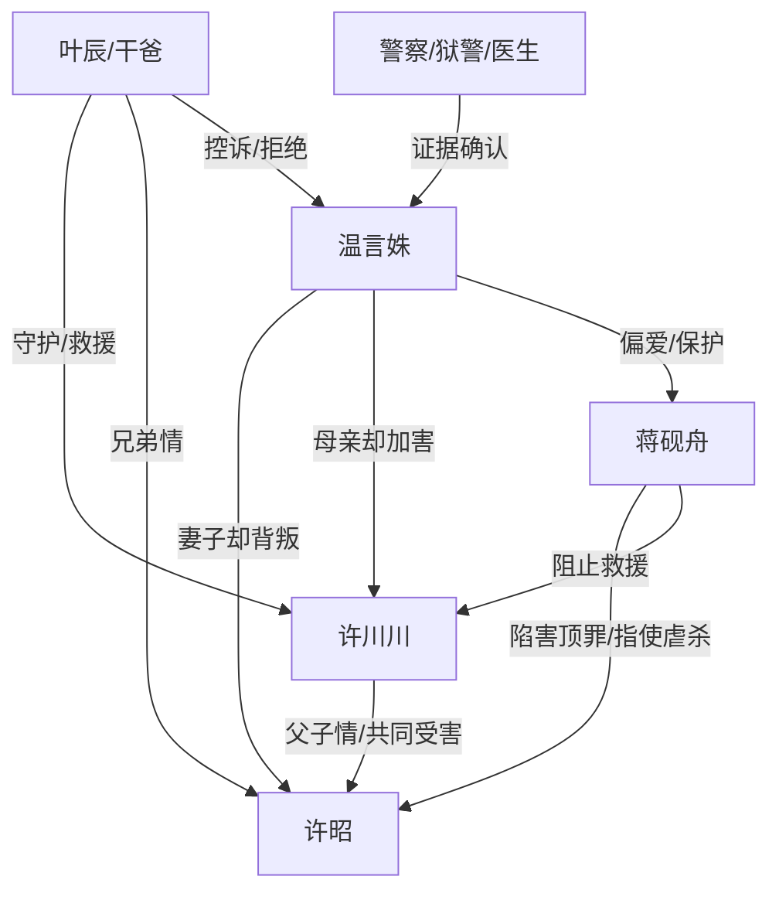

# 角色标签图谱

## 角色清单

### 许川川 — 高考前夕惨死的清醒受害者

- 叙事功能: 第一人称主角、受害核心、灵魂旁观者、道德坐标中心
- 核心标签: 高考生、被遗弃儿子、拒绝原谅
- 弧光: 求生求母亲相信 → 死亡旁观 → 冷漠拒绝来世弥补
- 台词风格: 哀求时破碎，旁观时冷静
- 关键行为: 在桑拿房求生、给干爸打电话、死亡后旁观真相
- 读者情绪关系: 心疼、愤怒、替他拒绝原谅而痛快

### 温言姝 — 恋爱脑偏执母亲/迟来悔疯者

- 叙事功能: 主要压迫者、误判制造者、最终悔恨承担者
- 核心标签: 偏听偏信、亲情背叛、迟来忏悔
- 弧光: 坚信父子作戏 → 冲走骨灰/害死儿子 → 真相击穿 → 清算白月光 → 自杀
- 台词风格: 命令式、否认式、后期崩溃忏悔
- 关键行为: 逼许昭二次顶罪、锁川川进桑拿房、冲走骨灰、拒接电话、清算蒋砚舟
- 读者情绪关系: 恨、厌恶、最后只允许她痛苦不允许被原谅

### 许昭 — 替罪惨死的父亲

- 叙事功能: 缺席受害者、情绪债源头、父子团圆终点
- 核心标签: 替罪丈夫、沉默父亲、惨死狱中
- 弧光: 曾为家庭顶罪 → 狱中被害 → 骨灰被辱 → 结尾接儿子离开
- 台词风格: 只在濒死幻听中出现，温柔求生式
- 关键行为: 替蒋砚舟顶罪、支撑川川三年希望、结尾接走川川
- 读者情绪关系: 心疼、惋惜、对温言姝和蒋砚舟的恨源

### 蒋砚舟 — 绿茶白月光/伪弱者真凶

- 叙事功能: 诱发母亲背叛的第三者、隐藏真凶、最终清算对象
- 核心标签: 装弱、恶毒、自导自演
- 弧光: 被温言姝保护的“受害者” → 阻止救人 → 诬辱骨灰 → 被查出害死许昭 → 入狱被折磨致死
- 台词风格: 怯懦、退让式绿茶话术
- 关键行为: 要许昭顶罪、阻止开门、诬称骨灰是脏东西、指使狱中害死许昭
- 读者情绪关系: 恨、恶心、期待报应

### 叶辰/干爸 — 义气守护者/外部见证人

- 叙事功能: 救援者、真相推进者、替读者表达愤怒的人
- 核心标签: 义气、暴怒、守灵人
- 弧光: 接到求救 → 闯温家 → 找到尸体 → 办葬礼 → 拒绝温言姝进灵堂
- 台词风格: 嘶吼、崩溃、直白骂醒
- 关键行为: 火化许昭、寻找川川、送医、查监控、守住灵堂边界
- 读者情绪关系: 安慰、代偿、替读者出手

### 保镖/警察/狱警/班主任/医生 — 现实证据链角色

- 叙事功能: 推进外部证据，逐步压垮温言姝否认
- 核心标签: 执行者、见证者、真相节点
- 弧光: 保镖助恶；警察因电话翻案；狱警确认死亡；班主任确认缺考；医生确认死讯
- 台词风格: 功能性、信息密集
- 关键行为: 封口、开门、翻案、宣布死亡
- 读者情绪关系: 保镖招恨；其余角色提供清算快感

## 关系网络

## 角色功能对照表（供改编参考）

| 原角色 | 极致标签 | 叙事功能 | 读者情绪功能 | 改编时必须保留的 |
|--------|---------|---------|-------------|---------------|
| 许川川 | 高考前夕惨死儿子 | 主角/受害者/灵魂视角 | 心疼与拒绝原谅 | 年轻前途、求生失败、死后旁观 |
| 温言姝 | 恋爱脑亲妈 | 主要加害者 | 恨点与悔恨爽点 | 坚决不信、亲手造成死亡、迟来忏悔 |
| 许昭 | 替罪惨死父亲 | 情绪债根源 | 心疼与家庭破碎感 | 曾顶罪、狱中惨死、骨灰受辱 |
| 蒋砚舟 | 绿茶白月光真凶 | 隐藏反派 | 报应期待 | 装弱、阻止救援、真凶反转 |
| 叶辰 | 义气干爸 | 外部救援/替读者发声 | 代偿与安慰 | 拼命救援、查证、拒绝进灵堂 |
