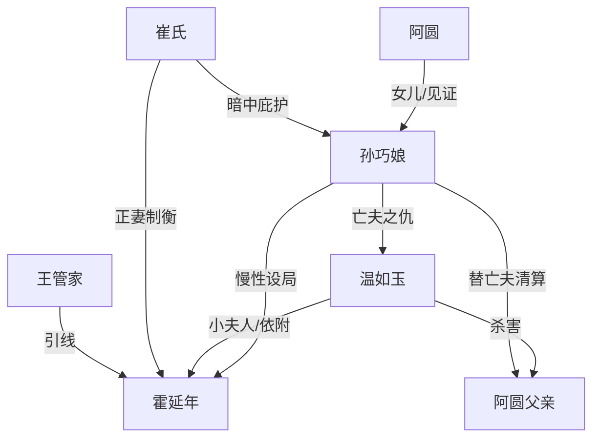

# 角色标签图谱

## 角色清单

### 阿圆 — 创伤见证者/复仇继承人

- 叙事功能: 第一人称视角，承载读者恐惧、心疼和最终释然。
- 核心标签: 丧父、隐忍、旁观成长。
- 弧光: 被吓到不敢哭的孩子 → 看懂母亲复仇的人 → 见证豆腐重回温暖的成年人。
- 台词风格: 少，常以疑问推动母亲解释。
- 关键行为: 失言喊出“爹”，触发身份危机；结尾理解母亲。
- 读者情绪关系: 心疼、代入、替她等报应。

### 孙巧娘/我娘 — 冷静复仇者/百味厨娘

- 叙事功能: 主谋、规则建立者、清算执行者。
- 核心标签: 忍狠、识人心、慢性设局。
- 弧光: 丈夫被害的寡妇 → 入京卖豆腐的局中人 → 让仇人吞下买命钱的审判者 → 把豆腐还给人间暖意的母亲。
- 台词风格: 短句、平静、反讽。
- 关键行为: 把三两银子扣入豆腐；用百味豆腐接近太傅府；长期投喂相克药粉；高潮揭露真相。
- 读者情绪关系: 爽、敬、心疼，也带一点道德寒意。

### 温如玉 — 权贵疯毒小夫人

- 叙事功能: 原始施害者，创伤源头，承担最终镜像报应。
- 核心标签: 残忍、骄纵、心虚疯魔。
- 弧光: 碾死豆腐匠取乐 → 反复逼害母女 → 仿做豆腐失败 → 被关地窖推空磨至死。
- 台词风格: 侮辱性强，常用命令句。
- 关键行为: 杀父；砸摊；石磨虐猫；灌哑药；诬告下毒。
- 读者情绪关系: 恨，期待她被石磨规则反噬。

### 霍延年 — 多疑权臣/被欲望反噬者

- 叙事功能: 权力核心，母亲复仇的真正入口和最终清算对象。
- 核心标签: 权倾朝野、多疑、空心。
- 弧光: 高位审视厨娘 → 被豆腐击中心魔 → 依赖母亲味道 → 病倒 → 吞下三两银子崩塌。
- 台词风格: 威压、交易、审问。
- 关键行为: 准许摆摊；收母女入府；偏信孙巧娘；关押温如玉；最终吃下银子。
- 读者情绪关系: 厌恶、等待他被自己的贪欲吞掉。

### 崔氏 — 清冷正妻/隐秘助攻者

- 叙事功能: 府内平衡力量，提供身份遮掩和道德旁证。
- 核心标签: 清醒、冷淡、厌恶血债。
- 弧光: 旁观太傅府罪孽 → 出手救母女 → 放任孽债自偿 → 遣散家仆收束旧府。
- 台词风格: 平静、冷讽、有分寸。
- 关键行为: 拿出盖印路引；点破温如玉苦水；结尾让府里清净。
- 读者情绪关系: 信任、轻微心疼、辅助爽感。

### 王管家 — 狗仗人势的试刀石

- 叙事功能: 展示百味豆腐能力，完成第一层爽点。
- 核心标签: 嚣张、势利、软肋明显。
- 弧光: 砸摊羞辱 → 吃豆腐跪哭 → 引太傅入局。
- 台词风格: 粗暴、威胁。
- 关键行为: 当街闹摊；吃出母亲包子味；将豆腐神异传入府内。
- 读者情绪关系: 前恨后爽，用来证明母亲有能力反杀。

## 关系网络

## 角色功能对照表（供改编参考）

| 原角色 | 极致标签 | 叙事功能 | 读者情绪功能 | 改编时必须保留的 |
|--------|---------|---------|-------------|---------------|
| 阿圆 | 创伤见证者 | 第一人称与情绪容器 | 心疼、代入 | 童年创伤、失言危机、成年理解 |
| 孙巧娘 | 冷静复仇厨娘 | 主谋与审判者 | 爽、敬、寒 | 用手艺/物件设局，最后回暖 |
| 温如玉 | 疯毒权贵女 | 原始恶源 | 恨 | 原句作恶、同构报应 |
| 霍延年 | 空心权臣 | 权力入口和终极猎物 | 等他崩塌 | 多疑但被欲望诱捕 |
| 崔氏 | 清冷正妻 | 府内助攻 | 松气、信任 | 不圣母，只因厌恶无辜被害而帮 |
| 王管家 | 狗腿试刀石 | 展示规则 | 小爽点 | 第一块豆腐必须击穿心魔 |
