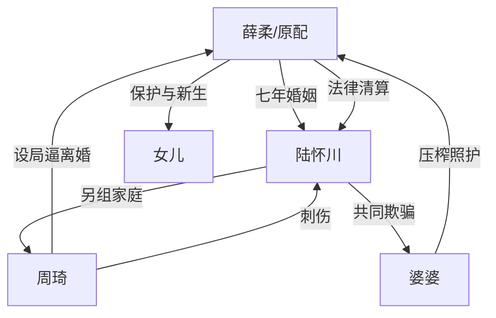

# 角色标签图谱

## 角色清单

### 薛柔 — 清醒原配/受压迫全职主妇
- 叙事功能: 受害者、调查者、清算者。
- 核心标签: 隐忍、清醒、决绝
- 弧光: 被蒙骗照护家庭 → 发现第二个家 → 法律清算并重启事业
- 台词风格: 前期试探，后期短句质问。
- 关键行为: 追随周琦进入第二个家；亮结婚证；收集证据；委托律师。
- 读者情绪关系: 心疼、代入、爽。

### 陆怀川 — 双面丈夫/精致利己背叛者
- 叙事功能: 核心施害者与情绪债源头。
- 核心标签: 贪心、虚伪、双标
- 弧光: 两头享受 → 被两个女人撕破 → 失财失爱失命
- 台词风格: 对周琦甜腻，对薛柔理性冷漠，对清算时卑微求饶。
- 关键行为: 另组家庭、转移财产、欺骗原配、污蔑前妻。
- 读者情绪关系: 恨、恶心、期待报应。

### 周琦 — 伪单纯孕小三/主动设局者
- 叙事功能: 真相引爆器与二次反转载体。
- 核心标签: 年轻、炫耀、心机
- 弧光: 甜美无辜 → 炫耀幸福 → 承认设局 → 刺伤陆怀川被捕
- 台词风格: 前期撒娇亲热，后期疯狂狠厉。
- 关键行为: 面馆故意搭话、邀请女主进家、公开承认设局、持刀伤人。
- 读者情绪关系: 前期疑惑，后期厌恶与震惊。

### 婆婆 — 共犯型恶婆婆/压榨者
- 叙事功能: 家庭伦理压迫的放大器。
- 核心标签: 刁难、贪婪、势利
- 弧光: 使唤女主 → 骗取十万 → 跪求原谅 → 养老院悔恨
- 台词风格: 命令式、道德绑架式、求饶式。
- 关键行为: 骗救命钱、伺候压榨、帮助儿子稳定小三。
- 读者情绪关系: 恨、期待反噬。

### 女儿 — 女主新生锚点
- 叙事功能: 道德正当性与未来希望。
- 核心标签: 幼小、无辜、依恋
- 弧光: 被旧家拖累 → 跟随母亲新生
- 台词风格: 天真短句。
- 关键行为: 牵手问去哪里，确认母女新生活。
- 读者情绪关系: 心疼、保护欲、补偿感。

## 关系网络

## 角色功能对照表（供改编参考）

| 原角色 | 极致标签 | 叙事功能 | 读者情绪功能 | 改编时必须保留的 |
|--------|---------|---------|-------------|---------------|
| 薛柔 | 清醒原配 | 受害与清算主体 | 代入、心疼、爽 | 前半忍耐有因，后半不回头 |
| 陆怀川 | 双面丈夫 | 主要施害者 | 恨与报应期待 | 对外温柔、对内压榨的双标 |
| 周琦 | 心机孕小三 | 反转引爆器 | 震惊、厌恶 | 假无辜到真设局的翻面 |
| 婆婆 | 共犯恶婆婆 | 情绪债累积器 | 恨、解气 | 骗钱与照护压榨 |
| 女儿 | 新生锚点 | 结尾补偿 | 温暖、释然 | 母女离开旧生活 |
