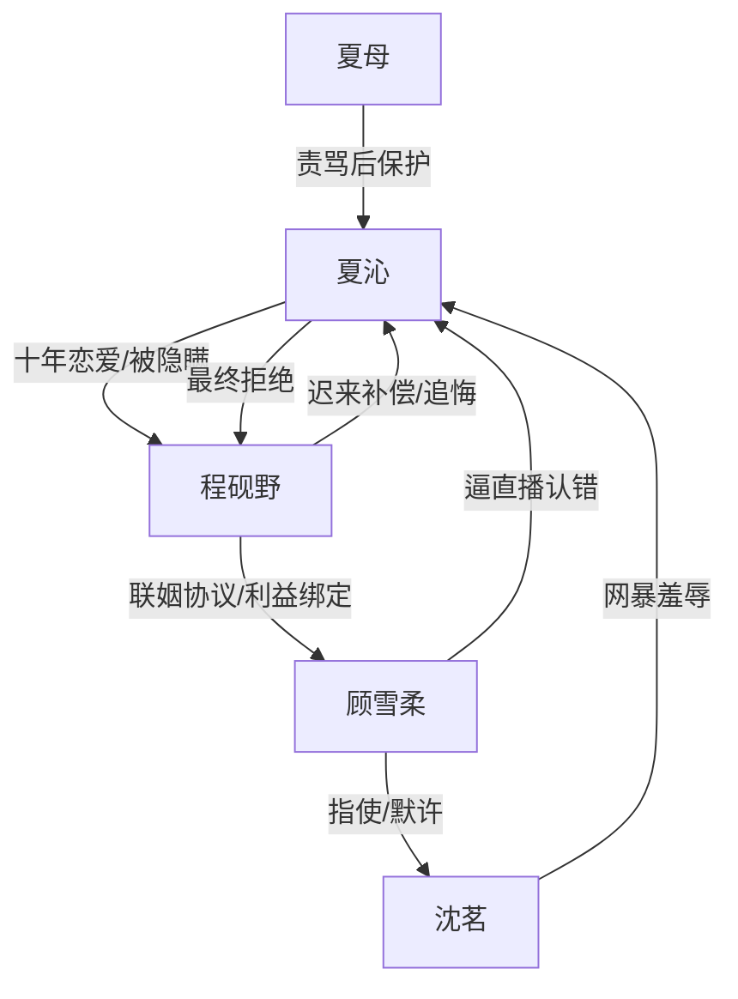

# 角色标签图谱

## 角色清单

### 夏沁 — 清醒撤离型受害者
- 叙事功能: 第一视角承压者、情绪债承载者、最终价值审判者。
- 核心标签: 十年奔赴、被权势碾压、清醒断联。
- 弧光: 相信爱情、主动求婚 → 被迫认罪、社会性死亡 → 北上重建、拒绝复合。
- 台词风格: 前期颤抖追问，后期冷静短句。
- 关键行为: 奔赴海城、拉黑离开、直播妥协救父、拒绝程砚野、北上生活。
- 读者情绪关系: 心疼、代入、希望她别回头。

### 程砚野 — 伪深情控制型霸总
- 叙事功能: 背叛源头、温度反转对象、追妻火葬场承担者。
- 核心标签: 隐婚总裁、自我感动、迟来悔恨。
- 弧光: 伪装普通职员享受无条件爱 → 用钱和身份安排女主 → 被断联后慌张追悔。
- 台词风格: 温柔包装控制，常把伤害说成“安排”。
- 关键行为: 隐瞒联姻六年、说女主是供应商、开价一百万、替顾雪柔开脱、追到北京。
- 读者情绪关系: 恨、厌、等他失去。

### 顾雪柔 — 端庄碾压型正妻
- 叙事功能: 权势压迫者、女主社会性死亡的执行核心。
- 核心标签: 怀孕正妻、体面恶意、规则制定者。
- 弧光: 温柔甜蜜展示婚姻 → 逼女主做固定情人 → 逼直播认错并羞辱。
- 台词风格: 礼貌、体面、句句带威胁。
- 关键行为: 加女主微信、约到别墅、支票协议、安排直播、默许磕头羞辱。
- 读者情绪关系: 恨、压迫感、期待被揭穿。

### 沈茗 — 恶毒执行者
- 叙事功能: 把顾雪柔的体面恶意落成暴力。
- 核心标签: 泼水者、偷拍视频者、羞辱执行者。
- 弧光: 机场泼水网暴 → 直播后台撒钱逼跪。
- 台词风格: 夸张、嘲笑、煽动围观。
- 关键行为: 泼水、拍视频、撒钱、嘲笑磕头。
- 读者情绪关系: 直接恨点。

### 夏母 — 亲情托底者
- 叙事功能: 后半情绪修复与现实代价放大器。
- 核心标签: 嘴硬心疼、护女、现实清醒。
- 弧光: 责问女儿 → 抱住女儿 → 愿意离乡搬家。
- 台词风格: 粗粝、直接、带母亲式疼痛。
- 关键行为: 质问、拥抱、挡住村人、提出搬家。
- 读者情绪关系: 心疼、安慰、补偿。

## 关系网络

## 角色功能对照表（供改编参考）

| 原角色 | 极致标签 | 叙事功能 | 读者情绪功能 | 改编时必须保留的 |
|--------|---------|---------|-------------|---------------|
| 夏沁 | 清醒撤离型受害者 | 承压与审判 | 心疼、代入、爽 | 不回头，不接受钱，不被复合收买 |
| 程砚野 | 伪深情控制型霸总 | 背叛与追悔 | 恨、看他失去 | 曾真温柔，但本质自私控制 |
| 顾雪柔 | 端庄碾压型正妻 | 权势压迫 | 憋屈、恨 | 礼貌外壳下的碾压 |
| 沈茗 | 恶毒执行者 | 暴力羞辱 | 直接怒点 | 公开视频/围观羞辱功能 |
| 夏母 | 亲情托底者 | 情绪修复 | 心疼、暖 | 先责后护的真实母亲感 |
