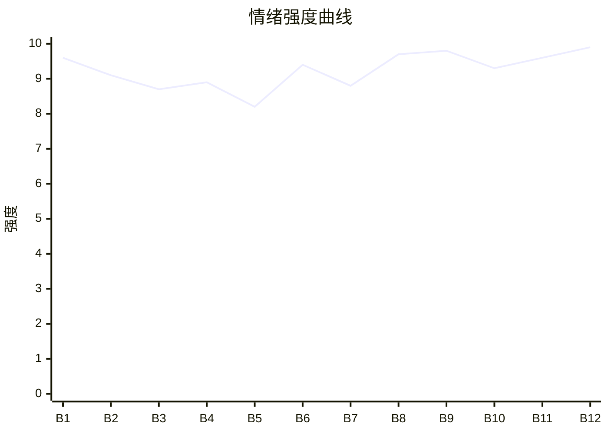

# Beat Sheet 节拍器

## 全文概况

- 总字数: 约 13200 字
- 节拍数: 12 幕
- 核心母题（Logline）: 被丈夫和父亲以“穿越攻略”骗局虐待三年的女主母女，死后以灵魂视角看他们否认真相，最终让所有施害者被真相、报应和拒绝和解反噬。
- 情绪模式: 极致打压 → 死亡剥离 → 被持续误解 → 真相婚礼爆破 → 太平间追悔 → 复刻惩罚 → 拒绝和解

## 节拍详表

### Beat 1: 穿越攻略骗局与献祭死亡 [开篇-契约生效]
- **字数**: 约 900 字（占比 6.8%）
- **核心事件**: 女主与母亲以为攻略失败，才发现疯批太子和暴君是丈夫与父亲演的，系统却真的剥离魂魄。
- **情绪标签**: 震惊、荒诞、绝望
- **情绪强度**: 9.6/10
- **情绪方向**: ⚡突变
- **冲突类型**: 大转折
- **悬念钩子**: 穿越是假，系统真，女主死后会看到什么？
- **叙事速度**: 快
- **对话占比**: 35%
- **reversal_mechanism**: [M4, M6]
- **hook_strength**: 9.3/10（极端度 3，信息密度 3，悬念 1.8，节奏 1.5）
- **关键句**: “可他们不知道，穿越是假，系统却是真的。”
- **原文摘录**: 我和妈妈一起穿越到古代。系统说，只要我们分别攻略疯批太子和暴躁皇帝，就能回家。太子打断我两根肋骨，将我丢在无数男人的身下。皇帝嫌妈妈跪得不够直，用铁钳夹碎她膝盖，逼她吞炭烫哑了嗓子。三年间，我们像两条狗活着。系统提示“攻略失败”时，站在我面前的太子突然笑了。他撕掉脸上的面具，露出我丈夫裴烬的脸。皇帝也扯掉胡子，满朝文武露出对讲机和短袖。父亲姜卫东说苦也吃了、罪也受了，就算扯平了。可他们不知道，穿越是假，系统却是真的。生命最后一刻，我和娘亲与系统定下契约，以魂魄为祭，只为换取他们一生富贵无忧。【契约生效，即将剥离魂魄。】

### Beat 2: 灵魂出窍，骗局全貌显影 [魂魄剥离-裴烬离开]
- **字数**: 约 950 字（占比 7.2%）
- **核心事件**: 女主灵魂旁观众人庆功，方盈盈装柔弱，裴烬认定尸体是在演戏并离开。
- **情绪标签**: 心寒、恶心、无力
- **情绪强度**: 9.1/10
- **情绪方向**: ↓下降
- **冲突类型**: 大转折
- **悬念钩子**: 女主已死但无人承认，真相何时被迫出现？
- **叙事速度**: 快
- **对话占比**: 45%
- **reversal_mechanism**: [M4, M5]
- **hook_strength**: null
- **关键句**: “这三年来所有的委屈、痛苦、折磨，从来都不是意外。”
- **原文摘录**: 下一秒，我感觉身体一轻，灵魂从身体里飘了出来。满朝文武笑作一团，夸裴总用情至深，为娶方小姐铺垫三年。姜卫东拍着裴烬肩膀说主意好。我才明白，这三年来所有委屈、痛苦、折磨，从来不是意外，而是裴烬和我爹特意给我们的惩罚。裴烬对我已无气息的身体不耐：“姜南音，还演？”姜卫东对娘亲温和地说惩罚结束了。方盈盈窜出来装懂事，裴烬立刻冷脸，说既然这么爱演，就让她们母女演个够。他转身离开，连一个眼神都没有分给我。

### Beat 3: 死者旁观新欢占位 [上车-尸体被发现前]
- **字数**: 约 1100 字（占比 8.3%）
- **核心事件**: 女主无法随母亲离开，只能跟着裴烬，看见方盈盈坐上“老婆专座”，裴烬笃定她会回家认错。
- **情绪标签**: 被替代、心痛、死寂
- **情绪强度**: 8.7/10
- **情绪方向**: ↓下降
- **冲突类型**: 微冲突
- **悬念钩子**: 尸体还跪在大殿，何时被发现？
- **叙事速度**: 中
- **对话占比**: 38%
- **reversal_mechanism**: [M4, M5]
- **hook_strength**: null
- **关键句**: “裴烬，我这辈子，都回不了家了。”
- **原文摘录**: 系统架起娘亲魂魄准备离开，却说我执念太深，时辰未到。我只能孤零零跟在裴烬身旁。车上副驾驶贴着“老婆专座”，曾经裴烬发誓除了我不会让任何女人坐，如今方盈盈熟练靠在他身上。她假惺惺问我们会不会不好，裴烬说南音和她妈又不是小孩子，之前就是太好了，才无法无天。他嗤笑我是在欲擒故纵，说用不了几天，我会乖乖回家服软认错。我飘在后座，说：“裴烬，我这辈子，都回不了家了。”古城散场后，无人记得我和娘亲尸体还跪在大殿。

### Beat 4: 警方发现尸体，第一次通知被嘲讽 [尸臭-挂断警方电话]
- **字数**: 约 1050 字（占比 8.0%）
- **核心事件**: 保安发现尸体，警察联系裴烬，他正在陪方盈盈试婚纱并认定电话是女主演戏。
- **情绪标签**: 荒唐、憋屈、愤怒
- **情绪强度**: 8.9/10
- **情绪方向**: ↑上升
- **冲突类型**: 大转折
- **悬念钩子**: 官方死亡通知都不信，下一次证据会如何升级？
- **叙事速度**: 快
- **对话占比**: 42%
- **reversal_mechanism**: [M4, M3]
- **hook_strength**: null
- **关键句**: “居然不惜诅咒自己的母亲死，有意思吗？”
- **原文摘录**: 几天后，腐臭味引来保安。警察赶来，从衣袋暗格里翻出刻着“姜南音”的木牌，照号码拨通裴烬电话。电话那头，方盈盈试穿婚纱，裴烬满眼宠溺。警察说妻子姜南音和岳母夏桂英被发现尸体，裴烬嗤笑：“姜南音还真是下血本，花了多少钱请你演这场戏？居然不惜诅咒自己的母亲死，有意思吗？”他挂断电话。方盈盈说婚礼算了吧，姜卫东说桂英刚刷亲属卡吃饭，方盈盈拿出 AI 伪造的海边朋友圈，他们全信了。

### Beat 5: 殡仪馆通知与“回归正常家庭”幻觉 [殡仪馆电话-一周无消息]
- **字数**: 约 850 字（占比 6.4%）
- **核心事件**: 殡仪馆要求签字，姜卫东怒斥诈骗；裴烬短暂动摇后选择继续婚礼。
- **情绪标签**: 死心、讽刺、窒息
- **情绪强度**: 8.2/10
- **情绪方向**: →平稳高压
- **冲突类型**: 微冲突
- **悬念钩子**: 裴烬开始烦躁，压抑不安会被什么点燃？
- **叙事速度**: 中
- **对话占比**: 40%
- **reversal_mechanism**: [M5, M3]
- **hook_strength**: null
- **关键句**: “只要完成这场婚礼，我们就回归正常家庭。”
- **原文摘录**: 第二天，殡仪馆电话打到姜卫东手机上，说遗体火化需要签字。姜卫东大吼诈骗电话都敢打到他头上。裴烬端咖啡杯的手顿了一下，问要不要去看看。姜卫东说这是母女俩逼他们低头，想都别想。裴烬沉默后点头：“也是，只要完成这场婚礼，我们就回归正常家庭。”我飘在他们身边，心底只剩死寂。原来在他们眼里，我的委屈与难过，从来都不值一提。

### Beat 6: 旧爱物被毁，情绪债加码 [裴烬问管家-毁长命锁]
- **字数**: 约 1550 字（占比 11.7%）
- **核心事件**: 裴烬因女主不回家焦躁，划破旧画像，踩碎婚戒、玉佩、长命锁。
- **情绪标签**: 崩溃、心碎、恨意
- **情绪强度**: 9.4/10
- **情绪方向**: ↑上升
- **冲突类型**: 大转折
- **悬念钩子**: 女主最后的念想被毁，婚礼真相爆点即将到来。
- **叙事速度**: 中
- **对话占比**: 30%
- **reversal_mechanism**: [M5]
- **hook_strength**: null
- **关键句**: “幸好人死了，心就感觉不到痛了。”
- **原文摘录**: 一周过去，裴烬没收到我任何消息，终于问管家我是否回家。他说给她打电话是痴心妄想，却看见墙上旧油画。那是他花半年为我画的，我站在金色花海里，他从身后拥着我，说画会比岁月更长久。他抓起水果刀划下去，我的手和笑脸被割成狰狞口子。方盈盈哭着冲进来，说我 AI 伪造她亲密照。裴烬给我发语音，限一小时回家道歉。时间到了，我不可能出现。他翻出木盒，踩碎婚戒，砸碎父亲给我的传家玉佩，掰断母亲跪三千级台阶求来的长命锁。我疯了般阻拦，手却一次次穿过。他发最后一条消息：“那你就永远别踏进这个门！”

### Beat 7: 婚礼盛景与警方入场 [婚礼筹备-警察拿照片]
- **字数**: 约 1250 字（占比 9.5%）
- **核心事件**: 盛大婚礼上，裴烬迟迟无法宣誓，警察进场询问家属，方盈盈继续构陷。
- **情绪标签**: 紧张、期待、爆破前夕
- **情绪强度**: 8.8/10
- **情绪方向**: ↑上升
- **冲突类型**: 大转折
- **悬念钩子**: 警方照片摆出，裴烬会信吗？
- **叙事速度**: 快
- **对话占比**: 48%
- **reversal_mechanism**: [M6, M3]
- **hook_strength**: null
- **关键句**: “请问二位，是姜南音与夏桂英的家属吗？”
- **原文摘录**: 半个月后，裴烬把精力投进婚礼筹备。婚礼当天，方盈盈穿婚纱，姜卫东坐父母席，方美珍像恩爱妻子。裴烬站台上，眼神飘向门口，安慰自己南音只是吃醋躲起来。司仪问他是否愿意娶方盈盈，无论健康疾病都守护她。裴烬迟迟没有应声。厚重大门被推开，警员走进来：“请问二位，是姜南音与夏桂英的家属吗？”方盈盈抢先说是不是南音姐和夏阿姨闯祸。姜卫东厌弃咒骂，裴烬说不保释，一切按法规处理。警察拿出照片，说两位早在半个月前已经去世。

### Beat 8: 死亡真相婚礼爆破 [照片被撕-方盈盈露馅]
- **字数**: 约 1200 字（占比 9.1%）
- **核心事件**: 裴烬撕照片后从碎片认出细节，警方揭穿 AI 消费与照片，方盈盈暴露。
- **情绪标签**: 爽感、迟来崩塌、荒诞
- **情绪强度**: 9.7/10
- **情绪方向**: ⚡突变
- **冲突类型**: 大转折
- **悬念钩子**: 他们终于相信，见到尸体会如何崩溃？
- **叙事速度**: 快
- **对话占比**: 45%
- **reversal_mechanism**: [M3, M6]
- **hook_strength**: null
- **关键句**: “一句话，彻底击碎了所有人的侥幸。”
- **原文摘录**: 裴烬偏执否认，抢过照片撕碎，说我为了闹砸婚礼煞费苦心。姜卫东大吼警察是骗子。警察亮证件，说明多人供口与他们多次否认死亡有关。碎纸落在裴烬脚边，他弯腰捡起，认出古城青石板，认出我身上的素色衣衫。姜卫东掏手机证明我妈还活着，说亲属卡刷过，海边度假。警察看着他，怜悯地说夏桂英手机早已遗失报废，消费记录、海边照片全部人为 P 图合成。一句话击碎侥幸。方盈盈脸色惨白，拉住裴烬辩解。裴烬看她：“你早就知道。”我漠然看着，迟来的反悔和愧疚，只剩恶心。

### Beat 9: 太平间认尸与男主追悔 [赶往太平间-查清三年]
- **字数**: 约 1450 字（占比 11.0%）
- **核心事件**: 裴烬和姜卫东见到尸体，医生说明长期非人折磨，裴烬记忆回潮并自扇耳光。
- **情绪标签**: 痛快、迟悔、悲凉
- **情绪强度**: 9.8/10
- **情绪方向**: ↑上升至峰值
- **冲突类型**: 大转折
- **悬念钩子**: 裴烬要查三年真相，方盈盈谎言将被全揭开。
- **叙事速度**: 中
- **对话占比**: 38%
- **reversal_mechanism**: [M5, M4]
- **hook_strength**: null
- **关键句**: “裴烬，你真是个畜生。”
- **原文摘录**: 裴烬扯掉新郎胸花，疯了一样冲往太平间，姜卫东踉跄跟上。两张病床盖着白布，两人颤抖掀开。娘亲面色灰败，姜卫东倒下。裴烬死死看着我的脸，摸过冰凉脸颊，低声说：“南音，别闹了。”他一遍遍喊我起来，说恨他怨他都可以。医生说我身上有多处新旧伤痕，下半身大面积溃烂。裴烬想起自己作为太子把我送入陌生男人手中，吩咐过不许伤她分毫。医生说那样暗无天日的折磨，我撑三年已是奇迹。他狠狠扇自己一巴掌：“裴烬，你真是个畜生。”随后打电话让助理查清这三年所有事。

### Beat 10: 文件砸脸，绿茶谎言坍塌 [方盈盈进太平间-裴烬说好]
- **字数**: 约 1150 字（占比 8.7%）
- **核心事件**: 578 页文件揭开虐待全貌与方盈盈从未怀孕、无癌症的真相，裴烬表面答应饶她。
- **情绪标签**: 清算、愤怒、期待报应
- **情绪强度**: 9.3/10
- **情绪方向**: ↑上升
- **冲突类型**: 大转折
- **悬念钩子**: 裴烬的“好”意味着怎样的报复？
- **叙事速度**: 快
- **对话占比**: 42%
- **reversal_mechanism**: [M6, M3]
- **hook_strength**: null
- **关键句**: “短短几分钟，所有虚假的伪装被彻底撕碎。”
- **原文摘录**: 方盈盈走进太平间，假装悲伤说南音姐怎么想不开，为什么不能再忍一忍。裴烬静静审视她。助理发来 578 页文件，记录我被囚禁、克扣吃食、言语羞辱、粗暴欺凌，也记录娘亲日日守护我。报告写明我和娘亲死于长期虐待，文件末尾附方盈盈身体检查报告：她从未有过妊娠痕迹，流产大出血、终身难孕是假；心肺脏器健康，没有癌变隐患。裴烬把文件展在她面前：“给我一个交代。”方盈盈跪地求饶，说只是太爱他。裴烬笑得冰冷残忍，只吐出一个字：“好。”

### Beat 11: 复刻古代牢笼，恶人重蹈旧苦 [方盈盈醒来-慎刑司]
- **字数**: 约 1600 字（占比 12.1%）
- **核心事件**: 方盈盈和方美珍被扔进复刻古代牢笼，按她们加害女主母女的方式受刑，方美珍护女而死，方盈盈被送慎刑司。
- **情绪标签**: 复仇爽、镜像报应、残酷
- **情绪强度**: 9.6/10
- **情绪方向**: ↑上升
- **冲突类型**: 大转折
- **悬念钩子**: 施害者被困“穿越”，会如何疯掉？
- **叙事速度**: 快
- **对话占比**: 50%
- **reversal_mechanism**: [M3, M6]
- **hook_strength**: null
- **关键句**: “这是裴烬的报复。”
- **原文摘录**: 方盈盈再睁眼，在破败潮湿的柴房。太监宣旨，说她身为太子侧妃，善妒下药谋害皇后，其母扰乱后宫，打入冷宫。她破口大骂不信穿越，侍卫长刀架上脖颈。她喊自己老公是裴氏总裁，没人理会。铁门落锁后，她终于想通：没有巧合，没有穿越，这是裴烬的报复，他亲手将她们扔进复刻的古代牢笼，让她们重蹈我受过的苦。第二日，裴烬穿龙袍出现。方盈盈求他带她出去，承认不该出计谋折磨南音。裴烬说她疯了，拖下去重打五十大板。方美珍扑上去护女，被木棍打到没了动静。方盈盈夺剑刺裴烬，被押去慎刑司严刑伺候。

### Beat 12: 追悔死亡与拒绝和解 [方盈盈疯-结尾]
- **字数**: 约 2150 字（占比 16.3%）
- **核心事件**: 方盈盈疯在牢笼，姜卫东死在墓前，裴烬自杀追魂，女主拒绝重逢并永久脱离世界。
- **情绪标签**: 解脱、冷感、终局惩罚
- **情绪强度**: 9.9/10
- **情绪方向**: ↓冷却后留白
- **冲突类型**: 大转折
- **悬念钩子**: 无，终局闭环。
- **叙事速度**: 慢
- **对话占比**: 28%
- **reversal_mechanism**: [M5, M8, M3]
- **hook_strength**: null
- **关键句**: “这世间最残忍的惩罚，从不是死亡。”
- **原文摘录**: 方盈盈入慎刑司后彻底疯了，被铁链锁在阴暗墙角，反复念叨“我穿越了……我要回现代……”，每次沉溺幻想，宫人就用冰水浇醒她。清醒、疯癫、冰水、折磨，日复一日。姜卫东抢救后不吃不喝，去墓园坐在娘亲墓碑旁一夜，天亮时已没了气息。裴烬处理后事，捐出财富，走进复刻古代宫殿，徒手在地砖上挖土坑，饮下鸠酒，说“南音，对不起，我来陪你了。”白雾里，他魂魄朝我奔来。我侧身避开，平淡说：“裴烬，我不想再和你有任何关系了，就这样吧。”系统提示献祭完成，魂魄彻底消融，永久脱离本世界。裴烬伸出的手空空落落，崩溃大哭。这世间最残忍的惩罚，从不是死亡。我受尽苦，总算解脱。他却一辈子欠着债、带着愧疚，孤零零陷在里面。从此，清风不问过往。你我，生生不见。

## 情绪曲线可视化

## 节拍密度检测

- 平均每 1100 字一个节拍
- 微冲突密度: 每 900 字一次
- 大转折密度: 每 1400 字一次
- 判定: 符合高频节拍器标准；后半每 1000-1500 字都有证据升级或报应升级。

## 反转机制清单(Reversal Mechanisms)

| 机制 ID | 机制名 | 承载 Beat | 关键段落/金句 | 等价改编提示 |
|--------|--------|-----------|--------------|-------------|
| M4 | 灵魂线视角 | Beat 1-12 | “灵魂从身体里飘了出来”“我只能孤零零地跟在裴烬身旁” | 死亡必须前置，死者只观看不行动，保留死者专属信息差。 |
| M5 | 温度反转曲线 | Beat 3,6,9,12 | “这幅画会陪着我们，比岁月更长久”“南音，别闹了” | 必须显式呈现曾经的爱，再写归零与负值追悔。 |
| M3 | 因果回旋反讽 | Beat 4,8,11,12 | 他们说女主“演”，最后方盈盈被困进“穿越戏”；裴烬追来却被拒 | 施害者规则要被原样反身应用，回敬句式和镜像动作必须具体。 |
| M6 | 多层递进反转 | Beat 1,7,8,10,11 | 穿越假→系统真→死亡真→方盈盈全假→复刻牢笼真报应 | 反转层数不能少，每层量级递增，情节、真相、权力、价值依次升级。 |
