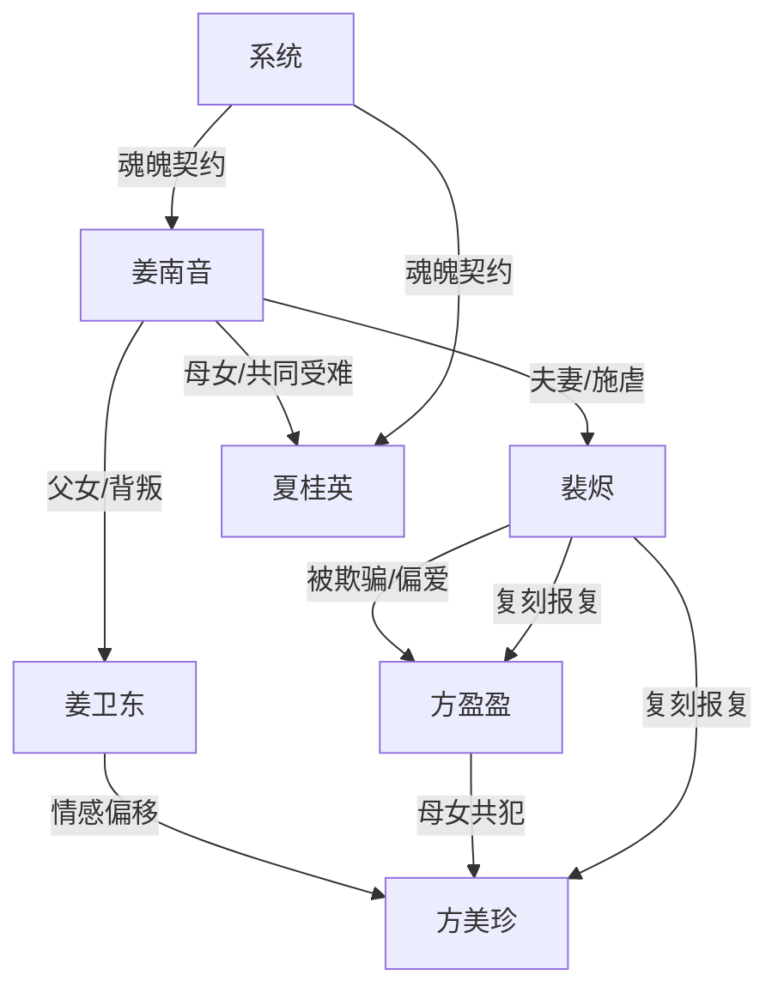

# 角色标签图谱

## 角色清单

### 姜南音 — 清醒亡魂/被献祭女主
- 叙事功能: 第一人称旁观者与情绪锚点，承受压迫并拒绝和解。
- 核心标签: 被虐、清醒、断情
- 弧光: 以为攻略失败 → 发现被至亲设局 → 死后旁观追悔 → 永久脱离
- 台词风格: 极少，结尾平静决绝。
- 关键行为: 与系统献祭魂魄；死后见证真相；最终拒绝裴烬。
- 读者情绪关系: 心疼、代入、替她痛恨施害者，结尾因她拒绝而获得解脱爽。

### 夏桂英/娘亲 — 苦难母亲/护女者
- 叙事功能: 亲情痛点与双倍情绪债来源。
- 核心标签: 护女、受虐、沉默
- 弧光: 与女儿共同攻略 → 被折磨致死 → 墓碑旁引发姜卫东殉悔
- 台词风格: 温柔祝福型，集中在长命锁回忆。
- 关键行为: 为女儿跪三千级台阶求平安锁；魂魄先被系统带走。
- 读者情绪关系: 心疼、催泪，放大家庭伦理恨点。

### 裴烬 — 疯批施害者/迟悔丈夫
- 叙事功能: 主压迫者、温度反转核心、追悔爽点承载者。
- 核心标签: 傲慢、误判、悔疯
- 弧光: 设计骗局折磨妻子 → 否认死亡 → 见尸崩塌 → 复仇方盈盈 → 自杀追魂被拒
- 台词风格: 前期刻薄不屑，后期破碎哀求。
- 关键行为: 设局三年；毁掉女主珍物；婚礼上被警方打脸；复刻古代牢笼；饮鸠自尽。
- 读者情绪关系: 前期恨，后期看他痛苦偿债，不能洗白。

### 姜卫东 — 愧悔父亲/失格家长
- 叙事功能: 家庭背叛线压迫者，与母亲墓前赎罪形成副线清算。
- 核心标签: 偏听、冷酷、迟悔
- 弧光: 用“扯平”合理化虐待 → 否认妻女死亡 → 认尸崩溃 → 墓前死去
- 台词风格: 父权式笃定、暴躁否认。
- 关键行为: 配合扮暴君；相信方美珍母女；拒绝签字；墓园殉悔。
- 读者情绪关系: 恨其失格，结尾殉悔只能部分偿债。

### 方盈盈 — 绿茶骗子/报应承载体
- 叙事功能: 挑拨者、谎言源头、镜像报应对象。
- 核心标签: 装病、装弱、恶毒
- 弧光: 伪造流产癌症骗爱 → 婚礼翻车 → 被丢入复刻冷宫 → 慎刑司疯掉
- 台词风格: 甜软、无辜、推责。
- 关键行为: AI 伪造照片；构陷女主；捏造流产和癌症；承认出计谋折磨女主。
- 读者情绪关系: 强恨点，报应越具体越爽。

### 方美珍 — 第三者母亲/共犯
- 叙事功能: 父亲背叛线的共犯，与方盈盈形成母女镜像。
- 核心标签: 插足、获利、共谋
- 弧光: 坐上父母席 → 被拖入冷宫 → 护女挨打身亡
- 台词风格: 原文少台词，靠位置和关系表达侵占。
- 关键行为: 与姜卫东亲昵参加婚礼；在复刻惩罚中护女而死。
- 读者情绪关系: 厌恶，报应对应夏桂英护女之痛。

### 系统 — 真契约/不可逆规则
- 叙事功能: 将“演戏”变成真实死亡与魂魄剥离，保证代价不可逆。
- 核心标签: 冷静、规则、终局
- 弧光: 提示攻略失败 → 剥离魂魄 → 判定执念未到 → 完成献祭
- 台词风格: 机械、平淡、无情绪。
- 关键行为: 剥离魂魄，阻止女主离开，最终让女主永久脱离世界。
- 读者情绪关系: 提供规则确定性，避免男主靠追悔逆转。

## 关系网络

## 角色功能对照表（供改编参考）

| 原角色 | 极致标签 | 叙事功能 | 读者情绪功能 | 改编时必须保留的 |
|--------|---------|---------|-------------|---------------|
| 姜南音 | 清醒亡魂 | 第一视角与拒绝和解 | 心疼、代入、解脱 | 死后旁观、无法行动、结尾断情 |
| 夏桂英 | 护女苦母 | 亲情债 | 催泪、加恨 | 为女儿付出生命级代价 |
| 裴烬 | 悔疯丈夫 | 追悔主轴 | 先恨后看偿债 | 误判、毁物、见尸、追魂被拒 |
| 姜卫东 | 失格父亲 | 家庭伦理背叛 | 恨与迟来忏悔 | 否认死亡、墓前赎罪 |
| 方盈盈 | 绿茶骗子 | 谎言源头 | 报应爽点 | 装病/伪造证据/被镜像惩罚 |
| 方美珍 | 第三者共犯 | 母女镜像 | 伦理恨点 | 与正牌母亲形成侵占对照 |
| 系统 | 冷规则 | 不可逆代价 | 终局保障 | 魂魄剥离与永久脱离 |
