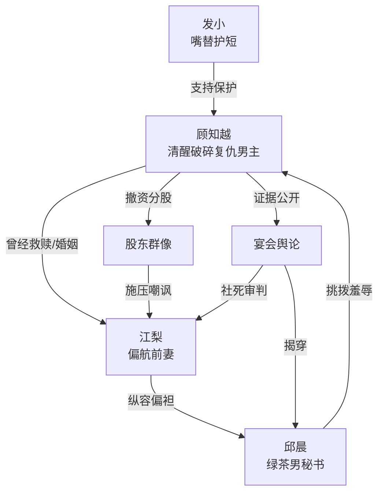

# 角色标签图谱

## 角色清单

### 顾知越 — 清醒破碎复仇男主
- 叙事功能: 受害者、情绪债承载者、最终清算者。
- 核心标签: 创伤幸存者、恋爱脑醒悟、资产型反击者。
- 弧光: 体面求离婚 → 被遗物和旧伤逼疯 → 撤资离婚 → 冷眼看悔恨。
- 台词风格: 短句、冷讽、爆发时重复喊名。
- 关键行为: 提离婚、暴打邱晨、撤资、分股、投放证据。
- 读者情绪关系: 前半心疼，遗物段痛快，后半爽与怅然并存。

### 江梨 — 迟来悔悟的偏航前妻
- 叙事功能: 主要情绪债制造者，也是后期悔恨偿还者。
- 核心标签: 商业新贵、自负偏袒、旧爱背誓。
- 弧光: 高位审判男主 → 被撤资逼签 → 被邱晨背叛 → 跪求无果 → 极端赎罪死亡。
- 台词风格: 命令式、质问式、后期崩溃忏悔。
- 关键行为: 捞人后指责、偏袒邱晨、泄露旧伤、签离婚、转账、行刺、自杀。
- 读者情绪关系: 前半恨，后半看她痛才爽，结尾带一点残酷余味。

### 邱晨 — 绿茶男秘书/寄生小三
- 叙事功能: 外部挑拨者、压迫触发器、江梨背叛的具象载体。
- 核心标签: 嘤嘤怪、装弱、投机背刺。
- 弧光: 装可怜插足 → 侵占家庭空间 → 暴露恶毒嘴脸 → 小人得志 → 被公开处刑。
- 台词风格: 自责式绿茶，后期撕破脸尖酸。
- 关键行为: 闯卧室、朋友圈炫耀、摔碎遗物、羞辱旧伤、勾结对手公司。
- 读者情绪关系: 纯恨点，承担被打脸和被清算的爽点。

### 发小 — 嘴替护短型亲友
- 叙事功能: 读者弹幕、情绪缓冲、行动支持。
- 核心标签: 粗口嘴替、无条件站队、行动派。
- 弧光: 接住崩溃男主 → 陪搬家 → 陪律所 → 陪离城。
- 台词风格: 粗口密集、吐槽尖锐、喜剧化。
- 关键行为: 收留男主、痛骂江梨、联系律师、陪伴离开。
- 读者情绪关系: 爽，提供安全感和代骂快感。

### 股东/宴会宾客 — 舆论审判群像
- 叙事功能: 把私人羞辱转为公开羞辱，放大清算。
- 核心标签: 利益现实、吃瓜审判、墙倒众人推。
- 弧光: 董事会施压江梨 → 宴会围观江梨丢脸。
- 台词风格: 群体吐槽、势利、直白。
- 关键行为: 逼江梨处理家事，围观证据包。
- 读者情绪关系: 放大爽点，让反派社死。

## 关系网络

## 角色功能对照表（供改编参考）

| 原角色 | 极致标签 | 叙事功能 | 读者情绪功能 | 改编时必须保留的 |
|--------|---------|---------|-------------|---------------|
| 顾知越 | 清醒破碎复仇男主 | 受害与清算双核心 | 心疼、代入、爽 | 创伤旧债、冷静撤离、资产反击 |
| 江梨 | 迟来悔悟前妻 | 压迫源与悔恨源 | 恨后看悔 | 曾经真爱、后期跪求、不可复合 |
| 邱晨 | 绿茶寄生者 | 挑拨和显性恨点 | 想看被打脸 | 装弱、自曝恶毒、背刺江梨 |
| 发小 | 嘴替护短亲友 | 情绪出口 | 爽、安心 | 粗口代骂、实际帮忙 |
| 股东/宾客 | 舆论审判 | 公开清算场 | 社死爽感 | 群体围观、现实利益施压 |
