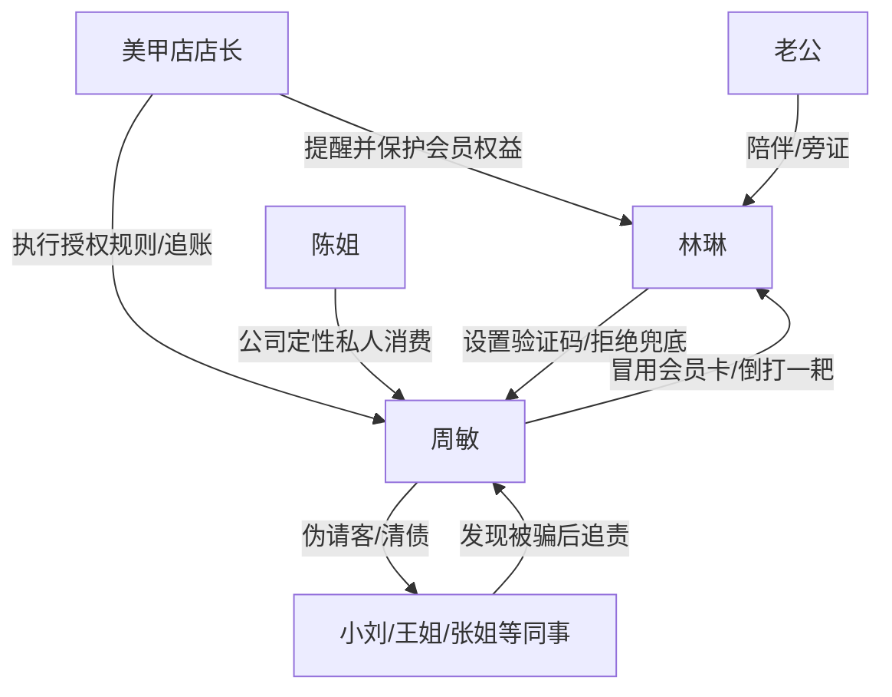

# 角色标签图谱

## 角色清单

### 林琳 — 冷静设防型孕期大女主
- 叙事功能: 第一人称视角与反杀执行者。
- 核心标签: 怀孕、谨慎、证据意识强。
- 弧光: 被惦记的不适 → 设置验证码 → 公开举证 → 清醒止损。
- 台词风格: 短句、反问、证据砸脸。
- 关键行为: 设置消费验证码；拒绝补付；展示群消息和借钱记录。
- 读者情绪关系: 心疼她被占便宜，爽她冷静反击。

### 周敏 — 占便宜型伪大方同事
- 叙事功能: 施害者与情绪债来源。
- 核心标签: 哭穷、爱面子、长期透支信任。
- 弧光: 装大方 → 撞上验证码 → 倒打一耙 → 被群体追债 → 离职崩盘。
- 台词风格: 亲昵称呼开局，出事后哭诉、甩锅、求兜底。
- 关键行为: 谎称女主借卡；带十三人高消费；逼要验证码；办公室质问。
- 读者情绪关系: 让读者恨、烦、最终感到“活该”。

### 小刘 — 利益受损后的反水同事
- 叙事功能: 群体反噬的第一颗火星。
- 核心标签: 跟风、被利用、现实。
- 弧光: 接受请客 → 发现花别人钱 → 公开质问。
- 台词风格: 从委婉到不满。
- 关键行为: 说出“原来花的是别人的钱”。
- 读者情绪关系: 让读者感到舆论开始倒向女主。

### 王姐 — 高价消费证人
- 叙事功能: 证明周敏主动怂恿别人选贵款。
- 核心标签: 现实、直接、账目清楚。
- 弧光: 感谢周敏 → 质问周敏。
- 台词风格: 直接算账。
- 关键行为: 指出八百八星月款是周敏强推。
- 读者情绪关系: 增强周敏“自作自受”的证据链。

### 张姐 — 财务型审判者
- 叙事功能: 负责把混乱事件定性清楚。
- 核心标签: 理性、精确、抓重点。
- 弧光: 被请客者 → 事实陈述者 → 追债方案提出者。
- 台词风格: 三句话讲清案情。
- 关键行为: 向主管说明“未经同意”“消费 5370 元”；提出各自付款后追偿。
- 读者情绪关系: 给读者秩序感。

### 陈姐 — 公司制度代表
- 叙事功能: 外部秩序介入者。
- 核心标签: 主管、失望、公私分明。
- 弧光: 介入询问 → 定性私人消费 → 后续推动离职。
- 台词风格: 简短、严肃、不容置疑。
- 关键行为: 说出“私人消费，私人解决”。
- 读者情绪关系: 带来制度层面的爽感。

### 美甲店店长 — 授权规则执行者
- 叙事功能: M1 固化载体的执行端。
- 核心标签: 聪明、配合、规则清楚。
- 弧光: 设置验证码 → 告知扣款失败 → 上门追账。
- 台词风格: 客服式礼貌，关键处清晰。
- 关键行为: 设置验证码；确认无授权；追讨消费。
- 读者情绪关系: 帮读者确认反杀合法有效。

### 老公 — 情绪支撑与旁证
- 叙事功能: 侧面补充周敏旧债，给女主情绪缓冲。
- 核心标签: 支持、理性、保护。
- 弧光: 听女主讲述 → 证实周敏抠门旧印象 → 陪伴余波。
- 台词风格: 生活化吐槽。
- 关键行为: 陪医院检查；递热牛奶。
- 读者情绪关系: 稳定女主处境，避免孤立无援。

## 关系网络

## 角色功能对照表（供改编参考）

| 原角色 | 极致标签 | 叙事功能 | 读者情绪功能 | 改编时必须保留的 |
|--------|---------|---------|-------------|---------------|
| 林琳 | 冷静设防型大女主 | 反杀执行者 | 心疼、爽 | 不主动害人，只设置授权规则 |
| 周敏 | 占便宜伪大方同事 | 情绪债源头 | 恨、厌恶、活该 | 长期占便宜 + 伪装请客 + 倒打一耙 |
| 小刘/王姐 | 被利用的消费同事 | 群体反噬 | 反转爽 | 发现自己要付钱后反水 |
| 张姐 | 财务型证人 | 事实定性 | 秩序爽 | 用账目和事实说话 |
| 陈姐 | 制度代表 | 公司清算 | 安全感 | 公私分明，不替周敏背书 |
| 店长 | 规则执行者 | 固化载体执行端 | 合法爽 | 验证码/授权规则必须落地 |
