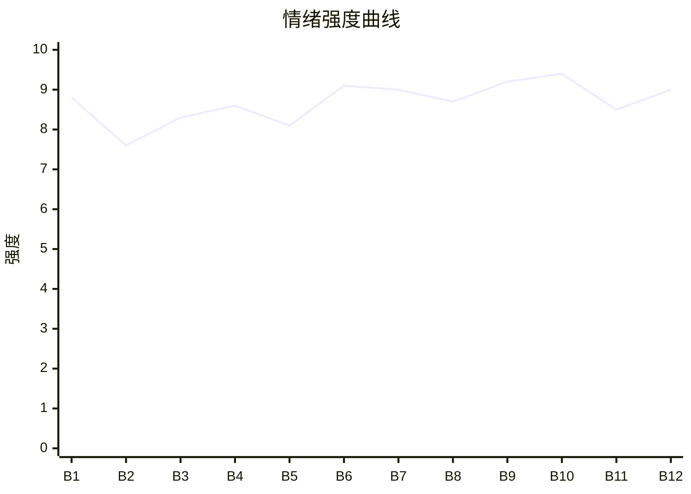

# Beat Sheet 节拍器

## 全文概况

- 总字数: 约 17600 字
- 节拍数: 12 幕
- 核心母题（Logline）: 被冒名顶替的裴家长女裴昭，为拿回母亲遗物与身份真相，借婚礼合约锁住霍裴两家，层层揭穿妹妹裴珂偷人生、偷遗物、挪公款、背叛婚约的真面目，最终拒绝豪门补偿清醒离场。
- 情绪模式: 当众羞辱 → 冷静举证 → 家族压迫 → 证据反杀 → 身份正名 → 清醒退场

## 节拍详表

### Beat 1: 婚礼掀盖头，冒牌货羞辱 [开篇-01 前]
- **字数**: 约 360 字（占比 2%）
- **核心事件**: 霍少衍在婚礼上掀盖头，当众否认裴昭是新娘。
- **情绪标签**: 震惊、羞辱、悬念
- **情绪强度**: 8.8/10
- **情绪方向**: ⚡突变
- **冲突类型**: 大转折
- **悬念钩子**: 婚书写的是“裴家长女”，裴珂却排行老二。
- **叙事速度**: 快
- **对话占比**: 45%
- **reversal_mechanism**: [M2]
- **hook_strength**: 8.7/10
- **关键句**: “婚书上写的是裴家长女。你心心念念的裴珂，排行老二。”
- **原文摘录**: 新郎在婚礼上当众掀了我的盖头。看清我的脸后，他当场摔了酒杯。说我不是他要娶的那个人。他怒不可遏：“你是谁！我要娶的是裴珂，你算什么东西！”我看向霍少衍：“你确定你要娶的是裴珂？”他冷笑：“我跟裴家定的亲，白纸黑字写着！”婚书上写的是裴家长女。你心心念念的裴珂，排行老二。

### Beat 2: 婚书与户籍公证，第一轮身份反打 [01 前半]
- **字数**: 约 1700 字（占比 10%）
- **核心事件**: 裴昭拿出婚书、户籍摘要，证明长女身份。
- **情绪标签**: 憋屈、冷静、期待
- **情绪强度**: 7.6/10
- **情绪方向**: ↑上升
- **冲突类型**: 微冲突
- **悬念钩子**: 父亲电话会站在哪边？
- **叙事速度**: 中快
- **对话占比**: 55%
- **reversal_mechanism**: [M2, M3]
- **hook_strength**: null
- **关键句**: “一份是口头承诺，一份是盖章文件，霍夫人做了这么多年生意，应该能分清哪个算数吧？”
- **原文摘录**: 我把婚书从桌上捡起来，翻到第二页：“裴家长女四个字，不是我写的，是你霍家拟的。”我又抽出公证文件：“裴衡之长女，裴昭……裴衡之次女，裴珂。”霍夫人说婚事是跟裴夫人谈的。我问：“那您跟我父亲确认过吗？”并指出婚书盖的是父亲私章。

### Beat 3: 父亲电话背刺，继母登场压人 [01 后半]
- **字数**: 约 1900 字（占比 11%）
- **核心事件**: 裴衡在电话里否认裴昭，宋芝赶来把她塑造成闹事者。
- **情绪标签**: 背叛、羞辱、愤怒
- **情绪强度**: 8.3/10
- **情绪方向**: ↓下降
- **冲突类型**: 大转折
- **悬念钩子**: 婚书第七条到底是什么？
- **叙事速度**: 中
- **对话占比**: 60%
- **reversal_mechanism**: [M3]
- **hook_strength**: null
- **关键句**: “违约方须赔偿对方家族名下资产的百分之三十。”
- **原文摘录**: 父亲在外放电话里说：“这门亲事，我跟你霍家定的是珂珂。”宋芝上台拉住我，说“这里不是你的地方”。我看着她腕上我妈的玉镯，逼问她敢不敢当着婚书再说一遍。随后我抛出第七条违约金，全场死寂。

### Beat 4: 被锁休息室，裴珂自曝设局偷人生 [02]
- **字数**: 约 2200 字（占比 12.5%）
- **核心事件**: 霍家暂时关押裴昭；裴珂视频通话炫耀自己安排婚礼羞辱，并承认偷照片、偷故事、偷遗物。
- **情绪标签**: 压迫、心痛、怒火
- **情绪强度**: 8.6/10
- **情绪方向**: ↑上升
- **冲突类型**: 大转折
- **悬念钩子**: 裴珂到底偷了多少属于裴昭的东西？
- **叙事速度**: 中
- **对话占比**: 65%
- **reversal_mechanism**: [M2, M3]
- **hook_strength**: null
- **关键句**: “而那个故事，现在是我的。”
- **原文摘录**: 裴珂视频里笑着说，从头到尾都是她安排的。她说霍老爷子要长女，父亲却让她上花轿；是她提议让裴昭先当一回新娘，被退回来。她戴着我妈的翡翠珠子，说“你妈留下的东西，全在我这里”。她承认拿了我小时候的海城照片和故事：“而那个故事，现在是我的。”

### Beat 5: 霍少衍逼签，裴珂手机掉出情人证据 [03]
- **字数**: 约 1800 字（占比 10%）
- **核心事件**: 霍少衍以钱房逼裴昭签字；裴珂进屋演柔弱，离开时手机掉落，暴露许奕消息。
- **情绪标签**: 压迫、轻蔑、暗爽
- **情绪强度**: 8.1/10
- **情绪方向**: ↑上升
- **冲突类型**: 微冲突转大转折
- **悬念钩子**: “孩子的事”会如何引爆？
- **叙事速度**: 快
- **对话占比**: 58%
- **reversal_mechanism**: [M2, M6]
- **hook_strength**: null
- **关键句**: “宝贝，孩子的事你别怕，我会处理。”
- **原文摘录**: 霍少衍拿一百万和公寓逼我签字，认定我没有靠山。裴珂进来装委屈，低声说“你赢不了的”。她离开时手机滑落，一条消息弹出：许奕说“宝贝，孩子的事你别怕，我会处理。”

### Beat 6: 父亲当众切割，一巴掌制造情绪谷底 [04]
- **字数**: 约 2100 字（占比 12%）
- **核心事件**: 裴衡公开宣布裴昭与裴家无关，并当众打她。
- **情绪标签**: 心寒、暴怒、触底
- **情绪强度**: 9.1/10
- **情绪方向**: ↓下降
- **冲突类型**: 大转折
- **悬念钩子**: 裴昭当众问“许奕是谁？”
- **叙事速度**: 中快
- **对话占比**: 60%
- **reversal_mechanism**: [M3, M6]
- **hook_strength**: null
- **关键句**: “法官信你的嘴，还是信你的章？”
- **原文摘录**: 裴衡说亲事是许给裴珂的，裴昭与裴家没有关系。裴昭举起公证件反问他章和嘴谁可信。下一秒父亲一巴掌落下。裴珂低声逼她签字。裴昭抬头问：“裴珂，许奕是谁？”

### Beat 7: 手机解锁，裴珂婚外孕和背叛曝光 [05]
- **字数**: 约 2200 字（占比 12.5%）
- **核心事件**: 裴昭逼裴珂交出手机，霍少衍查到她与许奕的关系和孩子信息。
- **情绪标签**: 爽、反杀、窒息
- **情绪强度**: 9.0/10
- **情绪方向**: ⚡突变
- **冲突类型**: 大转折
- **悬念钩子**: 霍少衍会如何处理婚书违约金？
- **叙事速度**: 快
- **对话占比**: 62%
- **reversal_mechanism**: [M3, M6]
- **hook_strength**: null
- **关键句**: “你要是真的清白，你怕什么？”
- **原文摘录**: 裴珂哭着说截图是 P 的。裴昭指出手机就在柜子后。霍少衍让她给密码，她拒绝。技术部解锁微信后，霍少衍看到聊天记录，确认许奕是竞标对手，并问“朋友？他说的孩子，是什么意思？”他转向裴昭：“婚书上的违约金条款，你的诉求是什么？”

### Beat 8: 霍老太太现身，母亲恩情正名 [06]
- **字数**: 约 2100 字（占比 12%）
- **核心事件**: 霍老太太揭开婚书“裴家长女”的真正原因：叶蘅救过霍老爷子。
- **情绪标签**: 震惊、平反、酸涩
- **情绪强度**: 8.7/10
- **情绪方向**: ↑上升
- **冲突类型**: 大转折
- **悬念钩子**: 裴珂佩戴的翡翠吊坠会被如何验证？
- **叙事速度**: 中
- **对话占比**: 50%
- **reversal_mechanism**: [M2, M6]
- **hook_strength**: null
- **关键句**: “不是因为什么古礼。是因为他要报恩。他要让叶蘅的女儿嫁进霍家。”
- **原文摘录**: 霍老太太问裴昭母亲姓名，认出叶蘅。她拿出紫檀匣子、照片、信和印章，说明叶蘅二十八年前救过霍老爷子，婚约指定长女是为报恩。她命裴珂摘下吊坠：“叶蘅的东西，你没有资格戴。”

### Beat 9: 吊坠八字与账目证据，偷窃升级成商业背叛 [07]
- **字数**: 约 2300 字（占比 13%）
- **核心事件**: 裴昭证明吊坠属于自己，又揭露裴珂向许奕公司转款一千三百万。
- **情绪标签**: 痛快、震惊、压迫反噬
- **情绪强度**: 9.2/10
- **情绪方向**: ↑上升
- **冲突类型**: 大转折
- **悬念钩子**: 许奕闯入现场会带出什么实锤？
- **叙事速度**: 快
- **对话占比**: 58%
- **reversal_mechanism**: [M2, M6]
- **hook_strength**: null
- **关键句**: “除非她外婆有未卜先知的本事，在我出生之前就把我的八字刻好了。”
- **原文摘录**: 裴昭指出吊坠背面刻着自己的生辰八字，证伪裴珂“外婆遗物”的说法。随后她调出银行记录：裴家四笔款项进入许奕的东禾创投，总计一千三百万，用于研究城东旧改投标方案，而城东旧改正是霍家大标。

### Beat 10: 许奕入场，裴珂双面谎言彻底崩塌 [08]
- **字数**: 约 1900 字（占比 11%）
- **核心事件**: 许奕闯入，亲口证实裴珂和他的关系、孩子、对霍家的“做戏”说法。
- **情绪标签**: 爆爽、塌房、混乱
- **情绪强度**: 9.4/10
- **情绪方向**: ↑上升
- **冲突类型**: 大转折
- **悬念钩子**: 霍少衍道歉后，裴昭会如何回应？
- **叙事速度**: 快
- **对话占比**: 70%
- **reversal_mechanism**: [M3, M6]
- **hook_strength**: null
- **关键句**: “你说和霍家只是做戏。”
- **原文摘录**: 许奕闯进来拉住裴珂，面对霍少衍说他们是朋友。被问到孩子后，他反问裴珂：“你不是说你们只是合作关系？”随后又喊出“三天前你还在我家过的夜”“孩子生下来我们就在一起”。裴珂崩溃承认自己不服，偷了裴昭的照片和故事。

### Beat 11: 道歉、赔偿、婚约继续的诱惑被女主拆穿 [09]
- **字数**: 约 1900 字（占比 11%）
- **核心事件**: 法务确认婚书有效，父亲道歉，霍少衍提出继续婚约，裴昭拒绝被补偿逻辑收编。
- **情绪标签**: 克制、清醒、余怒
- **情绪强度**: 8.5/10
- **情绪方向**: →平稳
- **冲突类型**: 微冲突
- **悬念钩子**: 裴昭不否认婚约，又不愿共度一生，她真正目标是什么？
- **叙事速度**: 中
- **对话占比**: 55%
- **reversal_mechanism**: [M3]
- **hook_strength**: null
- **关键句**: “认了就一定跟你过一辈子。这两件事，你自己想清楚区别在哪。”
- **原文摘录**: 律师确认婚书有效。裴衡弯腰道歉，裴昭问：“打你一巴掌又能怎样？”霍少衍提出婚事可以继续。裴昭质问他是因为真心还是因为违约金太贵。她合上婚书离开，只留下“认了不等于过一辈子”的区别。

### Beat 12: 女主亮出真实底牌，拿回遗物离开棋盘 [10]
- **字数**: 约 2600 字（占比 15%）
- **核心事件**: 裴昭揭露自己从一开始就不是为嫁人，而是为拿回母亲遗物和验证裴珂底线；她有饭馆和合规工作室，查账靠专业能力。
- **情绪标签**: 释然、清醒、终极爽
- **情绪强度**: 9.0/10
- **情绪方向**: ↑上升后收束
- **冲突类型**: 终局反转
- **悬念钩子**: 开放式余味：霍少衍是否配得上她不再重要。
- **叙事速度**: 中
- **对话占比**: 52%
- **reversal_mechanism**: [M2, M3, M6]
- **hook_strength**: null
- **关键句**: “棋局结束了。赢的人不必留在棋盘上。”
- **原文摘录**: 裴昭告诉霍少衍，她不追究违约金，也没打算嫁给他。婚书、族谱、违约金只是护身符。她真正要的是母亲项链、手镯、照片和信。她在海城有饭馆和法律咨询工作室，裴家子公司合规业务外包给她，所以她能查账。她离开时接到裴珂电话：“姐姐，你赢了。”裴昭答：“我没赢。因为我从来没跟你比过。”

## 情绪曲线可视化

## 节拍密度检测

- 平均每 1460 字一个节拍
- 微冲突密度: 每 2500 字一次
- 大转折密度: 每 1750 字一次
- 判定: 符合高频节拍器标准

## 反转机制清单(Reversal Mechanisms)

| 机制 ID | 机制名 | 承载 Beat | 关键段落/金句 | 等价改编提示 |
|--------|--------|-----------|--------------|-------------|
| M2 | 身份反差爆发 | Beat 1-2, 8, 12 | “长女是我，次女是她”；“那个人不存在。” | 身份载体可换，但前期误认、偷身份、最终真实能力揭露三层必须保留。 |
| M3 | 因果回旋反讽 | Beat 3, 6, 11, 12 | “法官信你的嘴，还是信你的章？”；“我没赢。因为我从来没跟你比过。” | 对方用身份规则压人，女主必须用同一规则反向清算；结尾需有回旋金句。 |
| M6 | 多层递进反转 | Beat 5-10, 12 | 手机消息→母亲恩情→吊坠八字→转账挪款→许奕闯入→女主真实底牌 | 层数不能少，证据量级必须从私情升到家族、商业、女主自主能力。 |
