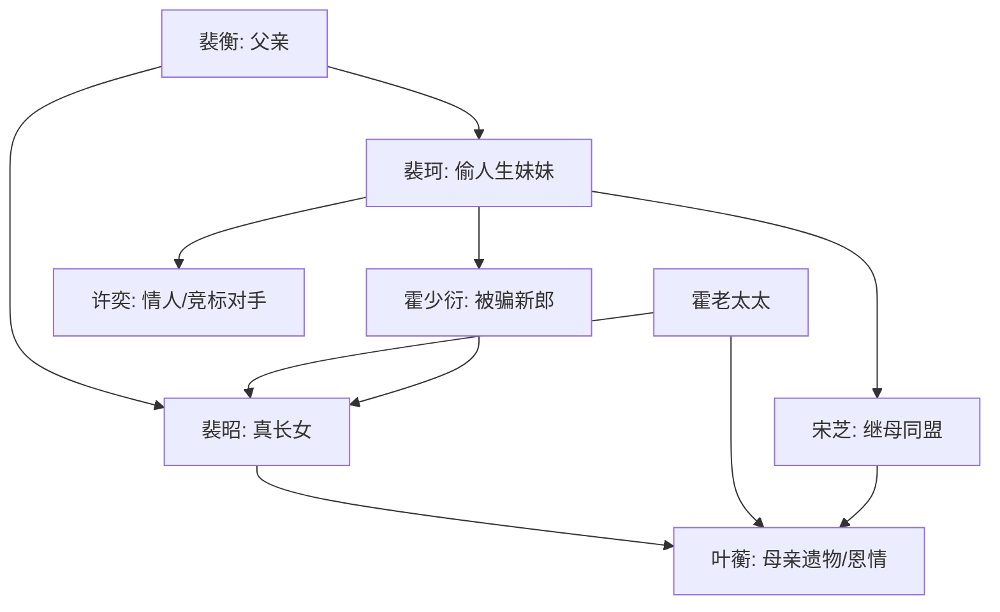

# 角色标签图谱

## 角色清单

### 裴昭 — 清醒证据流大女主
- 叙事功能: 主视角、反击执行者、身份真相的承载者。
- 核心标签: 冷静、专业、被偷人生的长女。
- 弧光: 被当众羞辱的“冒牌货” → 拿回遗物并离场的真正赢家。
- 台词风格: 短句、反问、证据压制。
- 关键行为: 拿婚书、举公证、拍截图、查账、拒绝婚约。
- 读者情绪关系: 心疼转爽，最终敬佩。

### 裴珂 — 偷人生绿茶妹妹
- 叙事功能: 核心反派、情绪债制造者、真相层层塌房对象。
- 核心标签: 冒名、贪婪、双面。
- 弧光: 被全家维护的准新娘 → 偷遗物、偷故事、挪款、怀孕全曝光。
- 台词风格: 人前柔弱，人后炫耀。
- 关键行为: 安排顶班羞辱、偷照片故事、戴遗物、转款给许奕。
- 读者情绪关系: 恨、厌、期待报应。

### 霍少衍 — 傲慢误判新郎
- 叙事功能: 开局压迫者、后期被真相打脸的悔恨对象。
- 核心标签: 傲慢、恋爱脑、迟来的醒悟。
- 弧光: 当众羞辱裴昭 → 发现爱的是伪造人设 → 请求重新认识。
- 台词风格: 前期命令式，后期低声道歉。
- 关键行为: 掀盖头、锁休息室、查手机、承认错误。
- 读者情绪关系: 先恨后看他追悔。

### 裴衡 — 偏心失职父亲
- 叙事功能: 家庭伦理压迫源，强化女主童年情绪债。
- 核心标签: 偏心、懦弱、迟悔。
- 弧光: 当众切割裴昭 → 发现裴珂丑闻 → 弯腰道歉。
- 台词风格: 父权训斥，后期破碎低头。
- 关键行为: 电话背刺、当众声明、打裴昭、低头认错。
- 读者情绪关系: 愤怒、失望。

### 宋芝 — 精明继母
- 叙事功能: 裴珂后台、母亲遗物侵占者、家族话术操盘者。
- 核心标签: 圆滑、伪善、算计。
- 弧光: 以母亲身份带走裴昭 → 被挪款与隐瞒牵连。
- 台词风格: 表面客气，暗中定性。
- 关键行为: 谎称裴珂为婚约对象、戴叶蘅玉镯、替裴珂遮掩。
- 读者情绪关系: 憎恶。

### 霍老太太 — 迟到的公正权威
- 叙事功能: 权威见证者，揭开婚约真正来源。
- 核心标签: 清醒、威严、知情者。
- 弧光: 旁观听完争吵 → 出面正名叶蘅与裴昭。
- 台词风格: 简短有分量。
- 关键行为: 拿紫檀匣子、讲叶蘅救命恩、逼裴珂摘吊坠、放裴昭离开。
- 读者情绪关系: 信任、解气。

### 许奕 — 意外实锤工具人
- 叙事功能: 裴珂塌房的外部证人。
- 核心标签: 情人、竞标对手、无意补刀。
- 弧光: 焦急找裴珂 → 当众说漏孩子和“做戏”。
- 台词风格: 直白、失控。
- 关键行为: 闯入现场、证实孩子和裴珂双面谎言。
- 读者情绪关系: 推动爽点，不承载同情。

## 关系网络

## 角色功能对照表（供改编参考）

| 原角色 | 极致标签 | 叙事功能 | 读者情绪功能 | 改编时必须保留的 |
|--------|---------|---------|-------------|---------------|
| 裴昭 | 清醒证据流大女主 | 反击者 | 心疼、爽、敬佩 | 不争夫，争身份与遗物 |
| 裴珂 | 偷人生绿茶 | 主反派 | 恨、期待塌房 | 偷故事/偷遗物/偷资源三件套 |
| 霍少衍 | 傲慢误判新郎 | 打脸对象 | 先恨后看悔 | 开局当众羞辱，后期追悔 |
| 裴衡 | 偏心父亲 | 伦理压迫 | 愤怒 | 当众切割+一巴掌 |
| 宋芝 | 算计继母 | 后台反派 | 厌恶 | 侵占母亲遗物 |
| 霍老太太 | 权威正名者 | 真相背书 | 解气 | 揭开上一代恩情 |
| 许奕 | 塌房证人 | 实锤工具 | 爽点催化 | 无意说漏关键真相 |
