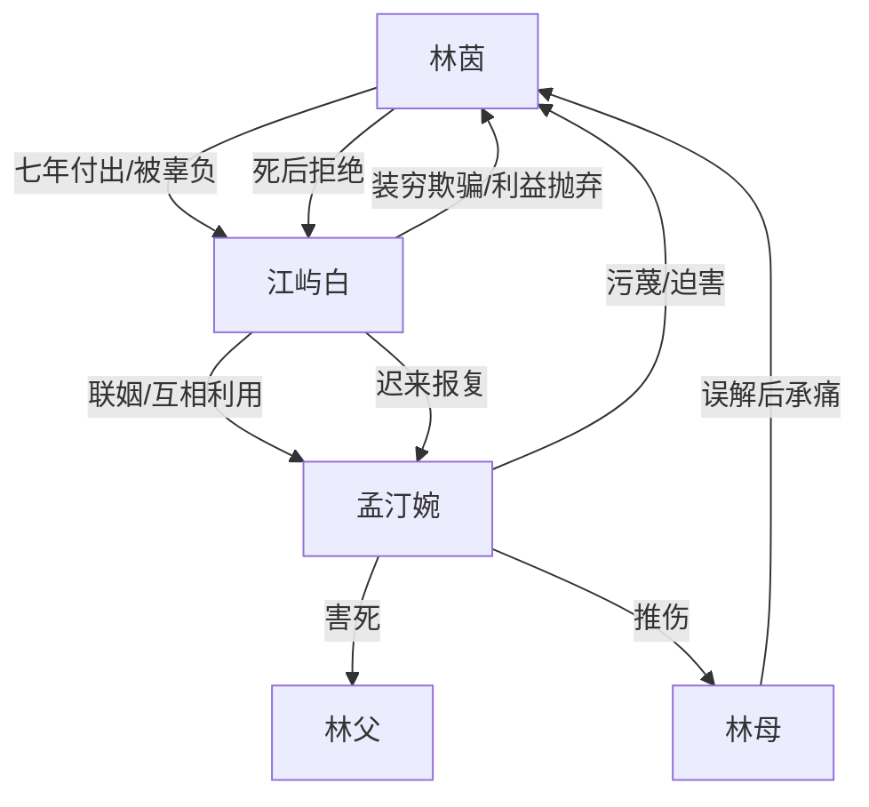

# 角色标签图谱

## 角色清单

### 林茵 — 残疾痴情女 / 死后清醒旁观者
- 叙事功能: 情绪债承载者、道德中心、终局审判者
- 核心标签: 断腿牺牲、被污名、死后放下
- 弧光: 为爱忍苦 → 被彻底摧毁 → 死后冷淡拒绝
- 台词风格: 前期哀求辩解，后期灵魂独白克制
- 关键行为: 卖唱攒彩礼、被迫磕头、发帖自证、跳楼、阻止墓碑刻名
- 读者情绪关系: 心疼、愤怒、替她拒绝男主

### 江屿白 — 负心首富 / 迟来悔疯男
- 叙事功能: 核心施害者、温度反转对象、悔恨偿债工具
- 核心标签: 装穷欺骗、利益联姻、迟来追悔
- 弧光: 宠溺别人羞辱女主 → 真相击碎 → 报复女二并自杀
- 台词风格: 前期冷漠自利，后期破防哀求
- 关键行为: 隐瞒成功、另娶孟汀婉、逼林茵道歉、否认关系、调监控、报复孟家、自杀
- 读者情绪关系: 恨、厌、看他悔恨但不希望被原谅

### 孟汀婉 — 恶毒正妻 / 利益操盘者
- 叙事功能: 外部压迫放大器、男主罪孽照妖镜
- 核心标签: 富家大小姐、伪受害者、恶意猎杀
- 弧光: 装无辜炫耀 → 公开羞辱 → 谋害亲人 → 被反噬疯癫
- 台词风格: 娇气伪善与恶毒直白切换
- 关键行为: 转账羞辱、晒结婚证、逼磕头、拔氧气管、派人殴打
- 读者情绪关系: 恨、期待报应

### 林母 — 被拖入灾难的亲情锚点
- 叙事功能: 扩大女主责任感与痛感
- 核心标签: 误会女儿、跪地求救、幸存承痛
- 弧光: 愤怒误解 → 为丈夫求救 → 重伤幸存 → 失女崩溃
- 台词风格: 家庭伦理式哭喊质问
- 关键行为: 打女儿、跪求江屿白、被孟汀婉推伤
- 读者情绪关系: 心疼、复杂

### 林父 — 死亡债务锚点
- 叙事功能: 将舆论羞辱升级为命债
- 核心标签: 病危父亲、被拔氧气管、无辜死亡
- 弧光: 病危 → 被害死亡
- 台词风格: 昏迷无台词
- 关键行为: 被孟汀婉拔氧气管害死
- 读者情绪关系: 心疼、愤怒

## 关系网络

## 角色功能对照表（供改编参考）

| 原角色 | 极致标签 | 叙事功能 | 读者情绪功能 | 改编时必须保留的 |
|--------|---------|---------|-------------|---------------|
| 林茵 | 残疾痴情女 | 情绪债容器 | 心疼与站队 | 为男主牺牲过不可逆代价 |
| 江屿白 | 负心首富 | 核心罪人 | 恨与看悔 | 装穷/背叛/迟来知真相 |
| 孟汀婉 | 恶毒正妻 | 压迫执行者 | 恨与报应期待 | 伪无辜、公开羞辱、害亲人 |
| 林母 | 亲情锚点 | 增加伦理痛 | 心疼复杂 | 被误导逼女主低头 |
| 林父 | 命债锚点 | 升级不可原谅 | 愤怒 | 被反派直接害死 |
