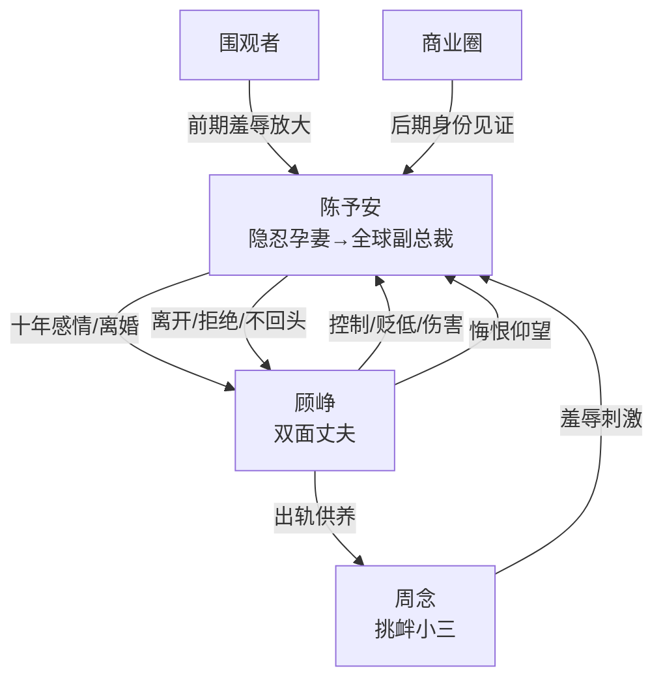

# 角色标签图谱

## 角色清单

### 陈予安 — 隐忍觉醒型逆袭大女主

- 叙事功能: 受害者、情绪承载者、最终清算者。
- 核心标签: 十年长情、孕期被背叛、事业逆袭。
- 弧光: 心软原谅的妻子 → 创伤离婚的逃离者 → 全球副总裁。
- 台词风格: 前期克制发问，后期冷静判决。
- 关键行为: 查备用机、跟到酒店、骗签离婚、砸碎落地窗、远走海外、拒绝复婚。
- 读者情绪关系: 前半心疼，后半爽与敬佩。

### 顾峥 — 贪欲双面型悔恨前夫

- 叙事功能: 核心施害者和后期悔恨对象。
- 核心标签: 曾经深情、反复出轨、迟来悔恨。
- 弧光: 好丈夫伪装者 → 傲慢控制者 → 失去后悔者 → 卑微仰望者。
- 台词风格: 前期哄骗温柔，中段命令贬低，后期哀求道歉。
- 关键行为: 婚前出轨、婚后复燃、转移共同财产、给女主下安眠药、失手致女主坠楼流产。
- 读者情绪关系: 恨、恶心、期待他悔恨。

### 周念 — 挑衅掠夺型小三

- 叙事功能: 刺激冲突升级，暴露顾峥道德底线。
- 核心标签: 年轻、得意、羞辱原配。
- 弧光: 被供养的情人 → 主动挑衅者 → 被顾峥迁怒驱逐。
- 台词风格: 茶味、炫耀、性羞辱。
- 关键行为: 发送暧昧语音、挑衅咖啡厅、展示落地窗照片、揭露安眠药真相。
- 读者情绪关系: 恨，但她的存在主要服务顾峥罪证。

### 服务员/同事/助理/记者 — 社会目光群像

- 叙事功能: 放大羞辱或见证逆袭。
- 核心标签: 围观者、舆论镜子、阶层见证。
- 弧光: 前期嘲笑“可怜老婆” → 后期见证“陈总”。
- 台词风格: 八卦、现实、功能性。
- 关键行为: 服务员议论开房，同事误认女主为保姆，记者拍摄商业盛典。
- 读者情绪关系: 前期加压，后期助爽。

## 关系网络

## 角色功能对照表（供改编参考）

| 原角色 | 极致标签 | 叙事功能 | 读者情绪功能 | 改编时必须保留的 |
|--------|---------|---------|-------------|---------------|
| 陈予安 | 隐忍觉醒型逆袭女主 | 承债与清算 | 心疼→爽 | 先心软、后彻底不回头 |
| 顾峥 | 双面悔恨前夫 | 施害与悔恨 | 恨→看他痛苦 | 曾经爱过+反复背叛+迟来悔恨 |
| 周念 | 挑衅小三 | 加压器 | 恨与恶心 | 主动羞辱原配，揭露关键罪证 |
| 围观群像 | 社会镜子 | 放大阶层落差 | 羞辱/见证爽 | 前后身份对照必须存在 |
