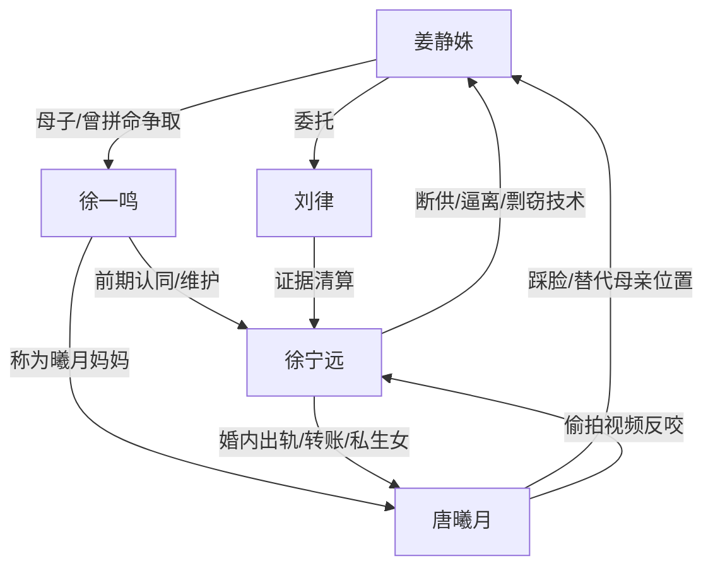

# 角色标签图谱

## 角色清单

### 姜静姝 — 清醒复仇型前天才母亲
- 叙事功能: 受害者、证据掌控者、最终清算者
- 核心标签: 前 IT 天才、隐忍母亲、冷静复仇
- 弧光: 死守抚养权 → 亲情心死 → 重启诉讼 → 拿回财产和自我
- 台词风格: 短句、反问、证据式陈述
- 关键行为: 放弃抚养权、破解小三电脑、起诉丈夫、法庭证明未受益
- 读者情绪关系: 前半心疼，后半爽，结尾尊重她不立刻原谅

### 徐宁远 — 伪精英渣总
- 叙事功能: 主要压迫者、因果回旋对象
- 核心标签: 出轨、断供、剽窃、操控
- 弧光: 百亿总裁胜券在握 → 发布会崩盘 → 法庭反扑失败 → 负债落魄
- 台词风格: 居高临下、冷暴力、算计式求和
- 关键行为: 七次起诉离婚、断女主资金和职业路、转移夫妻财产、试图共债拖女主下水
- 读者情绪关系: 极强恨点，最终被财产和债务双重反噬带来爽感

### 徐一鸣 — 被宠坏的白眼狼儿子
- 叙事功能: 亲情背刺核心，女主放弃抚养权的触发器
- 核心标签: 慕强、忘恩、被洗脑
- 弧光: 替父逼母离婚 → 诬陷母亲害病 → 真相曝光后求原谅 → 门口赎罪
- 台词风格: 稚嫩但伤人，前期用童声说残酷话
- 关键行为: 手写离婚协议、认小三做妈妈、学校诬陷女主、真相后求母亲
- 读者情绪关系: 前半恨，后半复杂；保留“不立刻原谅”满足读者公正感

### 唐曦月 — 绿茶秘书/伪科技天才
- 叙事功能: 婚姻第三者、反派镜像、事业犯罪引爆点
- 核心标签: 小三、副总、私生女母亲、留后手
- 弧光: 高定副总踩脸正妻 → 偷拍自保 → 直播反咬 → 入狱
- 台词风格: 撒娇、挑衅、甩锅
- 关键行为: 介入婚姻、生育私生女、接受大额转账、恐吓技术员、偷拍视频
- 读者情绪关系: 恨点与鄙夷；她的反咬推动徐宁远彻底崩塌

### 刘律 — 清算执行者
- 叙事功能: 法律工具人，帮助女主把情绪债转为可执行权益
- 核心标签: 专业、冷静、证据链
- 弧光: 接受诉求修改 → 调查证据 → 法庭清算
- 台词风格: 专业陈述
- 关键行为: 调取聊天记录、提交证据、证明未受益
- 读者情绪关系: 提供安全感和爽点落地感

## 关系网络

## 角色功能对照表（供改编参考）

| 原角色 | 极致标签 | 叙事功能 | 读者情绪功能 | 改编时必须保留的 |
|--------|---------|---------|-------------|---------------|
| 姜静姝 | 清醒复仇前天才母亲 | 受害者到清算者 | 心疼→爽 | 曾有高能力、为家牺牲、最终靠证据反杀 |
| 徐宁远 | 伪精英渣总 | 主要反派 | 恨、等报应 | 断供、出轨、剥夺女主劳动价值 |
| 徐一鸣 | 白眼狼儿子 | 亲情痛点 | 怒、复杂心疼 | 主动背刺母亲，后期赎罪但不被轻易原谅 |
| 唐曦月 | 绿茶副总小三 | 替代者和犯罪引线 | 恨、鄙夷 | 享受女主被剥夺的资源，后期反咬男主 |
| 刘律 | 法律清算者 | 爽点落地 | 安全感 | 证据链必须完整且可执行 |
