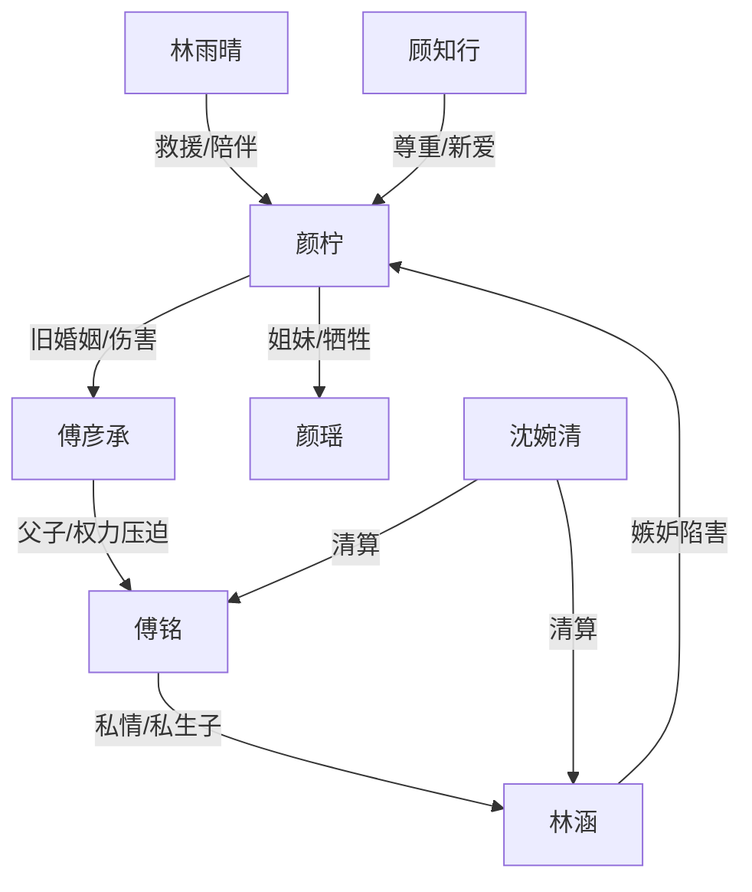

# 角色标签图谱

## 角色清单

### 颜柠 — 清醒重生型原配
- 叙事功能: 承载读者代入、情绪债积累与最终补偿。
- 核心标签: 卑微旧爱、失去一切、重拾画笔
- 弧光: 求丈夫回家 → 被逼到无家可归 → 海外新生
- 台词风格: 前半压抑克制，后半平静拒绝
- 关键行为: 签离婚协议、做 DNA、出国、重新画画、拒绝傅彦承
- 读者情绪关系: 心疼、替她憋屈、期待她彻底离开

### 傅彦承 — 傲慢失控型追妻火葬场男主
- 叙事功能: 主要施害者与后半悔恨载体。
- 核心标签: 权力傲慢、迟来爱意、赌输一切
- 弧光: 出轨羞辱 → 囚禁伤害 → 迟来追悔 → 赎罪退场
- 台词风格: 命令式、低解释欲、后期沉默
- 关键行为: 官宣冒名、囚禁颜柠、强制流产、逼她跪罚、追到 F 国、重修老房子
- 读者情绪关系: 恨、厌恶、后期看其悔恨偿债

### 林涵 — 上位小三/私生子母亲
- 叙事功能: 近身恶女，负责制造茶水、下药、挑拨、逼走女主。
- 核心标签: 嫉妒、阴毒、狐假虎威
- 弧光: 进门立威 → 栽赃上位 → 被沈婉清清算
- 台词风格: 轻飘挑衅、装无辜
- 关键行为: 捏断指栽赃、下药直播、承认赶走颜柠
- 读者情绪关系: 强烈恨点，期待被打脸

### 傅铭 — 伪权威父亲
- 叙事功能: 更高一层压迫来源，揭开孩子真相与傅家权力结构。
- 核心标签: 虚伪、怕妻、私生子
- 弧光: 维护林涵 → 压迫颜柠 → 被沈婉清剥夺一切
- 台词风格: 家长式命令
- 关键行为: 安排林涵进门、逼傅彦承离婚、暴露孩子是自己私生子
- 读者情绪关系: 厌恶、期待被上位权力碾压

### 颜瑶 — 无辜牺牲者
- 叙事功能: 将颜柠的情绪债从婚姻屈辱升级到亲人死亡。
- 核心标签: 病弱妹妹、无辜、不可挽回
- 弧光: 被牵连绑架 → 高烧 → 死亡
- 台词风格: 少量、脆弱
- 关键行为: 吃下被下药食物，加重病情
- 读者情绪关系: 心疼、愤怒的放大器

### 林雨晴 — 救援型闺蜜
- 叙事功能: 提供外部援手和情绪见证。
- 核心标签: 仗义、清醒、保护欲
- 弧光: 发照片提醒 → 陪葬礼 → 带颜柠出国 → 痛斥傅彦承
- 台词风格: 直接、有刀
- 关键行为: 帮做 DNA、带颜柠去 F 国、列举傅彦承罪行
- 读者情绪关系: 安全感、代替读者骂醒男主

### 沈婉清 — 降维清算型女强人
- 叙事功能: 完成傅家内部权力反转。
- 核心标签: 上位者、冷静、绝对权力
- 弧光: 传闻中的母亲 → 回国清算 → 剥夺傅铭
- 台词风格: 短句、判决式
- 关键行为: 夺傅铭职权股权、三巴掌清算林涵
- 读者情绪关系: 痛快、补偿

### 顾知行 — 温柔补偿型男二/新伴侣
- 叙事功能: 证明颜柠可被尊重、被等待、被平等爱。
- 核心标签: 克制、长情、支持梦想
- 弧光: 大学暗恋者 → 海外重逢 → 守护与求婚
- 台词风格: 温和、边界感强
- 关键行为: 推荐颜柠作品、买下画室、婚礼告白
- 读者情绪关系: 安慰、补偿、期待女主新生

## 关系网络

## 角色功能对照表（供改编参考）

| 原角色 | 极致标签 | 叙事功能 | 读者情绪功能 | 改编时必须保留的 |
|--------|---------|---------|-------------|---------------|
| 颜柠 | 清醒重生型原配 | 主代入与新生 | 心疼、期待补偿 | 从卑微到不回头 |
| 傅彦承 | 傲慢追妻火葬场 | 主压迫与悔恨 | 恨、看报应 | 迟来爱意必须失效 |
| 林涵 | 上位恶女 | 近身栽赃 | 恨点集中 | 栽赃和下药 |
| 傅铭 | 伪权威父亲 | 权力黑幕 | 厌恶 | 私生子真相 |
| 颜瑶 | 无辜妹妹 | 情绪触底 | 心疼 | 不可逆牺牲 |
| 林雨晴 | 救援闺蜜 | 安全出口 | 代骂、保护 | 带女主离开 |
| 沈婉清 | 上位清算者 | 权力反转 | 爽 | 降维惩罚 |
| 顾知行 | 温柔补偿型伴侣 | 新生活证明 | 安慰 | 尊重女主梦想 |
