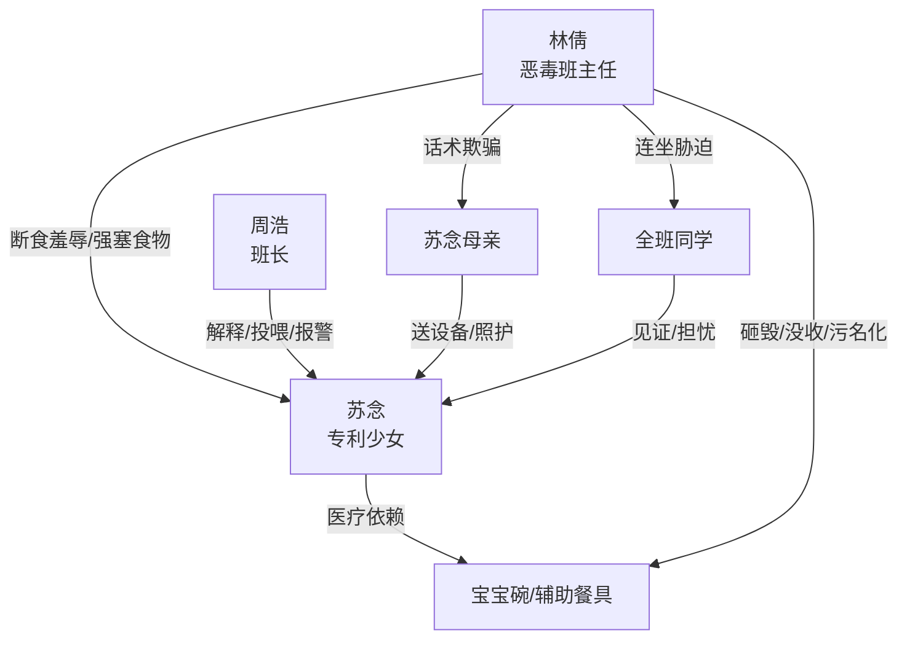

# 角色标签图谱

## 角色清单

### 苏念 — 专利少女/残障大女主

- 叙事功能: 被压迫者、证据载体拥有者、后续反杀执行者。
- 核心标签: 先天吞咽障碍、国家专利、冷静带刺。
- 弧光: 被误解的辅助需求者 → 被逼到濒死的受害者 → 后续法律反杀者。
- 台词风格: 前期轻巧反讽，危机时直接质问。
- 关键行为: 用宝宝碗进食、解释障碍、提交申请、识别伪造截图。
- 读者情绪关系: 心疼、护短、期待她反杀。

### 林倩 — 伪精英控制狂/恶毒班主任

- 叙事功能: 核心施害者，制造所有情绪债。
- 核心标签: 名校光环、权力滥用、歧视残障。
- 弧光: 当众被打脸 → 利用班主任权力报复 → 断食羞辱 → 强塞致命食物。
- 台词风格: 命令式、羞辱式、制度包装式。
- 关键行为: 砸碗、没收餐具、扣押设备、撒谎、销毁营养膏、伪造授权、阻止报警。
- 读者情绪关系: 强恨点，必须被法律清算。

### 周浩 — 护主班长/见证人

- 叙事功能: 旁证、情绪代偿、救援触发者。
- 核心标签: 正义、克制、关键证人。
- 弧光: 解释专利 → 偷买牛奶 → 帮找营养膏 → 濒死时拨打 120。
- 台词风格: 简短、事实型、关键时爆发。
- 关键行为: 公开解释宝宝碗，给苏念买牛奶，推开林倩，试图报警。
- 读者情绪关系: 安慰、可靠、替读者冲上去。

### 苏念母亲 — 保护型家长

- 叙事功能: 提供正常照护方案，反衬林倩的恶意阻断。
- 核心标签: 心疼、细致、被蒙骗。
- 弧光: 送设备救急 → 被教师话术劝退。
- 台词风格: 解释型、担忧型。
- 关键行为: 买破壁机和保温桶。
- 读者情绪关系: 心疼，强化“孩子被孤立在学校权力中”的无助。

### 全班同学 — 群体见证者/道德陪审团

- 叙事功能: 证明宝宝碗不是“搞特殊”，见证林倩犯罪升级。
- 核心标签: 沉默保护、集体焦灼、潜在证人。
- 弧光: 同款使用者 → 被没收者 → 被罚站胁迫者 → 围观濒死者。
- 台词风格: 集体沉默为主，关键时由班长发声。
- 关键行为: 使用同款碗、试图给苏念挑软食、被迫罚站。
- 读者情绪关系: 群体压迫感与证人安全感并存。

## 关系网络

## 角色功能对照表（供改编参考）

| 原角色 | 极致标签 | 叙事功能 | 读者情绪功能 | 改编时必须保留的 |
|--------|---------|---------|-------------|---------------|
| 苏念 | 专利少女/残障大女主 | 受害者与反杀者 | 心疼+期待爽点 | 弱需求与强能力并存 |
| 林倩 | 伪精英控制狂 | 施害与蓄债 | 恨点 | 制度话术包装恶意 |
| 周浩 | 正义班长 | 见证和救援 | 替读者行动 | 至少一次公开维护和一次救命行为 |
| 母亲 | 保护型家长 | 正常照护参照 | 心疼 | 被学校权力隔开 |
| 全班 | 道德陪审团 | 群体证人 | 压迫放大 | 集体使用/集体见证 |
