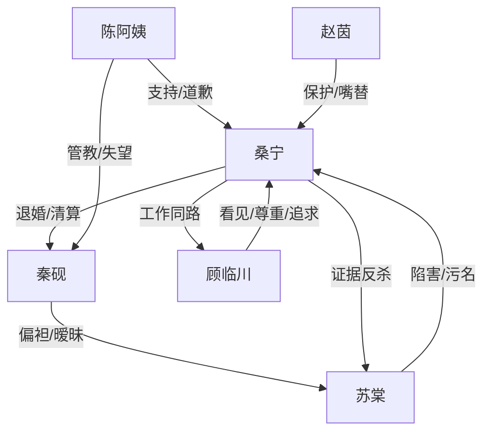

# 角色标签图谱

## 角色清单

### 桑宁 — 清醒边界型女医生
- 叙事功能: 主角、受害者、反击执行者、价值坐标。
- 核心标签: 冷静、证据意识、边界感。
- 弧光: 被副驾羞辱 → 退婚清算 → 名誉反杀 → 事业获证 → 允许新关系靠近。
- 台词风格: 短句、通知式、反问后落点。
- 关键行为: 取消婚礼、拆装修、留证据、发律师函、拒绝复合。
- 读者情绪关系: 心疼、爽、敬佩。

### 秦砚 — 边界感缺失的迟悔前任
- 叙事功能: 主要压迫者、温度反转承载者。
- 核心标签: 自负、偏心、迟钝。
- 弧光: 觉得桑宁会忍 → 多次护苏棠 → 舆论后悔 → 学会边界但失去资格。
- 台词风格: 命令、质问、后期低声追悔。
- 关键行为: 让副驾、带苏棠进婚房、沉默纵容、后期澄清捐赠。
- 读者情绪关系: 恨、失望、后期微弱惋惜但不希望复合。

### 苏棠 — 白莲绿茶型女助理
- 叙事功能: 引爆冲突、制造陷害、推动秦砚失格。
- 核心标签: 装弱、抢位、舆论操控。
- 弧光: 副驾示弱 → 假摔陷害 → 舆论卖惨 → 证据反噬 → 公开道歉离城。
- 台词风格: “都是我不好”式道德绑架。
- 关键行为: 坐副驾、穿拖鞋、假摔、发检查单、纵容偷拍视频。
- 读者情绪关系: 厌恶、期待被揭穿。

### 顾临川 — 尊重型职业对照男主
- 叙事功能: 后半段情感补偿、新关系价值标尺。
- 核心标签: 专业、克制、会看见。
- 弧光: 外聘专家 → 证人/同路人 → 追求者。
- 台词风格: 平实、观察式、不越界。
- 关键行为: 点出项目、提供照片、记住饮食与工作习惯、请求追求许可。
- 读者情绪关系: 安心、甜、补偿。

### 陈阿姨 — 清醒长辈
- 叙事功能: 秦家内部道德参照，证明不是“全家恶人”模板。
- 核心标签: 体面、清醒、自省。
- 弧光: 婚礼长辈 → 支持退婚 → 替自己道歉 → 祝贺桑宁。
- 台词风格: 克制、直指问题。
- 关键行为: 看监控、扇秦砚、结清装修款、送白山茶。
- 读者情绪关系: 尊重、温暖。

### 赵茵 — 嘴替闺蜜
- 叙事功能: 读者嘴替、情绪释放阀。
- 核心标签: 犀利、护短、幽默。
- 弧光: 旁观退婚 → 帮忙截图 → 陪伴庆祝。
- 台词风格: 口语化吐槽。
- 关键行为: 怼秦砚、转截图、陪桑宁庆功。
- 读者情绪关系: 爽、亲切。

## 关系网络

## 角色功能对照表（供改编参考）

| 原角色 | 极致标签 | 叙事功能 | 读者情绪功能 | 改编时必须保留的 |
|--------|---------|---------|-------------|---------------|
| 桑宁 | 清醒女医生 | 反击主体 | 心疼转爽 | 冷静边界、证据意识、职业价值 |
| 秦砚 | 迟悔前任 | 压迫与悔恨 | 恨与惋惜 | “以为她会忍”的傲慢 |
| 苏棠 | 绿茶女助理 | 挑衅陷害 | 厌恶与清算期待 | 装弱话术和自导自演 |
| 顾临川 | 尊重型新男主 | 情感补偿 | 安心与甜 | 不替女主做决定，只看见她 |
| 陈阿姨 | 清醒长辈 | 道德校准 | 温暖 | 不劝复合，承认问题 |
| 赵茵 | 嘴替闺蜜 | 释放情绪 | 爽感 | 犀利吐槽和陪伴 |
