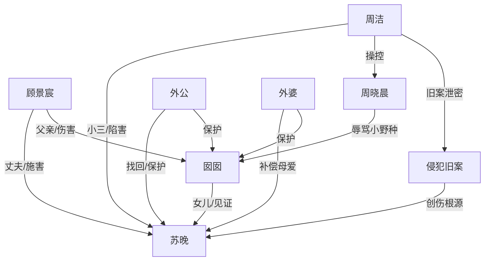

# 角色标签图谱

## 角色清单

### 囡囡 — 受伤见证者/情绪锚点
- 叙事功能: 第一人称视角，负责见证父母婚姻崩塌和读者代入。
- 核心标签: 无辜、早熟、护母
- 弧光: 被动目击伤害 → 主动保护妈妈 → 接受新生活
- 台词风格: 短、直、本能式判断
- 关键行为: 撞破出轨、替妈妈作证、用石子砸周洁、泼开顾景宸、结尾拒认父亲
- 读者情绪关系: 心疼、保护欲、代入性愤怒

### 苏晚/然然 — 受辱贤妻/清醒出逃者
- 叙事功能: 情绪债核心承载者，受害与反弹的中心。
- 核心标签: 隐忍、破碎、最终清醒
- 弧光: 为家庭忍耐 → 被逼跳楼假死 → 回到家人怀抱并冷拒前夫
- 台词风格: 前期少而碎，后期平静短句
- 关键行为: 撒面粉、答应留下孩子、准备离婚、跳楼逃脱、拒绝复合
- 读者情绪关系: 心疼、替她憋屈、后期为她解气

### 顾景宸 — 出轨渣夫/迟来悔疯者
- 叙事功能: 主反派兼 M5 悔恨承载者。
- 核心标签: 自私、暴力、迟钝
- 弧光: 自以为施舍 → 逼妻假死 → 真相崩塌 → 落魄求原谅被拒
- 台词风格: 先羞辱、后忏悔，前后温度反差极大
- 关键行为: 出轨、认小三儿子、逼妻接受私生子、打妻女、命混混侵犯苏晚、后期跪求
- 读者情绪关系: 恨、厌恶、看他悔恨获得爽感

### 周洁 — 绿茶小三/旧案共犯
- 叙事功能: 外部破坏者，推动出轨、诬陷、旧案真相。
- 核心标签: 表演型、恶毒、贪婪
- 弧光: 装弱胜利 → 诬陷升级 → 被证据反噬
- 台词风格: 又急又软，惯用哭和自责包装攻击
- 关键行为: 勾引顾景宸、让儿子辱骂囡囡、自扇耳光、伪造强奸流产、泄露苏晚行踪
- 读者情绪关系: 恨、恶心、期待她被揭穿

### 外公 — 迟到权力/清算执行者
- 叙事功能: 资源与真相的执行端，承担身份反转和法律清算。
- 核心标签: 威严、护短、冷硬
- 弧光: 寻女多年 → 找回女儿 → 收集证据清算
- 台词风格: 冷、短、带压迫感
- 关键行为: 抱起囡囡、揭露苏晚出身、交证据给警方、限制顾景宸靠近
- 读者情绪关系: 安全感、初爽、补偿感

### 外婆 — 母性补偿/温暖归处
- 叙事功能: 给苏晚和囡囡提供失去多年的家庭温度。
- 核心标签: 心疼、愤怒、保护
- 弧光: 寻女焦急 → 痛哭崩溃 → 护女重建
- 台词风格: 情绪外露，哭骂并存
- 关键行为: 看到囡囡巴掌印落泪、扑向白布、抱着苏晚痛哭
- 读者情绪关系: 补偿、心酸、安慰

## 关系网络

## 角色功能对照表（供改编参考）

| 原角色 | 极致标签 | 叙事功能 | 读者情绪功能 | 改编时必须保留的 |
|--------|---------|---------|-------------|---------------|
| 囡囡 | 受伤见证者 | 第一视角与护母行动 | 心疼、代入 | 孩子目击成人恶意，结尾拒认父亲 |
| 苏晚 | 受辱贤妻 | 情绪债核心 | 心疼、补偿爽 | 被创伤羞辱多年，最终不回头 |
| 顾景宸 | 悔疯渣夫 | 压迫与忏悔承载 | 恨与爽 | 前期必须主动施暴，后期必须跪求无果 |
| 周洁 | 绿茶小三 | 陷害与旧案共犯 | 恨 | 装弱、伪造受害、被证据反噬 |
| 外公外婆 | 迟到后盾 | 身份反转与救赎 | 安全感 | “原来她不是没人要”的强补偿 |
