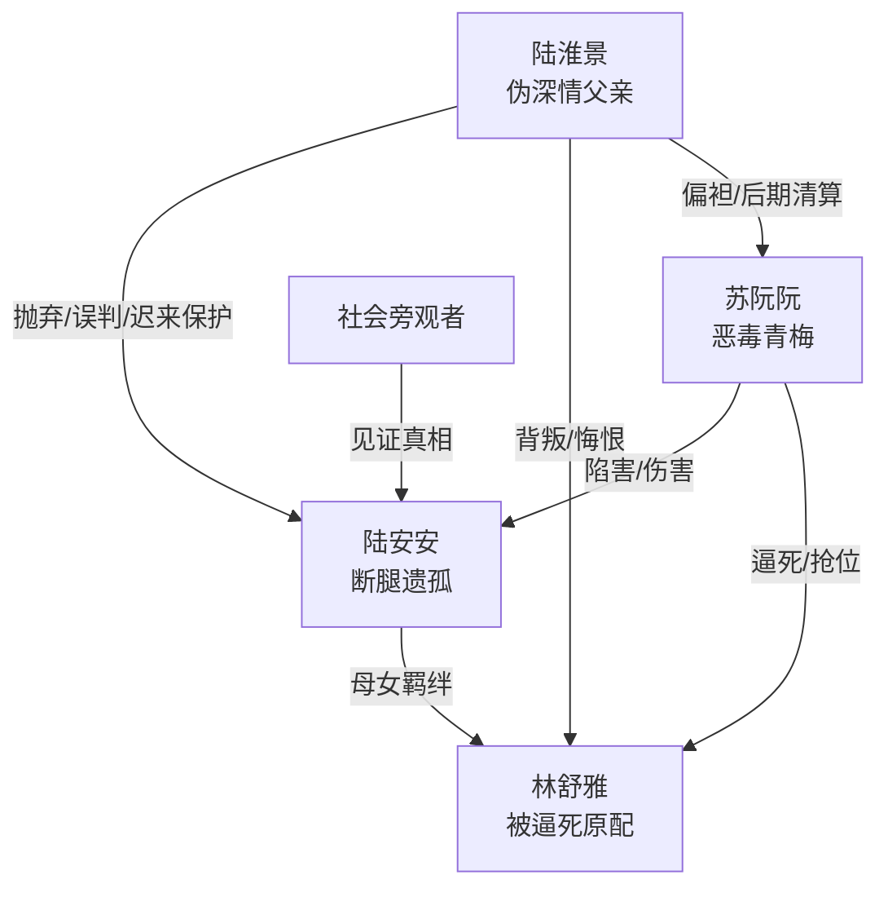

# 角色标签图谱

## 角色清单

### 陆安安 — 断腿遗孤 / 冷痛幸存者

- 叙事功能: 第一人称受害者、真相承载者、情绪债索偿者。
- 核心标签: 断腿、失母、冷恨。
- 弧光: 街头擦鞋的被遗弃女儿 → 割喉触底的绝望者 → 继承遗产并重启人生的幸存者。
- 台词风格: 冷、短、带讽刺；高潮处转为歇斯底里控诉。
- 关键行为: 退回父亲施舍；揭露母亲死讯；自杀逼真相落地；拒绝父亲补偿；最终重新上学。
- 读者情绪关系: 心疼、憋屈、替她恨父亲和苏阮阮，结尾获得补偿性爽感。

### 林舒雅 — 被献祭的原配母亲 / 温柔苦难者

- 叙事功能: 全文最大情绪债来源，女主行动的精神锚点。
- 核心标签: 卖血还债、护女、被逼死。
- 弧光: 相信丈夫的妻子 → 看清背叛的母亲 → 为不拖累女儿自杀的牺牲者。
- 台词风格: 温柔、忍耐，后期转为决绝。
- 关键行为: 为丈夫还债；保护安安被打；提出离婚；拔氧气管自杀。
- 读者情绪关系: 极强心疼，推动读者要求血债血偿。

### 陆淮景 — 伪深情父亲 / 迟到悔恨者

- 叙事功能: 伦理反派之一，也是后半段清算工具和代价承担者。
- 核心标签: 自私、伪深情、迟来保护。
- 弧光: 装穷丈夫与冷酷父亲 → 真相击穿后的悔恨者 → 替女儿挡刀死亡。
- 台词风格: 前期命令式、指责式；后期道歉、崩溃、报复式。
- 关键行为: 伪装破产；逼母女跪；撤手术费；误认女儿撒谎；得知真相后围剿苏家；替女儿挡刀。
- 读者情绪关系: 前期恨，后期复杂但不能完全原谅。

### 苏阮阮 — 恶毒青梅 / 小三上位施害者

- 叙事功能: 外显恶意与具体罪行执行者。
- 核心标签: 嫉妒、毒辣、特权。
- 弧光: 被保护的“陆太太” → 罪行败露的破产者 → 死刑犯。
- 台词风格: 撒娇伪弱与恶毒挑衅切换。
- 关键行为: 找催债人；截留空卡；污蔑母女；持刀刺杀。
- 读者情绪关系: 纯恨点，负责承受最明确的法律报应。

### 摆摊大婶 / 商场主管 / 律师 / 管家 — 社会见证者

- 叙事功能: 外部视角、压迫环境、结尾补偿的辅助证明。
- 核心标签: 旁观、势利、见证。
- 弧光: 无明显弧光。
- 台词风格: 信息提示型。
- 关键行为: 大婶引出“痴情总裁”谣言；主管体现陆氏权势；律师交付遗嘱；管家送女主上学。
- 读者情绪关系: 推动信息披露和社会地位反转。

## 关系网络

## 角色功能对照表（供改编参考）

| 原角色 | 极致标签 | 叙事功能 | 读者情绪功能 | 改编时必须保留的 |
|--------|---------|---------|-------------|---------------|
| 陆安安 | 断腿遗孤 | 第一视角、情绪债索偿者 | 心疼、代入、期待补偿 | 身体残缺 + 失母 + 冷静拒绝父亲 |
| 林舒雅 | 被献祭母亲 | 最大情绪债 | 心疼、怒意来源 | 为女儿牺牲与被空卡逼死 |
| 陆淮景 | 伪深情父亲 | 伦理罪人、迟来清算者 | 恨、复杂、迟来痛快 | “不是不知道，是不在乎”的定罪 |
| 苏阮阮 | 恶毒上位者 | 外显施害者 | 纯恨、报应爽 | 找人伤害、截留救命钱、最终死刑 |
| 旁观者 | 社会见证 | 补充信息和权势环境 | 强化真实感 | 外界误传“深情”必须被女主拆穿 |
