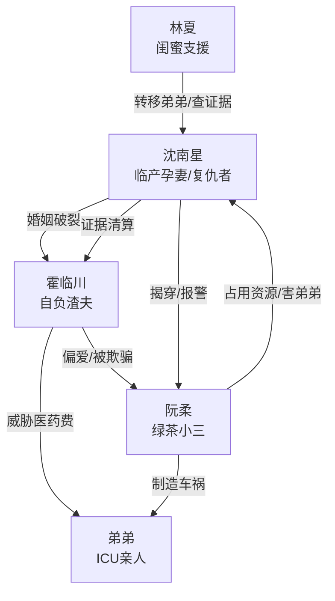

# 角色标签图谱

## 角色清单

### 沈南星 — 临产受害者/清醒复仇大女主

- 叙事功能: 承受极致压迫并完成证据链反杀。
- 核心标签: 孕妻、失子、冷静清算
- 弧光: 求生无门的妻子 → 死产后的复仇者 → 不回头的新生者
- 台词风格: 前半求救短句，后半冷静定罪。
- 关键行为: 砸报警器自救、隐藏行踪、转移弟弟、查血型、公开死产证明和录音、递离婚协议。
- 读者情绪关系: 心疼、愤怒代入、爽感投射。

### 霍临川 — 自负渣夫/迟来悔恨者

- 叙事功能: 核心施害者，制造全部情绪债，后期承担悔恨清算。
- 核心标签: 偏执、自负、冷血
- 弧光: 高位审判妻子 → 被小三欺骗 → 发现亲手害死孩子 → 跪地求赎无效
- 台词风格: 命令式、污名化、威胁式，后期哀求。
- 关键行为: 拿走待产包、反锁门、剪电话线、封锁孔、断水电、威胁弟弟医药费。
- 读者情绪关系: 强恨点，后期崩溃提供爽点。

### 阮柔 — 绿茶小三/毒妇反派

- 叙事功能: 外部诱因和二级罪魁，推动丈夫偏爱与最终真相反转。
- 核心标签: 伪弱者、诈骗者、杀人嫌疑
- 弧光: 娇弱产妇 → 孩子非亲生败露 → 车祸真凶 → 被捕
- 台词风格: 委屈装弱、甩锅、破罐破摔。
- 关键行为: 占用待产包、伪造早产、隐瞒孩子血缘、害女主弟弟车祸。
- 读者情绪关系: 憎恶、期待被撕破伪装。

### 林夏 — 护短闺蜜/行动辅助者

- 叙事功能: 帮女主转移弟弟、查证据、带保安控场。
- 核心标签: 仗义、执行力、外部支援
- 弧光: 接到求助 → 迅速协助 → 见证清算
- 台词风格: 直白愤怒，少废话。
- 关键行为: 垫付费用、查血型、堵阮柔、陪女主离开。
- 读者情绪关系: 安全感、替女主补充现实支撑。

### 弟弟 — 被威胁的亲情筹码/补偿希望

- 叙事功能: 增加女主软肋与阮柔罪行重量，结尾提供希望补偿。
- 核心标签: ICU、唯一亲人、苏醒希望
- 弧光: 被霍临川威胁停药 → 被转移保护 → 车祸真相曝光 → 脑电波恢复
- 台词风格: 无台词。
- 关键行为: 作为被害对象推动女主二次愤怒。
- 读者情绪关系: 心疼、希望。

## 关系网络

## 角色功能对照表（供改编参考）

| 原角色 | 极致标签 | 叙事功能 | 读者情绪功能 | 改编时必须保留的 |
|--------|---------|---------|-------------|---------------|
| 沈南星 | 失子复仇大女主 | 承压与清算 | 心疼转爽 | 临产/求生/失去不可逆/不原谅 |
| 霍临川 | 自负冷血渣夫 | 施害与悔恨 | 恨点与报应 | 亲手封死生路、后期跪求无效 |
| 阮柔 | 伪弱者毒妇 | 诱发偏爱与二次罪行 | 恶心与打脸 | 假柔弱、孩子血缘反转、被捕 |
| 林夏 | 护短盟友 | 外部执行力 | 安全感 | 快速行动而非空喊 |
| 弟弟 | 亲情软肋 | 增加债务和补偿 | 心疼与希望 | 被威胁、被保护、结尾有希望 |
