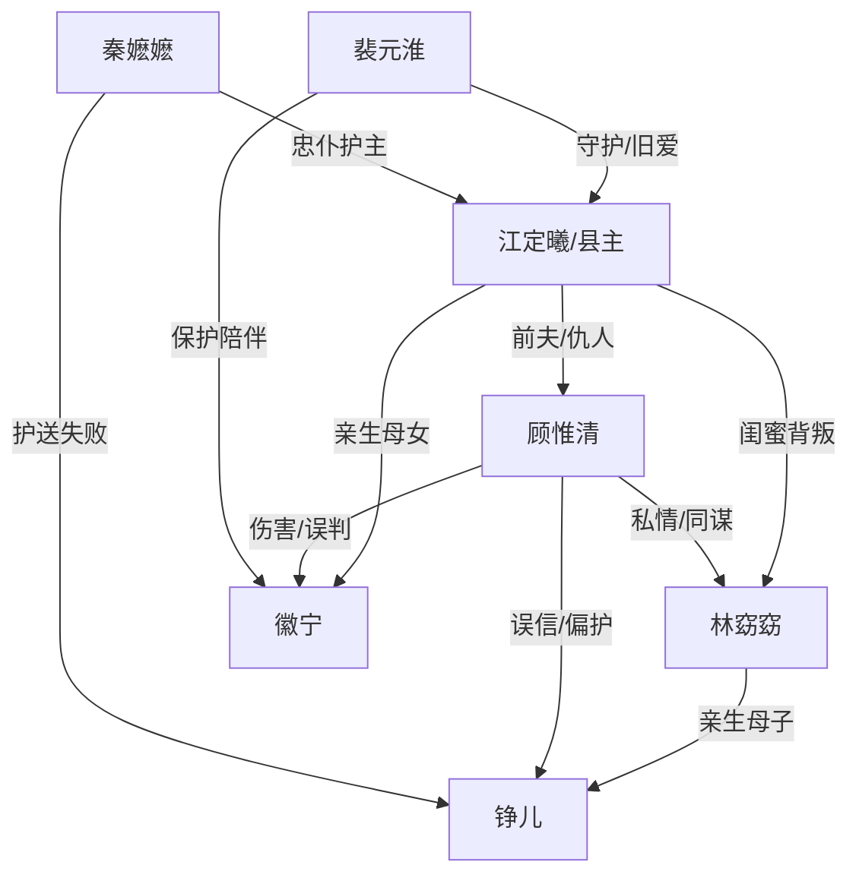

# 角色标签图谱

## 角色清单

### 江定曦/阿曦 — 重生护女清醒县主
- 叙事功能: 第一人称主角，承载被夺名分、被夺母位、重生复仇与情感补偿。
- 核心标签: 尊贵县主、护女、清醒断情
- 弧光: 错信夫君与密友 → 重生护女受尽酷刑 → 借权清算 → 接纳真正爱人
- 台词风格: 短促、直接、逼问式
- 关键行为: 抢回徽宁、吹响龙哨、宴会揭换子、拒见顾惟清、写名喜帖
- 读者情绪关系: 心疼、代入、替她讨公道、最终获得补偿爽感

### 顾惟清 — 负心误信追妻火葬场侯爷
- 叙事功能: 核心施害者，负责制造背叛、偏护、夺女血、私刑等主要情绪债。
- 核心标签: 薄情侯爷、被谎言操控、迟来悔恨
- 弧光: 临死求与林窈窈合葬 → 重生线继续伤妻女 → 真相后崩溃悔恨 → 临死不得相见
- 台词风格: 前期命令与责备，后期哀求与自辩
- 关键行为: 默许换子、强取徽宁血、打女主板子、杀林窈窈、跪求原谅
- 读者情绪关系: 恨、恶心、期待报应，后期看他悔死获得爽感

### 林窈窈 — 鸠占鹊巢伪善闺蜜
- 叙事功能: 绿茶反派，利用友情与谎言夺走女主夫君、妻位和孩子名分。
- 核心标签: 白莲闺蜜、嫉妒成狂、夺家者
- 弧光: 密友伪装 → 换子夺位 → 诬女主癔症 → 丧子疯癫死亡
- 台词风格: 委屈装善、柔弱控诉、崩溃嫉妒
- 关键行为: 安排换子、诬陷女主、切徽宁手臂取血、挑拨顾惟清
- 读者情绪关系: 强烈厌恶，期待被揭穿与反噬

### 裴元淮 — 深情权力白月光摄政王
- 叙事功能: 权力反转载体与情感补偿对象，替女主打破北漠私刑秩序。
- 核心标签: 摄政王、长情守候、降维救场
- 弧光: 被误会错过 → 暗中守护 → 黑骑救场 → 陪女主养女 → 终得回应
- 台词风格: 冷静、锋利、带克制深情
- 关键行为: 派暗卫保护、黑骑救场、亮金牌压侯府、查找徽宁、空喜帖试探
- 读者情绪关系: 安全感、补偿感、替代正确选择的满足

### 徽宁 — 被夺血的亲生女儿
- 叙事功能: 母亲线核心，被保护对象，也是顾惟清罪孽的最硬证据。
- 核心标签: 亲女、弱小、无辜受害
- 弧光: 前世早死 → 重生被抢回 → 被取血折磨 → 平安长大
- 台词风格: 婴儿无台词
- 关键行为: 被换、被取血、被救回、被裴元淮陪伴长大
- 读者情绪关系: 心疼、护崽欲、推动读者恨顾林二人

### 铮儿 — 白眼狼/伪世子
- 叙事功能: 换子阴谋的载体，前世背刺女主，今生反噬亲母。
- 核心标签: 替换之子、心症、伪世子
- 弧光: 前世被女主养大却认林窈窈为母 → 今生病发 → 死亡引爆林窈窈崩溃
- 台词风格: 婴儿期无台词，前世开篇冷酷
- 关键行为: 前世抢圣旨、今生需要徽宁血救命
- 读者情绪关系: 厌恶与复杂，不是最终清算主体

### 秦嬷嬷 — 忠仆乳母
- 叙事功能: 女主身边少数无条件保护者，死亡将压迫推至顶峰。
- 核心标签: 忠心、护主、牺牲
- 弧光: 帮女主护女 → 计划带走铮儿 → 被诬拐卖世子 → 军棍打死
- 台词风格: 忠诚、克制、替主担忧
- 关键行为: 扶起女主、配合带铮儿、临死还劝女主远离危险
- 读者情绪关系: 心疼、愤怒，要求清算顾家

## 关系网络

## 角色功能对照表（供改编参考）

| 原角色 | 极致标签 | 叙事功能 | 读者情绪功能 | 改编时必须保留的 |
|--------|---------|---------|-------------|---------------|
| 江定曦 | 重生护女清醒县主 | 受害者与复仇者 | 心疼、代入、爽 | 母亲护女底线与拒绝原谅 |
| 顾惟清 | 负心侯爷 | 主施害者/悔恨对象 | 恨、看报应 | 曾爱过但亲手伤害妻女 |
| 林窈窈 | 鸠占鹊巢闺蜜 | 挑拨者/夺位者 | 厌恶 | 友情背叛与身份冒占 |
| 裴元淮 | 深情摄政王 | 救场权力/补偿爱 | 安全感 | 高权力、长情、克制 |
| 徽宁 | 被夺血亲女 | 母亲线锚点 | 护崽心疼 | 弱小无辜且被取血 |
| 铮儿 | 伪世子白眼狼 | 换子载体 | 憋屈/厌恶 | 前世背刺与今生病症 |
| 秦嬷嬷 | 忠仆乳母 | 牺牲者 | 催泪、加债 | 为女主而死 |
